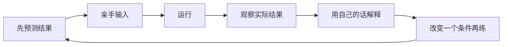

# 学习方法与进度表

这份页面解决三个问题：每次具体怎么学、怎样判断自己真的会了、卡住时怎样留下可以继续分析的证据。

## 最重要的学习循环

每遇到一个新命令、一段代码或一个界面操作，都使用下面的循环：



### 1. 先预测

在运行前写一句：“我觉得运行后会发生什么？”预测不必正确。它的作用是让你发现自己的理解和实际行为哪里不同。

### 2. 亲手输入

初学阶段不要整段复制。亲手输入会迫使你看见空格、引号、括号、大小写和路径分隔符。输入较长代码时可以分块完成，每完成一块就对照一次。

### 3. 运行

运行前确认三件事：

- 当前在哪个目录；
- 运行的是哪条命令或哪个按钮；
- 操作对象是不是练习文件，而不是真实数据。

### 4. 观察

不要只看“好像成功了”。记录：

- 终端输出了什么；
- 文件是否真的出现或变化；
- 应用界面是否变化；
- 退出码或测试结果是什么。

### 5. 自己解释

关掉答案，用自己的话说出：输入是什么、谁处理了它、产生了什么输出、数据保存在哪里。说不出来通常意味着只是认得画面，还没有理解过程。

### 6. 做一个变式

把文件名、文本、数组内容或样式值改变一点，再预测结果。只有答案完全相同时能运行，不算真正掌握。

## 为什么“复制后能运行”不等于会了

复制代码证明的是电脑能执行那段代码，不是你能独立重建它。真正掌握至少包含：

1. 能说出每个主要部分的作用；
2. 能在不看答案时重新写出核心步骤；
3. 改变一个条件后能预测变化；
4. 出错时能判断错误来自路径、语法、依赖还是运行环境；
5. 知道怎样验证结果，而不是凭感觉判断。

复制并非永远禁止。真实开发会复制官方示例，但复制后必须阅读、修改、验证，并确认版本与上下文一致。

## 一次 45～90 分钟的安排

### 45 分钟版本

- 5 分钟：回忆上次内容；
- 15 分钟：学习一个概念小节；
- 15 分钟：跟做并观察；
- 7 分钟：完成一个必做练习；
- 3 分钟：记录问题和下一步。

### 90 分钟版本

- 10 分钟：不看答案复习；
- 25 分钟：学习新内容；
- 25 分钟：跟做；
- 20 分钟：必做练习与变式；
- 10 分钟：纠错、总结和安排复习。

连续卡住 20 分钟时，不要重复同一操作。暂停，整理证据，再按“错误记录”分析。

## 错误记录模板

每次遇到有价值的问题，复制下面的模板到自己的 Obsidian 日记：

```markdown
### 问题标题

- 日期：
- 所在章节：
- 我原本想完成什么：
- 当前目录：
- 执行的完整命令或操作：
- 完整错误信息：
- 实际现象：
- 我认为可能的原因：
- 我检查过的证据：
- 最终原因：
- 修复方法：
- 我怎样验证修复成功：
- 下次如何预防：
```

### 记录错误时不要做什么

- 不要只写“报错了”；
- 不要只截最后一行而丢掉前面的上下文；
- 不要在错误信息里公开 API Key、密码、配对码或私人文件内容；
- 不要同时乱改五处，再猜是哪一处修好的；
- 不要因为终端出现红字就立刻删除项目或重装系统。

## 章节完成标准

一章只有同时满足下面条件才标记“已完成”：

- [ ] 能解释本章术语，不只是认得名称；
- [ ] 完成全部必做练习；
- [ ] 至少有一次不看答案完成核心操作；
- [ ] 能解释一项常见错误的原因和检查方法；
- [ ] 能指出本章内容在真实“学习空间”项目中的位置；
- [ ] 能说出一个安全边界：什么情况下应该停止操作；
- [ ] 一天后仍能复述本章主线。

若只完成阅读，状态应是“学习中”，不是“已完成”。

## 每周复习模板

```markdown
# 第 __ 周复习

## 本周完成
- 章节：
- 最重要的三个概念：
- 我能独立完成的操作：

## 仍然模糊
- 术语：
- 操作：
- 错误：

## 本周最有价值的一次错误
- 现象：
- 原因：
- 修复证据：

## 下周安排
- 需要重做的练习：
- 新章节：
- 计划学习次数：
```

## 进度表

在“状态”列填写：未开始、学习中、已完成或需复习。

| 章节 | 状态 | 第一次学习 | 不看答案复做 | 一周后复习 | 备注 |
| --- | --- | --- | --- | --- | --- |
| 01 软件、程序、应用与源码 | 未开始 |  |  |  |  |
| 02 文件、文件夹、路径与扩展名 | 未开始 |  |  |  |  |
| 03 编辑器、终端与开发者工具 | 未开始 |  |  |  |  |
| 04 安装开发环境 | 未开始 |  |  |  |  |
| 05 第一次使用命令行 | 未开始 |  |  |  |  |
| 06 Git 版本控制入门 | 未开始 |  |  |  |  |
| 07 网页由什么组成 | 未开始 |  |  |  |  |
| 08 HTML 从零入门 | 未开始 |  |  |  |  |
| 09 CSS 从零入门 | 未开始 |  |  |  |  |
| 10 JavaScript 基础一 | 未开始 |  |  |  |  |
| 11 JavaScript 基础二 | 未开始 |  |  |  |  |
| 12 异步、Promise 与网络请求 | 未开始 |  |  |  |  |
| 13 为什么需要 TypeScript | 未开始 |  |  |  |  |
| 14 泛型、类型缩小与实用类型 | 未开始 |  |  |  |  |
| 15 npm、依赖与 Vite | 未开始 |  |  |  |  |
| 16 React 组件与 JSX | 未开始 |  |  |  |  |
| 17 React 状态与事件 | 未开始 |  |  |  |  |
| 18 Effect 与数据加载 | 未开始 |  |  |  |  |
| 19 React Router 与应用外壳 | 未开始 |  |  |  |  |
| 20 前端架构与服务接口 | 未开始 |  |  |  |  |
| 21 Tauri 2 是什么 | 未开始 |  |  |  |  |
| 22 第一次前后端通信 | 未开始 |  |  |  |  |
| 23 Rust 基础一 | 未开始 |  |  |  |  |
| 24 Rust 基础二 | 未开始 |  |  |  |  |
| 25 Serde、错误与异步边界 | 未开始 |  |  |  |  |
| 26 数据库从零入门 | 未开始 |  |  |  |  |
| 27 SQL 基础 | 未开始 |  |  |  |  |
| 28 Rust 操作 SQLite | 未开始 |  |  |  |  |
| 29 迁移、软删除与版本冲突 | 未开始 |  |  |  |  |
| 30 事务、附件与备份 | 未开始 |  |  |  |  |
| 31 创建项目骨架 | 未开始 |  |  |  |  |
| 32 实现应用外壳与主题 | 未开始 |  |  |  |  |
| 33 实现首页和今日待办 | 未开始 |  |  |  |  |
| 34 实现学习资料系统 | 未开始 |  |  |  |  |
| 35 实现专注计时 | 未开始 |  |  |  |  |
| 36 实现学习照片与文件 | 未开始 |  |  |  |  |
| 37 首页、统计与复习闭环 | 未开始 |  |  |  |  |
| 38 英语资料模块 | 未开始 |  |  |  |  |
| 39 数学、政治与专业课模块 | 未开始 |  |  |  |  |
| 40 AI 整理与作文 AI | 未开始 |  |  |  |  |
| 41 设备互联与加密快照 | 未开始 |  |  |  |  |
| 42 测试驱动开发 | 未开始 |  |  |  |  |
| 43 调试与故障排查 | 未开始 |  |  |  |  |
| 44 安全与数据保护 | 未开始 |  |  |  |  |
| 45 构建、打包与发布 | 未开始 |  |  |  |  |
| 46 从需求到实现计划 | 未开始 |  |  |  |  |
| 47 怎样阅读陌生代码 | 未开始 |  |  |  |  |
| 48 怎样独立查资料和解决问题 | 未开始 |  |  |  |  |
| 49 毕业项目 | 未开始 |  |  |  |  |

课程文件已经完成不代表你已经学完，因此新增章节仍统一从“未开始”记录。只有达到上面的章节完成标准，才把状态改为“已完成”。

> [!warning] 第 21～30 章只使用独立实验
> 数据库、迁移、附件与恢复练习必须使用 `docs/tutorial/labs/backend-basics`、内存数据库或测试临时目录。不要把真实应用数据库、真实照片目录或真实备份当作练习材料。

## 怎样使用 AI，又不依赖 AI

AI 可以帮助你：

- 用另一种比喻解释概念；
- 检查你的理解是否有漏洞；
- 根据完整错误信息列出检查顺序；
- 审阅你已经写出的方案或代码；
- 生成额外练习题。

AI 不应该替代你：

- 决定未知命令是否安全；
- 在不了解范围时删除或覆盖文件；
- 验证代码是否真的运行；
- 保存真实密钥和私人数据；
- 完成所有练习后直接告诉你“已经掌握”。

使用 AI 后，仍然要通过运行、测试、文件变化和数据结果取得证据。课程设计成即使没有 AI，也能通过正文、答案、错误索引和官方文档完成。

## 安全暂停规则

遇到下列任一情况，先暂停，不要凭猜测继续：

- 命令包含删除、清空、强制、覆盖或递归操作；
- 操作对象是 `.git`、真实数据库、应用数据目录或发布文件；
- 系统请求管理员权限，而课程没有解释原因；
- 即将把 API Key、密码或个人资料写进源码；
- `git status --short` 出现你不认识的已有修改；
- 实际画面与教程不同，并且下一步可能改变数据。

暂停不是失败。正确做法是保存当前状态、记录完整错误、确认目标路径和影响范围，然后再行动。

## 学会了以后会有什么感觉

“会开发”不是再也不查资料，而是遇到陌生问题时有稳定流程：

1. 描述现象；
2. 确认当前环境和输入；
3. 缩小问题所在层次；
4. 阅读可靠文档或源码；
5. 做最小实验；
6. 用测试或可观察结果验证；
7. 记录原因和预防方法。

回到[课程总目录](00-课程总目录.md)，从第 01 章开始。
