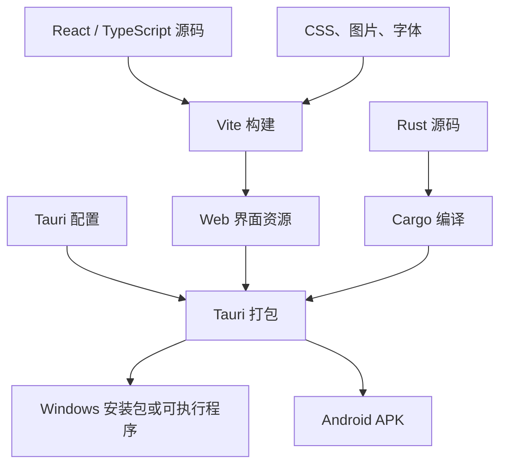
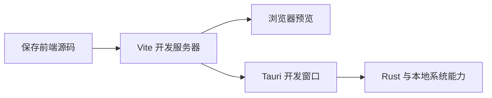

# 第 01 章：软件、程序、应用与源码

## 本章目标

学完后，你应该能够：

1. 区分源代码、构建工具、开发版、安装包和已经安装的应用；
2. 说出 `.tsx`、`.ts`、`.css`、`.rs`、`.json`、`.exe`、`.apk` 大致属于什么；
3. 解释“学习空间”怎样从一组文本文件变成 Windows 或 Android 应用；
4. 明白浏览器预览为什么不能证明桌面数据库、托盘或 Android 文件选择已经可用；
5. 只读查看项目中的五个代表性文件，不修改它们。

## 开始前需要会什么

本章不要求编程基础。你只需要会：

- 打开 Windows 文件资源管理器；
- 用鼠标双击文件夹；
- 阅读中文说明。

如果你连文件扩展名都没有见过，也可以继续。本章先建立整体认识，第 02 章会专门讲文件、路径和扩展名。

## 新术语表

| 术语 | 最短解释 |
| --- | --- |
| 软件 | 让电脑执行某类任务的指令与相关数据 |
| 程序 | 一组可以被执行的指令；日常语境中常与软件混用 |
| 应用 | 直接面向用户完成任务的软件 |
| 源代码 | 开发者编写、可阅读和修改的文本 |
| 编译 | 把源码检查并转换成另一种可执行形式 |
| 构建 | 编译、打包、复制资源等一整套生产过程 |
| 运行时 | 程序正在运行时依赖的环境 |
| 安装包 | 帮助系统安装应用的发布文件 |
| 开发服务器 | 开发期间快速提供界面的临时服务 |

需要查英文时使用[中英文术语表](../99-附录/01-中英文术语表.md)。

## 先建立直觉

可以暂时把开发软件想成做饭：

- 源代码像菜谱；
- 图片、字体和图标像食材；
- Node.js、Vite、Rust、Cargo 和 Tauri 像厨房设备；
- 构建过程像按照菜谱加工；
- `.exe` 或 `.apk` 像可以交付的成品；
- 安装过程像把成品放到合适的位置并准备好使用环境。

这个类比有局限：菜谱不会自动变成食物，而源码可以被构建工具机械处理；同一份软件源码也可能根据操作系统和配置产生不同成品。因此，记住核心关系即可：**源码不是成品，构建工具把源码与资源变成可以运行或安装的结果。**

“学习空间”不是一个单独的大文件。它由多种职责不同的文件共同组成：

- React 与 TypeScript 描述界面和交互；
- CSS 描述视觉样式；
- Rust 处理本地数据库、文件和系统能力；
- JSON、TOML 等配置告诉工具怎样构建；
- 图片和图标是资源；
- 测试文件检查行为有没有被破坏。

## 图解

开发时还存在一条更快的路线：

浏览器预览只运行 Web 界面和浏览器替代实现。Tauri 开发窗口才会连接真实 Rust 后端。因此两种预览用途不同。

## 跟我一步一步做

本次操作只查看文件，不保存任何修改。

### 第一步：打开项目文件夹

1. 打开文件资源管理器；
2. 在地址栏输入 `D:\Desktop\app`；
3. 按 Enter；
4. 确认能看到 `src`、`src-tauri`、`docs` 和 `package.json` 等项目。

如果路径不存在，不要创建同名空文件夹。先核对磁盘和拼写，因为课程假定真实项目位于这里。

### 第二步：观察前端入口

依次进入 `src` → `app`，找到 `App.tsx`。右键选择用 VS Code 或文本编辑器打开，只看不改。

你会看到很多英文、尖括号、括号以及 `import`。现在不需要理解语法，只要确认它是可以阅读的文本，不是安装后的应用界面。

### 第三步：观察样式

在同一目录找到 `app.css`。它也是文本，但内容主要包含选择器、颜色、宽高和布局规则。它不会单独运行成应用。

### 第四步：观察 Rust 后端

返回项目根目录，进入 `src-tauri` → `src`，打开 `lib.rs`。这是 Rust 源代码。它和 `App.tsx` 都是源码，但使用不同语言、负责不同层次。

### 第五步：观察配置

返回项目根目录，打开 `package.json` 和 `src-tauri\tauri.conf.json`。JSON 用键和值表达配置。配置文件不是普通说明文字，错误的逗号或引号可能导致工具无法读取。

### 第六步：关闭而不保存

如果编辑器提示是否保存，而你没有主动修改，请选择不保存。若不小心输入了字符，先使用编辑器撤销，确认文件恢复，再关闭。

## 完整示例

下面是一张文件角色判断表。它不是要求你理解代码，只是训练“文件在生产链上负责什么”。

| 文件 | 类型 | 谁主要读取 | 作用 |
| --- | --- | --- | --- |
| `src/app/App.tsx` | React + TypeScript 源码 | TypeScript、Vite、React 工具 | 组织页面与路由 |
| `src/app/app.css` | CSS 源码 | 浏览器/WebView | 控制全局外观与布局 |
| `src-tauri/src/lib.rs` | Rust 源码 | Rust 编译器与 Cargo | 组织 Tauri 后端能力 |
| `package.json` | JSON 配置 | npm、Node.js 工具 | 记录脚本、版本与前端依赖 |
| `src-tauri/tauri.conf.json` | JSON 配置 | Tauri CLI | 记录窗口、产品名、构建等设置 |
| `dist` | 构建输出目录 | Tauri 打包工具或服务器 | 保存前端生产构建结果 |
| `node_modules` | 依赖目录 | Node.js 工具 | 保存 npm 安装的包 |
| `.exe` | Windows 可执行结果 | Windows | 启动程序或安装程序 |
| `.apk` | Android 安装包 | Android | 安装移动应用 |

## 逐段解释

### 为什么项目有两套语言

React/TypeScript 擅长构建界面：按钮、表单、列表、页面切换和状态展示。Rust 擅长处理需要本机权限与可靠性的工作：SQLite、文件、系统托盘、诊断和平台差异。Tauri 在中间建立受控通道。

这不意味着“前端只管颜色、后端只管数据库”。前端也包含业务交互和数据校验，后端也可能返回适合界面展示的结构。真正边界要在后续架构课程中学习。

### 为什么配置也很重要

源码回答“程序做什么”，配置经常回答“怎样构建、叫什么名字、允许什么权限、加载哪个目录”。同样的源码配上不同配置，可能得到调试版、正式版、Windows 版或 Android 版。

### 为什么改源码不会自动更新已安装应用

你修改的是项目文件。已经安装的应用使用的是之前构建并安装的成品。要让它包含新修改，需要重新构建、测试、打包并安装新版本。开发服务器会自动刷新只是开发工具提供的便利，不代表发布流程消失。

### 浏览器预览和真实应用

浏览器擅长快速检查界面，但它没有 Tauri 的全部权限和 Rust command。项目可能为浏览器提供临时内存数据或安全降级实现。因此：浏览器里按钮能点，只能证明对应浏览器路径工作；不能证明 SQLite、原生文件选择、托盘、通知或 Android 权限正常。

## 运行并观察

本章不要求启动项目，因为“运行源码”需要第 04 章的开发环境。现在只完成观察：

1. `.tsx`、`.css`、`.rs`、`.json` 都能作为文本打开；
2. 每种文件的内容形式不同；
3. 项目根目录包含大量协作文件，而不是一个可以双击的应用文件；
4. 构建输出和源码目录不是同一个概念。

把下面这句话补完整并读出来：

> 我正在查看的是 ______，它需要经过 ______ 才能成为可安装或可运行的应用结果。

参考答案：源代码；构建和打包。

## 常见错误与修复

### 错误一：把 React 当成整个应用

React 负责主要界面，但真实桌面应用还包含 Tauri、Rust、本地数据库、配置和操作系统能力。修复理解的方法是重新画本章第一张流程图。

### 错误二：认为 Rust 就是数据库

Rust 是编程语言，SQLite 是数据库引擎。Rust 代码可以调用 SQLite，也可以处理很多与数据库无关的功能。

### 错误三：认为 APK 是源码

APK 是构建后的 Android 安装包。可以安装它，不代表适合直接编辑它来维护项目。维护应从源码和构建配置开始。

### 错误四：浏览器能打开，所以桌面功能一定正常

浏览器和 Tauri 的运行环境不同。修复方法是把测试结论写具体：“浏览器页面布局正常”，不要扩大成“应用全部正常”。

### 错误五：直接编辑 `dist` 或 `node_modules`

这些通常由工具生成或安装，重新构建、重新安装依赖时会被覆盖。应修改 `src` 中的源码或正确配置。

### 错误六：双击 `.tsx`，期待打开应用

`.tsx` 是源码，需要开发工具处理。双击可能只会打开编辑器或弹出选择程序。

## 在“学习空间”项目里找到它

只读查看以下真实位置：

- 前端应用入口：[`src/app/App.tsx`](../../../src/app/App.tsx)
- 全局样式：[`src/app/app.css`](../../../src/app/app.css)
- Rust 启动与注册：[`src-tauri/src/lib.rs`](../../../src-tauri/src/lib.rs)
- 前端工具配置：[`package.json`](../../../package.json)
- Tauri 配置：[`src-tauri/tauri.conf.json`](../../../src-tauri/tauri.conf.json)

这里的相对链接从当前章节位置出发：章节在 `docs/tutorial/01-准备篇`，先回到项目根目录需要三级 `..`。如果链接无法打开，先不要修改项目；第 02 章会详细解释路径。

## 必做练习

### 练习一：分类

把下面项目分成“源码”“配置”“构建结果”“依赖目录”：

1. `App.tsx`
2. `tauri.conf.json`
3. `node_modules`
4. Android `.apk`
5. `lib.rs`
6. `dist`

### 练习二：解释流程

不看本章图，画出至少包含以下节点的箭头图：React/TypeScript、Vite、Web 资源、Rust、Cargo、Tauri、Windows/Android 成品。

### 练习三：判断结论

判断下面说法是否可靠，并说明原因：

1. “浏览器页面正常，所以系统托盘正常。”
2. “修改 `App.tsx` 后，昨天安装的 APK 会自动更新。”
3. “`package.json` 不是业务代码，所以随便改也没关系。”
4. “Rust 可以读写数据库，但 Rust 本身不是数据库。”

## 选做挑战

在不打开搜索引擎的情况下，找到项目里三个 `.test.ts` 或 `.test.tsx` 文件。根据文件名猜测它们想保护什么行为。只记录路径和猜测，不修改文件。

## 答案与思路

### 练习一答案

- 源码：`App.tsx`、`lib.rs`；
- 配置：`tauri.conf.json`；
- 构建结果：`.apk`、`dist`；
- 依赖目录：`node_modules`。

`dist` 里面也是文件，但它们由构建产生；分类关注的是项目维护角色，而不是“是不是文件”。

### 练习二参考

React/TypeScript 经 Vite 变成 Web 资源；Rust 经 Cargo 编译成本机部分；Tauri 结合 Web 资源、本机部分和配置，产生平台应用。

### 练习三答案

1. 不可靠。浏览器没有验证托盘所在的 Tauri/系统路径；
2. 不会。必须重新构建和安装；
3. 错。配置会影响脚本、依赖与构建，语法错误也会让工具停止；
4. 正确。语言和数据库是不同事物。

## 本章自检

- [ ] 我能说出源码与安装包的区别；
- [ ] 我能解释构建比“编译一个文件”范围更大；
- [ ] 我知道 React、Tauri、Rust、SQLite 不是同一个东西；
- [ ] 我能说出浏览器预览的验证边界；
- [ ] 我只读查看了五个真实项目文件；
- [ ] 我没有编辑生成目录；
- [ ] 我能不看答案画出源码到应用的主流程。

若有两项以上无法确认，先重做“完整示例”和必做练习，再进入下一章。

## 本章小结

“学习空间”是一套源码、资源、配置和工具共同构建的产品。React/TypeScript 负责主要界面，Rust 提供本地后端能力，Tauri 把两边组合到 Windows 与 Android 外壳中。`.exe` 和 `.apk` 是构建结果，不是日常维护的源码。浏览器预览、Tauri 开发版和正式安装版处在不同运行环境，测试结论必须说明范围。

## 下一章

下一章学习文件、文件夹、路径与扩展名。完成后，你将能真正看懂 `D:\Desktop\app\src\app\App.tsx` 每一段表示什么位置，并能避免在错误目录运行命令。

继续：[第 02 章：文件、文件夹、路径与扩展名](02-文件文件夹路径与扩展名.md)
