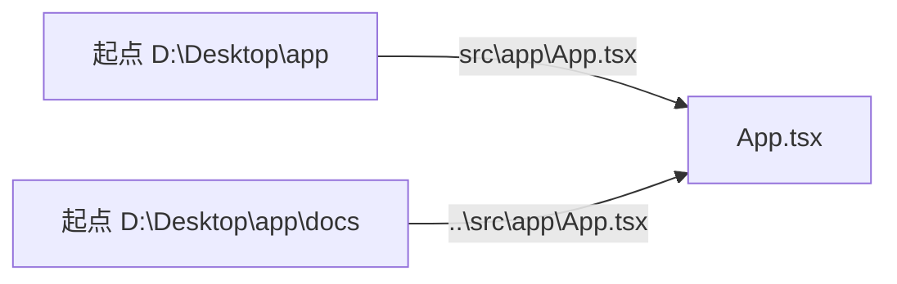

# 第 02 章：文件、文件夹、路径与扩展名

## 本章目标

学完后，你能够：

1. 看懂 Windows 绝对路径和相对路径；
2. 区分文件名、扩展名、文件夹和当前目录；
3. 在专用练习目录中创建一棵小目录树；
4. 说明项目根目录和 `src`、`src-tauri`、`docs` 等目录的用途；
5. 识别生成目录，避免把修改写到会被覆盖的位置。

## 开始前需要会什么

- 知道源码和安装包不是同一个东西；
- 能打开文件资源管理器；
- 已完成第 01 章的只读观察。

本章的写入操作只在新建的练习目录中进行，不修改 `D:\Desktop\app`。

## 新术语表

| 术语 | 含义 |
| --- | --- |
| 磁盘 / drive | Windows 用盘符区分的存储位置，例如 `C:`、`D:` |
| 文件 / file | 带名称的一组数据，例如文字、图片或源码 |
| 文件夹 / directory | 用于组织文件和其他文件夹的容器 |
| 路径 / path | 描述某个文件或文件夹位置的文字 |
| 绝对路径 | 从盘符或根位置开始的完整路径 |
| 相对路径 | 相对于某个起点的路径 |
| 当前目录 | 终端目前把哪个文件夹当作相对路径起点 |
| 扩展名 | 文件名最后一个点后常用于表示格式的部分 |
| 编码 | 文字与字节之间的转换规则，项目文本通常使用 UTF-8 |
| 生成目录 | 由工具自动产生、可以重新生成的文件集合 |

## 先建立直觉

把磁盘想成一栋档案馆：

- 盘符像不同大楼；
- 文件夹像楼层和抽屉；
- 文件像抽屉里的文档；
- 路径像从大楼入口写到具体文档的地址；
- 当前目录像你现在站在哪个抽屉前。

`D:\Desktop\app\src\app\App.tsx` 可以拆成：

| 片段 | 表示什么 |
| --- | --- |
| `D:` | D 盘 |
| `Desktop` | D 盘下名为 Desktop 的文件夹 |
| `app` | 项目根文件夹 |
| `src` | 前端源码目录 |
| 第二个 `app` | 应用入口与全局样式目录 |
| `App.tsx` | 文件名，扩展名为 `.tsx` |

反斜杠 `\` 是 Windows 路径分隔符。路径是一段地址，不是一条动作指令；单独把它输入终端，PowerShell 可能尝试把它当程序运行。

## 图解

```text
D:\
└─ Desktop\
   └─ app\                  ← 项目根目录
      ├─ src\               ← React / TypeScript 前端源码
      │  └─ app\
      │     └─ App.tsx
      ├─ src-tauri\         ← Tauri、Rust 与平台配置
      ├─ docs\              ← 文档
      ├─ public\            ← 静态资源
      ├─ package.json       ← 前端项目配置
      └─ node_modules\      ← npm 安装的依赖，通常不手改
```

相对路径必须有起点：



同一目标从不同起点出发，相对路径会不同。

## 跟我一步一步做

### 第一步：显示扩展名

打开文件资源管理器，在“查看”相关设置中启用“文件扩展名”。不同 Windows 版本按钮位置可能不同，可以在资源管理器的选项或“显示”菜单中查找。

可观察结果：文件显示为 `App.tsx`、`package.json`，而不只显示 `App` 或 `package`。

### 第二步：选择安全练习目录

计划使用：

```text
D:\Desktop\study-space-course-practice
```

先在资源管理器查看它是否已经存在。如果不存在，创建它。如果存在且里面有内容，不要清空；改用 `study-space-course-practice-2`，并把后续示例路径同步替换。

### 第三步：创建目录树

在练习目录内创建三个文件夹：

```text
notes
images
code
```

在 `notes` 中新建 `first-note.txt`，写入：

```text
这是我的开发学习练习文件。
```

保存后关闭，再重新打开，确认文字仍在。这个动作证明内容写入了磁盘，而不只是停留在编辑器里。

### 第四步：观察绝对路径

点击资源管理器地址栏，复制 `first-note.txt` 所在文件夹路径。它应类似：

```text
D:\Desktop\study-space-course-practice\notes
```

把文件名接在末尾就是文件绝对路径。

### 第五步：写出相对路径

若起点是练习目录，目标文件相对路径为：

```text
notes\first-note.txt
```

若起点已经是 `notes`，相对路径只需：

```text
first-note.txt
```

## 完整示例

假设当前目录为 `D:\Desktop\study-space-course-practice\code`：

| 想去哪里 | 可用相对路径 | 过程 |
| --- | --- | --- |
| 上一级练习目录 | `..` | 从 `code` 返回父目录 |
| `notes` 目录 | `..\notes` | 先上一级，再进 notes |
| `first-note.txt` | `..\notes\first-note.txt` | 上一级、进 notes、找文件 |
| 当前 `code` 目录 | `.` | 点表示当前位置 |

绝对路径无论当前站在哪里都指向同一位置，但更长、可能只适合这台电脑。相对路径更便于项目整体移动，但必须明确起点。

## 逐段解释

### 文件名和扩展名

`App.tsx` 的完整文件名是 `App.tsx`，扩展名是 `.tsx`。把它重命名为 `App.txt` 只改变名称，不会把 React 代码自动转换成普通文章。格式由内容规则与读取工具共同决定。

### 隐藏文件

以点开头的名称常用于工具配置，例如 `.gitignore`。Windows 也可能隐藏系统文件。显示隐藏项目是为了理解项目，不代表可以随意删除它们。

### 文本编码

中文在磁盘上需要编码。UTF-8 是项目常用选择。若文件出现乱码，可能是读取工具用了不同编码；不要先把乱码保存回原文件，否则可能造成二次破坏。

### 大小写

Windows 常对文件名大小写不敏感，但 Web、Git、Android 或其他系统可能敏感。源码导入路径的大小写应与真实文件一致，不能因为 Windows 暂时能找到就忽略。

### 路径中的空格

命令行里遇到空格要用引号包住完整路径：

```powershell
Get-ChildItem -LiteralPath "D:\My Study Files"
```

否则 shell 可能把一个路径拆成多个参数。

## 运行并观察

本章可以先通过资源管理器完成。若你已会打开 PowerShell，可在练习目录运行以下只读命令：

```powershell
Set-Location -LiteralPath "D:\Desktop\study-space-course-practice"
Get-Location
Get-ChildItem
Get-ChildItem -LiteralPath ".\notes"
```

预期：`Get-Location` 显示练习目录；列表中出现 `notes`、`images`、`code`；`notes` 内出现 `first-note.txt`。

若你还不懂这些命令，只观察输出即可，第 05 章会逐个解释。

## 常见错误与修复

### 在错误目录创建文件

现象：文件存在，但不在预期位置。先查看资源管理器地址栏或运行 `Get-Location`，再搜索文件名。不要为了重新来过而删除不认识的目录。

### 隐藏扩展名导致“双扩展名”

现象：以为创建了 `note.txt`，实际是 `note.txt.txt`。启用扩展名显示，再重命名练习文件。

### 把路径当命令

现象：输入 `D:\Desktop\app` 后报无法运行。要切换目录，应使用 `Set-Location -LiteralPath "D:\Desktop\app"`。

### 相对路径起点想错

现象：同一相对路径在另一个目录失败。先确认当前目录，再从起点逐段走到目标。

### 修改生成目录

现象：改动暂时有效，重新安装依赖或构建后消失。找到对应源码或配置修改，不要把 `node_modules`、`dist`、`target` 当源文件。

## 在“学习空间”项目里找到它

项目根目录是 `D:\Desktop\app`。主要目录：

- [`src`](../../../src)：前端源码；
- [`src-tauri`](../../../src-tauri)：Rust、Tauri 与平台文件；
- [`docs`](../../../docs)：学习、设计和实施文档；
- [`public`](../../../public)：静态资源；
- [`package.json`](../../../package.json)：前端脚本和依赖信息。

不要直接编辑：

- `node_modules`：npm 安装依赖；
- `dist`：Vite 构建输出；
- `src-tauri/target`：Rust 构建缓存；
- `src-tauri/gen`：Tauri 生成的平台工程，除非后续课程明确说明某个受支持修改点。

## 必做练习

1. 把 `D:\Desktop\app\src-tauri\src\lib.rs` 拆成盘符、每一级目录、文件名和扩展名；
2. 以 `D:\Desktop\app` 为起点，写出 `package.json` 和 `src\app\App.tsx` 的相对路径；
3. 以 `D:\Desktop\app\docs` 为起点，写出到 `src\app\App.tsx` 的相对路线；
4. 画出练习目录树；
5. 解释为什么不应在 `node_modules` 中长期修复项目功能。

## 选做挑战

找出项目中各一个 `.tsx`、`.ts`、`.css`、`.rs`、`.json`、`.toml` 文件，记录其路径并根据所在目录猜测职责。只读查看，不修改。

## 答案与思路

1. `D:` 是盘符；`Desktop`、`app`、`src-tauri`、`src` 是目录；`lib.rs` 是文件名；`.rs` 是扩展名。
2. `package.json`；`src\app\App.tsx`。
3. `..\src\app\App.tsx`。这里 `..` 从 `docs` 回到项目根。
4. 应至少包含根目录以及 `notes/first-note.txt`、`images`、`code`。
5. 依赖目录由 npm 管理，重新安装会覆盖，而且修改难以通过项目源码和锁文件复现。

## 本章自检

- [ ] 我能拆解一条 Windows 路径；
- [ ] 我能解释相对路径必须有起点；
- [ ] 我已启用扩展名显示；
- [ ] 我在独立练习目录创建了目录树；
- [ ] 我知道路径含空格时要加引号；
- [ ] 我能列出四个不应直接编辑的生成目录；
- [ ] 我没有修改真实项目文件。

## 本章小结

路径是位置描述，绝对路径从盘符开始，相对路径从当前起点开始。文件扩展名帮助工具识别常见格式，但改后缀不是格式转换。开发中最常见的低级错误之一就是站错目录，所以任何命令前都要知道当前位置和目标。真实项目的源码、文档、配置、依赖和构建输出各有边界。

## 下一章

下一章认识 VS Code、终端、PowerShell、浏览器和开发者工具，解决“到底在哪写、在哪运行、在哪看结果”的问题。

继续：[第 03 章：编辑器、终端与开发者工具](03-编辑器终端与开发者工具.md)
