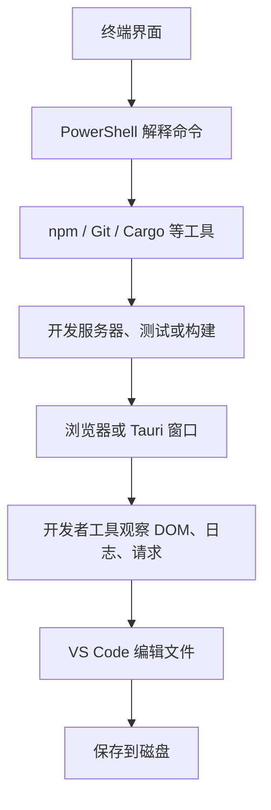

# 第 03 章：编辑器、终端与开发者工具

## 本章目标

完成后，你能够：

1. 区分编辑器、IDE、终端、shell、浏览器和运行中的应用；
2. 用 VS Code 打开整个项目，而不是只打开一个孤立文件；
3. 使用资源管理器、全局搜索、问题面板和集成终端；
4. 在浏览器开发者工具中观察 Elements、Console 和 Network；
5. 明白开发者工具中的临时修改不会自动写回源码。

## 开始前需要会什么

- 能看懂绝对路径和相对路径；
- 知道 `D:\Projects\study-space` 是项目根目录；
- 能识别文件扩展名；
- 本机已经安装 VS Code 最好，未安装时先阅读第 04 章的安装部分。

## 新术语表

| 术语 | 含义 |
| --- | --- |
| 文本编辑器 | 查看和修改文本文件的工具 |
| IDE | 集成编辑、运行、调试和项目理解能力的开发环境 |
| 工作区 | 编辑器当前打开并组织的一组项目文件 |
| 终端 | 显示命令输入和输出的窗口界面 |
| shell | 解释命令的程序，Windows 中常用 PowerShell |
| 面板 | VS Code 中可显示终端、问题和输出的区域 |
| 开发者工具 | 浏览器/WebView 提供的页面结构、日志与网络检查工具 |
| DOM | 浏览器把 HTML 页面表示成的对象树 |
| Console | 显示 JavaScript 日志和错误的开发者工具面板 |
| Network | 显示页面请求与响应的开发者工具面板 |

## 先建立直觉

把软件开发想成维修一台机器：

- VS Code 是工作台，摆放图纸和工具；
- 源码文件是图纸；
- 终端是你与工具下达指令的操作台；
- PowerShell 是理解这些指令的操作员；
- Vite、npm、Git 等是被操作员叫来的具体工具；
- 浏览器或 Tauri 窗口是运行中的样机；
- 开发者工具像透明外壳和仪表盘。

这个类比的关键是：**写代码、运行命令、观察程序是三个相关但不同的动作。** 终端不是源码，编辑器也不会自动运行所有文件。

## 图解



## 跟我一步一步做

### 第一步：用“打开文件夹”打开项目

1. 启动 VS Code；
2. 选择“文件”→“打开文件夹”；
3. 选择 `D:\Projects\study-space`；
4. 若出现工作区信任提示，确认这是你自己的本地项目后再信任；
5. 看左侧资源管理器顶部，确认根目录是 `app`。

只双击 `App.tsx` 会打开一个文件，但 VS Code 不一定知道完整项目范围。打开文件夹后，全局搜索、类型分析和终端起点才更可靠。

### 第二步：认识五个区域

在默认布局中寻找：

1. 活动栏：资源管理器、搜索、源代码管理、运行等入口；
2. 侧边栏：显示所选入口的内容；
3. 编辑区：打开文件的主要区域；
4. 底部面板：问题、输出、调试控制台和终端；
5. 状态栏：分支、编码、行列和语言模式等状态。

版本或语言不同可能改变按钮位置。按 `Ctrl+Shift+P` 打开命令面板，输入功能名称，比死记图标位置更可靠。

### 第三步：打开并定位文件

在资源管理器依次展开 `src` → `app`，点击 `App.tsx`。观察标签页和面包屑路径。不要编辑。

按 `Ctrl+P`，输入 `App.tsx`，观察快速打开候选。若存在同名文件，要结合完整路径判断。

### 第四步：全局搜索

按 `Ctrl+Shift+F`，搜索：

```text
学习空间
```

观察结果中的文件路径、匹配行和上下文。搜索结果说明文字出现在哪里，不等于所有匹配都应该修改。

### 第五步：打开集成终端

通过“终端”→“新建终端”打开底部终端。确认终端类型为 PowerShell，然后运行：

```powershell
Get-Location
```

预期路径是项目根目录或 VS Code 当前工作区。若不是 `D:\Projects\study-space`，运行：

```powershell
Set-Location -LiteralPath "D:\Projects\study-space"
Get-Location
```

### 第六步：查看问题面板

按 `Ctrl+Shift+M`。问题面板显示编辑器和语言工具发现的错误或警告。没有问题时列表可能为空；这不证明应用所有运行场景都正常。

## 完整示例

假设你想知道首页“学习日历”来自哪里：

1. 在 VS Code 全局搜索 `学习日历`；
2. 从结果中打开页面文件或测试文件；
3. 查看路径，区分生产源码和 `.test.tsx` 测试；
4. 在编辑器里阅读上下文；
5. 若项目已经运行，在浏览器中打开首页；
6. 用开发者工具 Elements 找到显示该文字的 DOM 节点；
7. 用 Console 检查是否有运行错误；
8. 回到源码，而不是在 Elements 中做永久修改。

这条路线把“界面现象”连接到“源码位置”和“运行证据”。

## 逐段解释

### 记事本、VS Code 和 IDE

记事本能编辑文本，但不理解整个 TypeScript/Rust 项目。VS Code 通过扩展和语言服务提供搜索、跳转、类型提示和终端。完整 IDE 往往把特定平台的编译、调试、设备管理整合得更深，例如 Android Studio。

工具越强不代表自动理解越多。路径打开错、依赖没安装或源码版本不匹配时，IDE 也会给出不完整信息。

### 终端和 PowerShell

终端是显示窗口，PowerShell 是其中运行的 shell。你也可以在 Windows Terminal 或 VS Code 终端里运行 PowerShell；界面不同，但命令解释器相同。

### 浏览器和 Tauri 应用

浏览器可运行 Web 前端。Tauri 窗口使用系统 WebView 显示前端，并通过受控接口连接 Rust。两个窗口可能长得一样，底层能力却不同。

### 开发者工具不是源码编辑器

在 Elements 面板修改文字或 CSS，只改变当前运行页面内存中的 DOM/样式。刷新后通常消失。要永久改变产品，应定位源文件、修改、保存、测试和重新构建。

## 运行并观察

如果依赖尚未安装，本节只阅读，完成第 04 章后返回操作。

在项目根目录运行：

```powershell
npm run dev
```

预期：终端显示本地地址，浏览器打开应用预览。开发服务器持续运行，所以终端暂时不会回到普通提示符。

打开浏览器开发者工具（通常为 `F12` 或 `Ctrl+Shift+I`）：

- Elements：点击页面元素，观察标签、类名和层级；
- Console：查看是否有红色错误；
- Network：刷新页面，观察 HTML、脚本、样式和数据请求。

结束开发服务器时回到对应终端按 `Ctrl+C`。不要直接关闭所有 VS Code 窗口来代替理解停止动作。

## 常见错误与修复

### 只打开一个文件，搜索不到项目内容

修复：使用“打开文件夹”打开项目根目录，确认资源管理器顶部路径。

### 在错误终端目录运行命令

修复：先运行 `Get-Location`。看到 `package.json` 的目录通常才是前端 npm 命令起点。

### 终端正在运行服务，无法输入新命令

原因：前台开发服务器正在占用该终端。可以新建第二个终端，或在确认要停止时按 `Ctrl+C`。

### 修改 Elements 后刷新丢失

这是正常行为。利用临时修改试验效果，再把确认后的变化写进对应源码。

### Console 出现大量信息，不知道看哪条

先找第一条与你操作时间相符的红色错误，记录错误类型、文件、行号和调用栈。不要只截最后一行。

### 菜单和教程截图位置不同

使用命令面板搜索功能名称，并关注功能的稳定概念，而不是某一版本的像素位置。

## 在“学习空间”项目里找到它

- 应用入口与路由：[`src/app/App.tsx`](../../../src/app/App.tsx)
- 页面目录：[`src/pages`](../../../src/pages)
- 公共组件：[`src/components`](../../../src/components)
- 前端服务：[`src/services`](../../../src/services)
- Rust 后端：[`src-tauri/src`](../../../src-tauri/src)
- 前端测试配置与脚本：[`package.json`](../../../package.json)

搜索时优先从入口、页面、服务和测试开始，不要一上来逐行阅读整个仓库。

## 必做练习

1. 用“打开文件夹”打开项目，并写下资源管理器根目录名称；
2. 用 `Ctrl+P` 打开 `src/app/App.tsx`；
3. 全局搜索“学习空间”，记录两个不同类型的匹配文件；
4. 打开集成 PowerShell，运行 `Get-Location` 并解释输出；
5. 说出终端与 PowerShell的区别；
6. 说出 Elements 临时改字为什么不会修改源码。

## 选做挑战

在全局搜索中启用“区分大小写”，分别搜索 `AppShell` 与 `appshell`，观察结果差异。再关闭该选项，解释搜索设置怎样改变证据范围。

## 答案与思路

1. 根目录应为 `app`，完整路径应指向 `D:\Projects\study-space`；
2. 快速打开结果要核对路径，不只看文件名；
3. 可能同时找到生产组件、测试或配置，答案取决于当前源码；
4. 输出表示终端当前目录，是相对路径的起点；
5. 终端提供输入输出界面，PowerShell 读取并解释命令；
6. Elements 操作运行中的 DOM，源码文件没有被保存修改。

## 本章自检

- [ ] 我能区分编辑器、终端和 shell；
- [ ] 我会打开项目文件夹；
- [ ] 我会使用快速打开与全局搜索；
- [ ] 我会确认终端当前目录；
- [ ] 我知道开发服务器为何持续占用终端；
- [ ] 我能说出 Elements、Console、Network 的用途；
- [ ] 我知道浏览器临时修改不是永久源码修改。

## 本章小结

VS Code 是组织项目工作的编辑器工作台；终端承载命令交互；PowerShell 解释命令；npm、Git、Cargo 等执行具体任务；浏览器或 Tauri 运行应用；开发者工具帮助观察结构、日志和请求。开发的基本闭环是编辑、保存、运行、观察、定位，再回到源码修改。

## 下一章

下一章安装并验证开发环境。你会理解 PATH、版本输出和“已经安装但命令仍找不到”到底意味着什么。

继续：[第 04 章：安装开发环境](04-安装开发环境.md)
