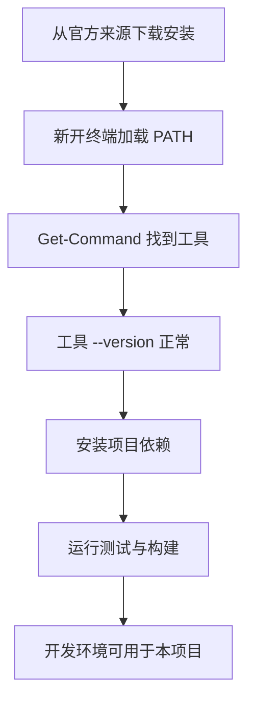

# 第 04 章：安装开发环境

## 本章目标

学完后，你能够：

1. 理解安装程序、PATH、版本和项目依赖分别是什么；
2. 从官方来源安装 VS Code、Node.js、Git、Rust 和 Windows 构建工具；
3. 用命令验证工具是否真的可用；
4. 区分“软件已安装”“命令能找到”“项目能够构建”三个层次；
5. 在不覆盖现有项目修改的前提下判断是否适合安装项目依赖；
6. 认识 Android 工具链，但把实际配置留到后续移动端课程。

## 开始前需要会什么

- 能看懂路径与文件扩展名；
- 能打开 VS Code 和 PowerShell；
- 知道终端、PowerShell 和具体开发工具不是同一个东西；
- 能识别官方网站与第三方下载站的区别。

安装过程可能需要下载较大文件。网络慢不是代码错误，不要因此反复启动多个安装程序。

## 新术语表

| 术语 | 含义 |
| --- | --- |
| 安装程序 | 把软件文件复制到系统位置并配置入口的程序 |
| 用户级安装 | 只为当前 Windows 用户安装，通常不需管理员权限 |
| 系统级安装 | 为所有用户安装，通常需要管理员权限 |
| PATH | shell 查找可执行命令时依次搜索的一组目录 |
| 版本 | 标识软件发布状态的编号，例如 `24.x.x` |
| LTS | 长期维护版本，适合稳定项目 |
| 工具链 | 编译、链接、打包所需的一组配套工具 |
| 依赖 | 项目需要调用的外部库或工具 |
| 锁文件 | 精确记录依赖解析结果的文件，例如 `package-lock.json` |
| 链接器 | 把编译产物和库组合成最终本机程序的工具 |

## 先建立直觉

安装工具像给工坊添置设备：

- 下载并安装，只代表设备搬进了房间；
- PATH 像设备索引，让 PowerShell 知道去哪里找；
- `--version` 像通电自检；
- 项目测试或构建像用设备完成真实工作；
- 项目依赖像针对某个产品准备的模具与零件。

所以“开始菜单里能看到 Node.js”不能单独证明项目能运行。必须分层验证。

## 图解



任意一层失败，都应停在那一层排查，而不是把所有工具一起重装。

## 跟我一步一步做

### 第一步：记录安装前状态

打开一个普通 PowerShell，逐条运行：

```powershell
Get-Command code -ErrorAction SilentlyContinue
Get-Command node -ErrorAction SilentlyContinue
Get-Command npm -ErrorAction SilentlyContinue
Get-Command git -ErrorAction SilentlyContinue
Get-Command rustc -ErrorAction SilentlyContinue
Get-Command cargo -ErrorAction SilentlyContinue
```

有输出说明当前 shell 能找到命令；没有输出说明需要继续检查，并不一定代表软件绝对没有安装。

### 第二步：安装 VS Code

从 [VS Code 官方 Windows 安装说明](https://code.visualstudio.com/docs/setup/windows) 进入下载。大多数个人电脑适合 User Setup：只安装给当前用户，更新更顺畅，通常不需要管理员权限。官方安装程序会把 `code` 加入 PATH。

安装完成后关闭旧终端，新开 PowerShell：

```powershell
code --version
Get-Command code
```

预期：显示版本和命令位置。版本数字会随时间变化，不要机械追求教程截图中的数字。

### 第三步：安装 Node.js 与 npm

从 [Node.js 官方下载页](https://nodejs.org/en/download) 选择当前仍受支持的 LTS 版本和适合本机架构的 Windows 安装方式。LTS 表示长期维护，不等于永远不更新。

新开终端后验证：

```powershell
node --version
npm --version
Get-Command node
Get-Command npm
```

正常输出形状：Node 版本通常以 `v` 开头，npm 是数字版本。版本页面会变化，以项目兼容性、锁文件和实际测试为准。

### 第四步：安装 Git for Windows

从 [Git 官方 Windows 下载页](https://git-scm.com/download/win) 获取安装程序。初学阶段保留推荐设置即可；遇到默认编辑器选择时可以选择 VS Code。

新开终端验证：

```powershell
git --version
Get-Command git
```

Git 若要求姓名和邮箱，只影响提交作者信息。先检查是否已有配置：

```powershell
git config --global user.name
git config --global user.email
```

已有值时不要为了跟教程一致而覆盖。没有值时，第 06 章会在第一次练习提交前说明怎样设置。

### 第五步：安装 Windows C++ Build Tools

Tauri 2 官方前置条件要求 Windows 开发环境具备 Microsoft C++ Build Tools。进入 [Tauri 2 官方前置条件](https://v2.tauri.app/start/prerequisites/) 提供的 Microsoft 链接，打开 Visual Studio Installer，在工作负载中选择“使用 C++ 的桌面开发”（英文为 Desktop development with C++）。

这个安装通常较大。确认包含 MSVC 构建工具与 Windows SDK。VS Code 本身不是 C++ 编译工具，安装 VS Code 不会自动完成这一步。

### 第六步：确认 WebView2

Tauri 在 Windows 上使用 Microsoft Edge WebView2 显示 Web 界面。较新的 Windows 通常已经具备它。只有系统或 Tauri 明确报告缺失时，再从 Microsoft 官方 WebView2 Runtime 页面安装 Evergreen Runtime。

不要把“装了 Edge 浏览器”当成唯一证据，也不需要从第三方网站下载所谓 WebView 修复包。

### 第七步：安装 Rust 与 Cargo

从 [Rust 官方安装页](https://www.rust-lang.org/tools/install) 下载适合本机架构的 `rustup-init.exe`。Windows 上使用 Tauri 时选择 MSVC 工具链。Rust 官方说明中，Rust 工具通常安装到 `%USERPROFILE%\.cargo\bin`，安装器会尝试更新 PATH。

安装后关闭旧终端并新开一个：

```powershell
rustc --version
cargo --version
rustup show
```

预期：`rustc`、`cargo` 显示版本；`rustup show` 显示工具链和默认 host。若命令找不到，先重开终端，必要时注销重登，再检查 `%USERPROFILE%\.cargo\bin` 是否在 PATH。

### 第八步：做一轮汇总验证

```powershell
code --version
node --version
npm --version
git --version
rustc --version
cargo --version
```

把输出记录在学习笔记中，但不要把用户名路径、密钥或公司内部地址公开发布。

## 完整示例

假设 `node --version` 提示无法识别命令，按下面顺序检查：

1. 核对输入的是 `node --version`，不是 `node.js --version`；
2. 从开始菜单或“已安装的应用”确认 Node.js 是否安装；
3. 关闭当前终端，新开 PowerShell；
4. 运行 `Get-Command node -ErrorAction SilentlyContinue`；
5. 查看 PATH 中是否有 Node 安装目录：

```powershell
$env:Path -split ";"
```

6. 若安装不完整，重新运行官方安装程序并选择修复；
7. 不要从搜索结果里下载一个孤立的 `node.exe` 放进系统目录。

这套方法先收集证据，再处理具体层次。

## 逐段解释

### PATH 为什么需要新终端

进程启动时会读取环境变量。安装程序更新了用户 PATH，已经打开的终端仍可能保留旧值。新开终端让 PowerShell重新读取配置。

### 为什么不固定写“必须安装最新版本”

最新版可能带来新特性，也可能超出旧项目测试范围。项目通常通过 `package.json`、锁文件、Cargo 配置和持续测试确定兼容范围。学习时选择受支持的 LTS/稳定版本，再以实际构建为证据。

### 全局工具与项目依赖

Node.js、Git、Rust 是系统或用户层工具。React、Vite、Tauri JavaScript API 等由项目的 npm 配置与锁文件管理。全局有 Node 不代表项目依赖已经在 `node_modules` 中。

### `npm install` 可能改变什么

它会下载依赖并创建 `node_modules`，在某些版本、参数或锁文件状态下也可能更新 `package-lock.json`。真实工作区已有未提交修改时，不要把它描述为完全只读操作。

## 运行并观察

先进入项目根目录并查看状态：

```powershell
Set-Location -LiteralPath "D:\Projects\study-space"
git status --short
```

若存在大量未提交修改，而依赖已经可用，本章不要求重新安装。若这是干净的练习副本且依赖缺失，可以使用锁文件一致安装：

```powershell
npm ci
```

成功时会创建 `node_modules` 并显示安装包数量和审计摘要。失败时记录第一条具体错误；网络、权限、Node 版本、锁文件不一致是不同问题。

项目工具验证将在后续章节运行：

```powershell
npm run test:run
npm run build
cargo test --manifest-path src-tauri/Cargo.toml
```

现在只需认识这些命令，不必一次完成长时间 Rust 构建。

## 常见错误与修复

### 软件能打开，命令却找不到

先重开终端，再用 `Get-Command`。这通常是 PATH 或安装方式问题，不是源码问题。

### PowerShell 阻止 npm 脚本

记录完整策略错误，不要立刻把全系统执行策略改为最宽松。确认官方安装、实际调用文件和设备安全策略；必要时使用 npm 的 Windows 命令入口并查官方说明。

### Rust 报找不到链接器

检查“使用 C++ 的桌面开发”、MSVC 和 Windows SDK 是否安装完整，而不是反复重装 Rust。

### 下载很慢或失败

区分浏览器下载、安装器下载和包管理器下载。保存网址、错误码和时间。不要使用来源不明的镜像，尤其不要下载声称包含全部工具的私人压缩包。

### 安装时要求管理员权限

先确认安装的是系统级工具且来源可信。VS Code User Setup 通常不需管理员权限；C++ Build Tools 等系统组件可能需要。权限提示本身不是应该无条件同意的理由。

### `npm install` 后 Git 出现新差异

用 `git status --short` 和 `git diff -- package-lock.json` 查看，不要自动恢复已有用户改动。先判断差异来自原工作区还是本次安装。

## 在“学习空间”项目里找到它

- Node 与 npm 脚本：[`package.json`](../../../package.json)
- 前端精确依赖解析：[`package-lock.json`](../../../package-lock.json)
- Rust 包配置：[`src-tauri/Cargo.toml`](../../../src-tauri/Cargo.toml)
- Rust 精确依赖解析：[`src-tauri/Cargo.lock`](../../../src-tauri/Cargo.lock)
- Tauri 构建配置：[`src-tauri/tauri.conf.json`](../../../src-tauri/tauri.conf.json)

本项目同时面向 Windows 与 Android，但两端共享代码不等于工具链相同。

## 必做练习

1. 运行六条版本命令，记录每条由哪个工具处理；
2. 对每个工具运行一次 `Get-Command`，记录真实位置；
3. 解释为什么安装后需要新开终端；
4. 区分 Node.js、npm 和项目里的 React 依赖；
5. 写出“命令找不到”的七步检查顺序；
6. 解释为什么真实脏工作区里不应盲目重新安装或清理依赖。

## 选做挑战

运行：

```powershell
rustup show
```

找出 default host 和 active toolchain，查术语表后用一句话解释两者。不要添加或切换工具链。

## 答案与思路

1. `code` 属于 VS Code；`node` 属于 Node.js；`npm` 是 Node 包管理器；`git` 是版本控制工具；`rustc` 是 Rust 编译器；`cargo` 管理和构建 Rust 包。
2. 实际路径因安装方式和用户名而异，答案不是固定字符串；重点是命令确实可解析。
3. 旧终端进程可能保留安装前的 PATH。
4. Node.js 是运行环境，npm 是包管理/脚本工具，React 是项目依赖。
5. 拼写 → 新终端 → `Get-Command` → 确认安装 → 检查 PATH → 官方修复安装 → 不下载来历不明的同名程序。
6. 安装可能改变锁文件或生成大量文件，而已有修改属于用户，不能为了环境整洁覆盖它们。

## 本章自检

- [ ] 我能解释 PATH；
- [ ] 我只从官方来源下载安装；
- [ ] 六条版本命令可以运行，或我已记录明确阻塞原因；
- [ ] 我知道 Tauri Windows 开发需要 C++ Build Tools 和 WebView2；
- [ ] 我知道 Rustup、rustc、Cargo 的关系；
- [ ] 我知道 npm 依赖与全局 Node.js 的区别；
- [ ] 我没有清理或覆盖真实项目已有修改。

## 本章小结

开发环境不是“装一个软件”就结束，而是官方安装、PATH 可发现、版本命令可运行、项目依赖可解析、测试与构建可执行的一条验证链。出现问题时定位具体层次，远比全部重装可靠。

Android 后续还需要 Android Studio、JDK、SDK Platform、Platform-Tools、NDK、Build-Tools、Command-line Tools、环境变量与 Rust Android targets。Tauri 官方前置条件会随版本更新，实际安装时应重新核对官方页面。

## 下一章

下一章系统学习 PowerShell：命令、参数、输出、错误和退出码，并在专用练习目录中完成安全操作。

继续：[第 05 章：第一次使用命令行](05-第一次使用命令行.md)
