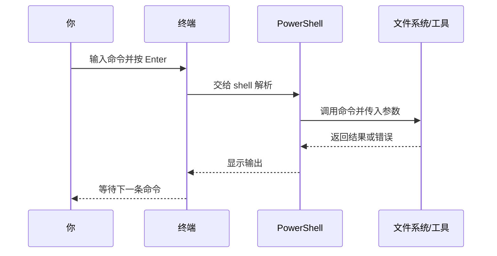

# 第 05 章：第一次使用命令行

## 本章目标

学完后，你能够：

1. 看懂提示符、命令名、参数、选项、输出与错误；
2. 始终先确认当前目录，再操作明确的练习路径；
3. 创建、查看、复制、移动练习文件；
4. 区分“命令找不到”和“路径找不到”；
5. 理解退出码与 `Ctrl+C`；
6. 在按 Enter 前识别高风险命令。

## 开始前需要会什么

- 已创建专用练习目录；
- 理解绝对路径和相对路径；
- 能打开 PowerShell；
- 开发工具安装到了可验证状态。

本章不练习递归删除、系统权限修改或真实项目写入。

## 新术语表

| 术语 | 含义 |
| --- | --- |
| 提示符 | shell 等待输入时显示的当前位置和符号 |
| 命令名 | 要调用的程序或 PowerShell cmdlet 名称 |
| 参数 | 告诉命令目标、模式或数值的信息 |
| 选项 | 改变命令行为的命名参数，PowerShell 常以 `-` 开头 |
| 标准输出 | 程序正常结果常用的输出通道 |
| 标准错误 | 程序报告问题常用的输出通道 |
| 退出码 | 本机程序结束时返回的数字状态 |
| 通配符 | 表示一组名称的字符，例如 `*`、`?` |
| 管道 | 把一个命令输出交给另一个命令 |
| 重定向 | 把输入或输出改送到文件等位置 |

## 先建立直觉

命令行像填写一张非常严格的工作单：

```powershell
Get-ChildItem -LiteralPath "D:\Desktop\study-space-course-practice"
```

- `Get-ChildItem`：请谁做事；
- `-LiteralPath`：说明下一项是一个精确路径；
- 引号内路径：对哪个目标做事；
- 空格：把各部分分开；
- Enter：正式提交工作单。

电脑不会自动理解“你大概想看练习目录”。拼写、空格、引号和当前位置都属于输入的一部分。

## 图解



## 跟我一步一步做

### 第一步：进入练习目录

```powershell
Set-Location -LiteralPath "D:\Desktop\study-space-course-practice"
Get-Location
```

预期：`Path` 显示该练习目录。若你在第 02 章使用了带 `-2` 的新名称，这里必须改成真实名称。

### 第二步：查看目录内容

```powershell
Get-ChildItem
Get-ChildItem -LiteralPath ".\notes"
```

预期：第一条看到 `notes`、`images`、`code`；第二条看到 `first-note.txt`。

`.` 表示当前目录，`.\notes` 就是“当前目录下的 notes”。

### 第三步：创建新的练习文件

```powershell
New-Item -ItemType File -Path ".\notes\command-practice.txt"
Get-ChildItem -LiteralPath ".\notes"
```

预期：列表出现空文件。若已存在，不要加 `-Force`；改用新文件名，避免无意覆盖。

### 第四步：读取文本

```powershell
Get-Content -LiteralPath ".\notes\first-note.txt"
```

预期：显示第 02 章写入的文字。若出现乱码，先停止保存，检查文件编码。

### 第五步：复制再移动

```powershell
Copy-Item -LiteralPath ".\notes\first-note.txt" -Destination ".\notes\first-note-copy.txt"
Get-ChildItem -LiteralPath ".\notes"
Move-Item -LiteralPath ".\notes\first-note-copy.txt" -Destination ".\code\example-note.txt"
Get-ChildItem -LiteralPath ".\code"
```

复制后原文件仍在；移动后副本从 `notes` 消失并出现在 `code`。

### 第六步：停止持续运行的程序

本章不必启动开发服务器。只需认识：当一个程序持续占用终端时，按 `Ctrl+C` 通常会请求停止它。不要在普通提示符下反复按，也不要把它当成撤销文件修改。

## 完整示例

完整安全观察流程：

```powershell
Set-Location -LiteralPath "D:\Desktop\study-space-course-practice"
Get-Location
Get-ChildItem
Get-ChildItem -LiteralPath ".\notes"
Get-Content -LiteralPath ".\notes\first-note.txt"
Get-Command Get-Content
```

逐条运行，不要一次粘贴整块。每条前先预测，运行后把实际结果和预测比较。

如果要只读观察真实项目：

```powershell
Get-ChildItem -LiteralPath "D:\Desktop\app"
```

这条命令列出内容，不会修改项目。但本章所有创建、复制和移动仍只在练习目录进行。

## 逐段解释

### PowerShell cmdlet 的命名

许多 cmdlet 使用“动词-名词”，例如 `Get-Location`、`Set-Location`、`Get-Content`。这种一致性帮助猜测用途，但执行未知命令前仍应查看官方帮助。

### 引号和 `-LiteralPath`

引号把含空格的路径作为一个参数。`-LiteralPath` 要求按字面解释，避免 `[`、`*` 等字符被当成匹配模式。明确目标时它比依赖通配符安全。

### 输出为空

命令没有输出不一定失败：空目录、空文件、没有搜索匹配都可能正常无输出。通过下一条只读检查验证状态，不靠颜色猜测。

### 退出码

运行 Git、Node 等本机程序后可以查看：

```powershell
git --version
$LASTEXITCODE
```

通常 `0` 表示成功，非零表示该程序报告失败。具体数字由程序定义。PowerShell cmdlet 不总用这个变量表达自身状态。

### 管道和重定向为什么后学

管道会把数据交给下一命令，重定向可能写入或覆盖文件。它们很强，但影响范围不够直观时容易造成误操作。本章只认识，不使用写入重定向。

## 运行并观察

做两个无害的故障实验。

### 实验一：不存在的路径

```powershell
Get-ChildItem -LiteralPath ".\this-folder-does-not-exist"
```

观察错误中包含的路径。结论应是“目标路径不存在”，不是“PowerShell 坏了”。

### 实验二：不存在的命令

```powershell
ThisCommandDoesNotExist
```

观察“无法识别”类信息。它说明 shell 找不到命令，与第一个实验的路径错误不同。

把两条完整错误记录到学习日志，然后继续运行：

```powershell
Get-Location
```

预期仍能工作，证明一次普通错误不会破坏终端。

## 常见错误与修复

### 提示符路径不是预期目录

先 `Get-Location`，再用完整 `Set-Location -LiteralPath` 切换。不要靠连续输入很多 `cd ..` 猜位置。

### 路径含空格却没加引号

PowerShell 可能拆成多个参数。把完整路径放入双引号，并使用 `-LiteralPath`。

### 复制时目标已存在

不要立即加 `-Force`。先列出目标目录，决定是保留、换名还是停止。

### 红字很多，只看最后一句

从第一条与本次命令相关的错误开始，记录命令、当前目录、目标路径和错误类型。

### 把管理员权限当万能修复

权限不足只是众多原因之一。管理员运行会扩大影响范围。先确认目标和错误证据，再决定是否确实需要提升权限。

### 从网页粘贴一长串命令

先拆分并解释每个命令、管道、变量、下载地址和写入目标。解释不了就不执行。

## 在“学习空间”项目里找到它

项目常用检查命令都从项目根运行：

```powershell
Set-Location -LiteralPath "D:\Desktop\app"
Get-Location
git status --short
npm run test:run
npm run build
cargo test --manifest-path src-tauri/Cargo.toml
```

后三条会运行工具，但不会自动等于“完全只读”：测试和构建可能创建缓存或输出目录。因此运行前后都应看 Git 状态，生成目录应由 `.gitignore` 管理。

参考：[PowerShell 命令速查](../99-附录/03-PowerShell命令速查.md)。

## 必做练习

1. 在练习目录依次运行 `Get-Location`、`Get-ChildItem`；
2. 创建一个新空文件并用列表证明它存在；
3. 复制一个文本文件，再移动副本；
4. 解释示例命令中命令名、选项和路径参数；
5. 制造一次路径不存在错误和一次命令不存在错误，写出区别；
6. 运行 `git --version` 后查看 `$LASTEXITCODE`；
7. 写出按 Enter 前的六项安全检查。

## 选做挑战

使用：

```powershell
Get-Help Get-ChildItem -Examples
```

只阅读示例，找出其中一个你还没学过的参数，记录名称和你猜测的用途。不执行涉及陌生路径或递归写入的示例。

## 答案与思路

1. 当前位置必须是实际练习目录；
2. `New-Item -ItemType File -Path ".\notes\你的文件名.txt"`，再列 `notes`；
3. `Copy-Item` 保留源，`Move-Item` 改变位置或名称；
4. 例如 `Get-ChildItem` 是命令，`-LiteralPath` 是选项，后面的引号文本是路径值；
5. 路径错误说明命令存在但目标不存在；命令错误说明 shell 找不到可执行命令；
6. 正常情况下 Git 版本命令退出码为 `0`；
7. 能解释动作、确认当前目录、核对目标、确认是练习数据、理解特殊符号、不需要未知提升权限。

## 本章自检

- [ ] 我每次写操作前会确认当前目录；
- [ ] 我能拆解一条 PowerShell 命令；
- [ ] 我会安全查看、创建、读取、复制和移动练习文件；
- [ ] 我能区分路径不存在与命令不存在；
- [ ] 我理解退出码不是所有错误的完整解释；
- [ ] 我知道 `Ctrl+C` 是中断前台任务，不是撤销文件；
- [ ] 我没有在真实项目里练习写入或删除。

## 本章小结

命令行不是神秘黑框，而是一套精确的输入—解析—执行—输出过程。可靠操作来自明确当前目录、使用精确目标、逐条运行并观察证据。错误信息是定位层次的材料，不是要求重装电脑的信号。

## 下一章

下一章学习 Git。你会在独立练习仓库里证明：两个文件同时修改时，可以只提交一个，并完整保留另一个。

继续：[第 06 章：Git 版本控制入门](06-Git版本控制入门.md)
