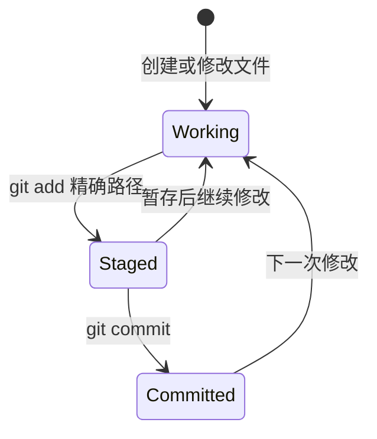

# 第 06 章：Git 版本控制入门

## 本章目标

完成后，你能够：

1. 解释仓库、工作区、暂存区、提交、分支和 HEAD；
2. 看懂 `git status --short` 的常见状态；
3. 在独立练习仓库中创建选择性提交；
4. 用 diff 证明提交里具体包含什么；
5. 在真实脏工作区中保留别人的或之前的修改；
6. 识别可能覆盖历史或文件的高风险 Git 操作。

## 开始前需要会什么

- 能在 PowerShell 中切换目录；
- 能创建和读取练习文件；
- Git 已安装并能运行 `git --version`；
- 理解本章写操作绝不能直接拿真实项目第一次试验。

## 新术语表

| 术语 | 含义 |
| --- | --- |
| 仓库 / repository | Git 管理历史的项目目录 |
| 工作区 / working tree | 当前磁盘上能看到和编辑的文件状态 |
| 未跟踪 / untracked | 文件存在，但还没进入 Git 历史管理 |
| 暂存区 / staging area | 下一次提交准备包含的变化 |
| 提交 / commit | 带作者、时间和说明的本地历史检查点 |
| 提交哈希 / commit hash | 标识某个提交的字符编号 |
| 分支 / branch | 指向一条提交历史线的可读名称 |
| HEAD | 当前检出位置的引用 |
| 差异 / diff | 两个状态之间的逐行变化 |
| `.gitignore` | 告诉 Git 哪些未跟踪路径通常不纳入版本控制 |

## 先建立直觉

把开发桌面想成三个区域：

- 工作区是正在摊开的草稿；
- 暂存区是你为下一次归档挑出的页面；
- 提交是装订、编号并写好说明的历史册。

修改文件不会自动进入暂存区；暂存不会自动成为提交；提交不会自动上传网络。

这个类比也有限：Git 主要记录内容快照与变化关系，不是简单复制整个文件夹；分支是移动的历史指针，不是每次都复制一套普通目录。

## 图解



`git status` 观察三个区域的关系，`git diff` 观察工作区差异，`git diff --cached` 观察下一次提交候选。

## 跟我一步一步做

### 第一步：创建独立练习仓库

选择一个尚不存在的新目录，例如：

```powershell
New-Item -ItemType Directory -Path "D:\Desktop\git-course-practice"
Set-Location -LiteralPath "D:\Desktop\git-course-practice"
Get-Location
git init
```

若目录已存在且有内容，改用新的明确名称，不要清空旧目录。

`git init` 会创建仓库元数据。不要进入或手工编辑 `.git`。

### 第二步：确认初始状态

```powershell
git status --short
```

新仓库没有文件时可能完全没有输出。用 `git status` 可查看更完整说明。

### 第三步：创建两个文件

使用记事本或 VS Code 创建：

`first.txt`：

```text
第一份练习内容。
```

`second.txt`：

```text
第二份内容必须暂时保留在工作区。
```

保存后运行：

```powershell
git status --short
```

预期：两个文件都是 `??`，表示未跟踪。

### 第四步：只暂存第一个文件

```powershell
git add -- first.txt
git status --short
git diff --cached --name-only
```

预期：`first.txt` 显示已添加，`second.txt` 仍是 `??`；已暂存名称只出现 `first.txt`。

### 第五步：检查提交内容

```powershell
git diff --cached
```

逐行确认新增内容。不要因为文件名正确就跳过正文检查。

### 第六步：第一次提交

```powershell
git commit -m "docs: add first practice note"
```

若 Git 报告作者身份缺失，先确认没有现有值：

```powershell
git config --global user.name
git config --global user.email
```

确实为空时，使用你希望出现在提交记录中的姓名和有效邮箱进行设置。不要照抄教程虚构值，也不要覆盖已有身份。

### 第七步：证明第二个文件被保留

```powershell
git status --short
git show --stat --oneline HEAD
```

预期：`second.txt` 仍显示 `??`；最新提交统计只包含 `first.txt`。这就是选择性提交。

## 完整示例

一次安全提交的完整思路：

```powershell
git status --short
git diff -- first.txt
git add -- first.txt
git diff --cached --name-only
git diff --cached
git commit -m "docs: explain a focused change"
git status --short
git show --stat --oneline HEAD
```

每条命令回答一个问题：

1. 当前有哪些变化？
2. 目标文件具体变了什么？
3. 把哪个文件加入候选？
4. 候选文件名单是什么？
5. 候选正文是什么？
6. 创建什么目的的检查点？
7. 提交后还剩什么？
8. 新提交实际包含什么？

## 逐段解释

### `git status --short` 的两列

常见代码：

| 状态 | 含义 |
| --- | --- |
| `??` | 未跟踪文件 |
| ` M` | 工作区已修改，未暂存 |
| `M ` | 修改已暂存 |
| `MM` | 已暂存后又在工作区继续修改 |
| `A ` | 新文件已暂存 |
| ` D` | 工作区删除已跟踪文件 |

第一列接近暂存区状态，第二列接近工作区状态。空格有意义。

### diff 中的符号

diff 文件头里的 `---` 与 `+++` 表示旧文件和新文件标记，不等于正文删除三行、增加三行。正文前 `-` 是旧内容，`+` 是新内容，没有前缀的行是上下文。

### 提交信息

好的提交信息说明目的，例如“docs: teach safe Git fundamentals”。“改了一下”“更新”无法帮助未来判断历史。

### 分支和 HEAD

分支名称是指向某个提交的可移动标签。HEAD 表示当前工作位置，通常指向当前分支。每次在该分支提交后，分支指向新提交。

### `.gitignore`

它只影响尚未跟踪的匹配文件。已经被 Git 跟踪的文件不会因为后来加入 `.gitignore` 就自动从历史消失。它也不是保护敏感数据的保险箱。

## 运行并观察

在练习仓库继续：

1. 修改 `first.txt`，增加第二行；
2. 运行 `git status --short`，预期 ` M first.txt`；
3. 运行 `git diff -- first.txt`，观察未暂存差异；
4. 暂存它；
5. 再修改 `first.txt`，增加第三行；
6. 运行状态，预期接近 `MM first.txt`；
7. 分别运行 `git diff` 与 `git diff --cached`。

你会看到：同一个文件可以同时存在“已暂存版本”和“暂存后又修改的版本”。提交前只看文件名还不够，要看两种 diff。

完成观察后，可以把第三行也暂存，再创建第二次练习提交。

## 常见错误与修复

### 在真实项目中第一次运行写操作

立即停止。第一次练习应在独立仓库。真实项目可能包含用户已有工作，错误恢复命令会覆盖它。

### 使用 `git add .` 把无关文件一起暂存

先运行 `git diff --cached --name-only`。不要继续提交；确认每个文件归属后再采用可解释的方式调整暂存区。初学阶段从精确路径重新规划比盲目执行恢复命令安全。

### `git commit` 说没有可提交内容

查看状态。可能没有暂存、文件未保存、路径在另一个仓库，或变化与当前版本相同。

### 提交后以为所有修改都安全了

查看 `git status --short`。只提交了暂存内容，其他工作区文件仍未进入历史。

### 把提交等同于上传

本地 commit 不会自动推送到远程。网络远程将在后续协作课程讲解。

### 为了干净使用强制清理

整洁的状态不是最高目标，保护未知修改才是。不要使用 `git reset --hard`、`git clean` 或文件覆盖命令清理真实工作区。

## 在“学习空间”项目里找到它

只读观察真实项目：

```powershell
Set-Location -LiteralPath "D:\Desktop\app"
git status --short
git diff --stat
git diff --name-only
git diff --cached --name-only
git log --oneline -10
```

如果看到很多修改，它们可能来自正在进行的界面、AI、同步或文档工作。你不能因为“不认识”就恢复，也不能顺手纳入自己的提交。

项目安全流程参考本章前面的“安全修改流程”和 [Git 安全命令速查](../99-附录/04-Git安全命令速查.md)。

## 必做练习

1. 初始化一个全新的练习仓库；
2. 创建两个文件并预测 `git status --short`；
3. 只暂存一个文件；
4. 用 `git diff --cached --name-only` 证明候选文件范围；
5. 提交后证明另一个文件仍未提交；
6. 制造 `MM` 状态并解释两个 diff；
7. 用 `git show --stat HEAD` 证明最新提交内容；
8. 写出五个在真实脏工作区中禁止自动执行的动作。

## 选做挑战

运行：

```powershell
git log --oneline --decorate --graph --all
```

找出提交短哈希、当前分支或 HEAD 标记。只观察，不创建或切换分支。

## 答案与思路

1. `git init` 后先看状态；
2. 两个新文件通常显示 `??`；
3. 使用 `git add -- 精确文件名`；
4. 输出必须只含目标文件；
5. 提交后另一个文件仍显示 `??`，这是保留而非失败；
6. `MM` 表示暂存区有一版，工作区在此基础上又变了一版；
7. `git show --stat --oneline HEAD` 应只显示最新提交文件；
8. 不自动恢复未知文件、不硬重置、不清理未跟踪文件、不删除 `.git`、不强制推送未知远程历史。

## 本章自检

- [ ] 我能画出工作区、暂存区与提交的关系；
- [ ] 我会读常见短状态；
- [ ] 我会在暂存前后查看不同 diff；
- [ ] 我完成了只提交一个文件的练习；
- [ ] 我能证明另一个文件被保留；
- [ ] 我知道 commit 不等于上传；
- [ ] 我不会为了状态干净而覆盖未知修改。

## 本章小结

Git 的核心不是“后悔药按钮”，而是明确选择、检查差异并建立可解释的历史。可靠流程始终是先看状态，再看差异，暂存精确路径，检查候选，提交后再次验证。真实项目已有修改时，保护未知工作比让状态看起来整洁更重要。

## 下一章

你已经完成准备篇：认识了软件生产链、文件路径、开发工具、环境、命令行和 Git。下一阶段将从 HTML、CSS 与 JavaScript 开始，亲手构建第一个可以交互的学习页面。

返回[课程总目录](../00-课程总目录.md)，完成第一阶段验收后再进入第 07 章。
