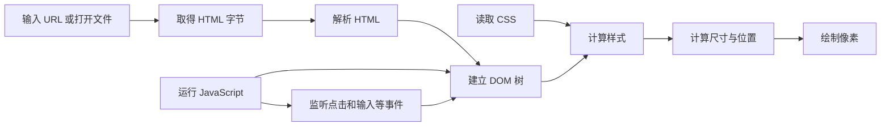

# 第 07 章：网页由什么组成

## 本章目标

学完后，你能够：

1. 区分浏览器、网页、网站、服务器和 URL；
2. 解释 HTML、CSS、JavaScript 各自负责什么；
3. 用浏览器打开一个自己编写的静态网页；
4. 理解浏览器怎样把 HTML 文字转换成 DOM 树并显示出来；
5. 在开发者工具中找到一个元素，并区分临时修改与源码修改；
6. 制作第一张不依赖 React 的静态学习任务卡片。

## 开始前需要会什么

- 能使用 VS Code 打开一个文件夹；
- 能创建文件并看懂扩展名；
- 能在 PowerShell 中确认当前目录；
- 知道浏览器预览和 Tauri 应用不是同一个运行环境；
- 已完成第 01～06 章的基础练习。

本章不需要理解 React、TypeScript、数据库或 Rust。我们先学习它们共同依赖的 Web 基础。

## 新术语表

| 术语 | 普通话解释 |
| --- | --- |
| 浏览器 / browser | 读取 Web 内容、构建页面并执行 JavaScript 的应用 |
| 网页 / webpage | 浏览器显示的一份页面内容 |
| 网站 / website | 通过链接和共同地址组织起来的一组网页与资源 |
| 服务器 / server | 接收请求并返回页面、数据或文件的程序 |
| URL | 描述资源位置和访问方式的地址 |
| HTML | 表达页面内容结构与语义的标记语言 |
| CSS | 描述页面外观和布局的样式语言 |
| JavaScript | 在浏览器中实现行为、状态和逻辑的编程语言 |
| 元素 / element | HTML 文档中的一个结构单位，例如标题或按钮 |
| 属性 / attribute | 写在元素开始标签里，补充名称、关系或状态的信息 |
| DOM | 浏览器根据 HTML 建立的可操作对象树 |
| 事件 / event | 用户或浏览器发生的动作，例如点击、输入、加载 |

## 先建立直觉

可以把网页想成一家正在营业的餐厅：

- HTML 是空间与设施安排：哪里是入口、菜单、桌子和按钮；
- CSS 是视觉与布局：颜色、间距、字体、桌子怎样排列；
- JavaScript 是行为规则：点击点餐后发生什么、总价怎样变化；
- 浏览器是把这些规则变成可见、可操作场景的执行环境；
- 服务器像后厨或仓库，在收到请求后提供页面和数据。

这个类比并不完全准确。HTML 不是建筑材料，CSS 也不仅是“装修”，JavaScript 还会处理数据和网络。需要记住的核心是：**三种语言分工不同，但会在同一页面协作。**

React 没有取代 HTML、CSS 和 JavaScript。React 最终仍让浏览器创建 DOM、应用 CSS 并运行 JavaScript。先理解底层三件套，后面才能看懂 React 帮你省略了什么。

## 图解

浏览器显示页面的大致过程：



三种语言的职责对照：

| 需求 | 主要负责者 | 示例 |
| --- | --- | --- |
| 表明文字是页面主标题 | HTML | `<h1>` |
| 让卡片有边框和圆角 | CSS | `border`、`border-radius` |
| 点击按钮后改变任务状态 | JavaScript | 点击事件处理函数 |
| 把任务永久存入 SQLite | 不属于纯前端三件套 | “学习空间”通过服务层与 Rust 完成 |

## 跟我一步一步做

这次练习使用一个新目录，不直接修改 App。

### 第一步：建立练习目录

在 `D:\Desktop\study-space-course-practice` 下新建：

```text
web-07
```

如果同名目录已有自己的内容，改用 `web-07-2`，不要覆盖。

用 VS Code 的“打开文件夹”打开这个目录。

### 第二步：创建 HTML 文件

新建 `index.html`。文件名中的 `index` 是 Web 项目常用首页名称，不是强制语法；`.html` 告诉编辑器和浏览器它使用 HTML 格式。

输入以下完整内容，建议亲手逐行输入：

```html
<!doctype html>
<html lang="zh-CN">
  <head>
    <meta charset="UTF-8" />
    <meta name="viewport" content="width=device-width, initial-scale=1.0" />
    <title>我的第一张学习任务卡</title>
  </head>
  <body>
    <main>
      <article>
        <p>英语</p>
        <h1>整理阅读错题</h1>
        <p>预计学习 30 分钟</p>
        <button type="button">标记完成</button>
      </article>
    </main>
  </body>
</html>
```

保存文件。

### 第三步：用浏览器打开

在文件资源管理器找到 `index.html`，双击或右键选择浏览器打开。

预期看到：英语、整理阅读错题、预计学习时间和“标记完成”按钮。页面很朴素是正常的，因为尚未添加 CSS。

观察地址栏，它可能以 `file:///` 开头。这表示浏览器直接读取本地文件，并没有通过开发服务器。

### 第四步：打开开发者工具

按 `F12` 或 `Ctrl+Shift+I`，切换到 Elements（元素）面板。使用左上角的元素选择工具，再点击“整理阅读错题”。

预期：DOM 树中对应的 `<h1>` 被选中。你看到的是浏览器解析后的 DOM，不是 VS Code 编辑器中的原始文件。

### 第五步：做一次临时修改

在 Elements 中双击 `<h1>` 的文字，把它临时改成“复习长难句”。页面立即变化。

刷新浏览器。预期又显示“整理阅读错题”，因为你只改了运行中的 DOM，没有修改并保存 `index.html`。

### 第六步：做一次源码修改

回到 VS Code，把源文件里的标题改成“复习长难句”，保存，再刷新浏览器。现在修改会保留，因为浏览器重新读取了已保存文件。

## 完整示例

本课程提供一个会在后续五章逐步增强的参考实验页：

- [打开实验页源码](../labs/web-basics/index.html)
- [查看基础样式](../labs/web-basics/styles.css)

现在只读 `index.html` 的结构。即使暂时看不懂全部标签，也可以先回答：

1. 页面标题在哪里？
2. 添加任务的输入框在哪里？
3. 三个筛选按钮在哪里？
4. 空任务列表使用了什么标签？

实验页已经预留后续 JavaScript 文件引用。在 JavaScript 章节完成前，浏览器可能报告 `app.js` 暂时不存在；页面的 HTML 内容仍然应该能够阅读和操作表单控件。

## 逐段解释

### `<!doctype html>`

告诉浏览器按现代 HTML 标准模式解释文档。它不是普通元素，也不需要结束标签。

### `<html lang="zh-CN">`

`html` 包住整个文档。`lang` 属性说明主要语言是简体中文，帮助屏幕阅读器选择发音，也帮助浏览器和搜索工具理解内容。

### `<head>` 与 `<body>`

`head` 放标题、字符编码、视口等页面元信息；`body` 放用户在页面中看到和操作的主要内容。浏览器标签页的标题来自 `<title>`，不是页面里的 `<h1>`。

### 标签、元素和属性

在 `<button type="button">标记完成</button>` 中：

- `<button ...>` 是开始标签；
- `type="button"` 是属性；
- `标记完成` 是文字内容；
- `</button>` 是结束标签；
- 整体组成一个按钮元素。

### 嵌套与 DOM 树

`article` 写在 `main` 内部，因此它是 `main` 的子元素；标题、段落和按钮又是 `article` 的子元素。浏览器把这种嵌套关系建成树，JavaScript 才能查找和修改具体节点。

### 按钮为什么还没有行为

HTML 声明它是按钮，使它可以被键盘聚焦和点击。但本章没有 JavaScript 事件处理函数，点击后不会自动改变任务状态。HTML 提供语义，不会猜测你的业务规则。

## 运行并观察

把开发者工具切换到 Console（控制台）。如果页面语法完整，可能没有红色错误。现在分别做以下观察：

1. 在源码删除 `</article>`，保存刷新，观察浏览器仍尽量显示页面；
2. 在 Elements 中观察浏览器如何修复 DOM 层级；
3. 立即撤销源码删除，恢复正确结束标签；
4. 把 `<h1>` 改成普通 `<p>`，观察默认外观变化；
5. 不要据此得出“h1 只是大号字体”的结论——它还表达页面结构语义。

浏览器容错能力强，不代表无效 HTML 没有问题。错误嵌套可能造成辅助技术理解错误、CSS 选择异常和 JavaScript 查找失败。

## 常见错误与修复

### 保存成 `index.html.txt`

现象：浏览器显示源码文字或系统仍把它当文本文件。启用文件扩展名显示，确认完整名称是 `index.html`。

### 双击后打开的是编辑器

文件默认程序可能是 VS Code。右键选择浏览器打开，或把文件拖到浏览器窗口。

### 页面显示旧内容

确认源码已经保存，再刷新浏览器。检查浏览器打开的路径是否正是当前练习目录下的文件。

### 点击按钮没反应

这是本章的正常结果。按钮有 HTML 语义，但尚未注册 JavaScript 事件。

### 在 Elements 改好后以为完成了

刷新验证。若修改消失，说明只改了运行中的 DOM；应回到源码修改并保存。

### 把默认大标题当作 HTML 的“样式功能”

浏览器给元素默认样式，但 `<h1>` 的根本作用是标记最高级标题。视觉大小将由 CSS 控制。

### 把网站等同于服务器

网站是内容和功能的整体组织；服务器是提供资源的程序或设备角色。一个静态网页可以从本地文件打开，没有远程服务器参与。

## 在“学习空间”项目里找到它

真实项目主要写 JSX，而不是直接维护一份巨大 HTML。JSX 最终仍转换成浏览器理解的元素结构：

- HTML 外壳：[`index.html`](../../../index.html)
- React 应用入口和路由：[`src/app/App.tsx`](../../../src/app/App.tsx)
- 全局 CSS：[`src/app/app.css`](../../../src/app/app.css)
- Tauri 加载前端的配置：[`src-tauri/tauri.conf.json`](../../../src-tauri/tauri.conf.json)

现在不要尝试把真实 React 页面改写成普通 HTML。这里的目标是理解它最终运行在什么基础之上。

## 必做练习

### 练习一：职责分类

把下列需求分别归到 HTML、CSS、JavaScript 或后端/数据库：

1. 表明“今日任务”是二级标题；
2. 卡片在平板宽度下改成两列；
3. 点击完成后切换状态；
4. 重启应用后任务仍存在；
5. 输入框与“任务标题”文字建立关联；
6. 错误文字显示为红色。

### 练习二：画 DOM 树

根据本章任务卡代码画出从 `html` 到 `button` 的父子树。

### 练习三：比较两种修改

分别在 Elements 和源码中修改任务标题，刷新页面，记录哪一种保留以及原因。

### 练习四：解释地址

回答 `file:///D:/.../index.html` 与 `http://localhost:4174/` 的主要区别。

## 选做挑战

在任务卡中增加一个 `<time>` 元素表达计划日期。先查 MDN 或 HTML 官方资料中 `time` 的 `datetime` 属性，再写出可读文字与机器可读值。不要加入 CSS 或 JavaScript。

## 答案与思路

### 练习一

1. HTML：标题语义；
2. CSS：响应式布局；
3. JavaScript：事件和状态；
4. 后端/数据库或其他持久化能力；
5. HTML：`label` 与控件关系；
6. CSS 负责颜色，HTML/JavaScript 决定错误内容何时存在。

### 练习二

主路线：`html` → `body` → `main` → `article` → `button`。`head` 与 `body` 是兄弟；`p`、`h1`、另一个 `p` 和 `button` 是 `article` 的子元素。

### 练习三

Elements 修改 DOM 内存，刷新后浏览器重新解析磁盘文件，所以消失；源码保存到磁盘，刷新后重新读取，因此保留。

### 练习四

`file://` 直接读取本机文件；`http://localhost:4174` 通过本机运行的服务器请求资源。模块加载、请求行为和安全规则可能不同。

## 本章自检

- [ ] 我能区分网页、网站、浏览器和服务器；
- [ ] 我能说明 HTML、CSS、JavaScript 的主要职责；
- [ ] 我亲手创建并打开了 `index.html`；
- [ ] 我能解释标签、属性、元素和 DOM；
- [ ] 我在 Elements 中找到了任务标题；
- [ ] 我验证了临时 DOM 修改与源码修改的区别；
- [ ] 我知道按钮没有 JavaScript 时不会自动完成业务操作。

## 本章小结

网页不是一张静态图片。浏览器取得 HTML 后建立 DOM，结合 CSS 计算布局并绘制，再由 JavaScript响应事件和改变状态。HTML、CSS、JavaScript 分工协作；React 与 Tauri 都建立在这些基础能力之上。开发者工具让你观察运行结果，但永久修改仍需回到源码。

## 下一章

下一章深入 HTML：学习标签、属性、嵌套、表单、列表、按钮以及无障碍名称，并搭出完整的任务页面骨架。

继续：[第 08 章：HTML 从零入门](08-HTML从零入门.md)
