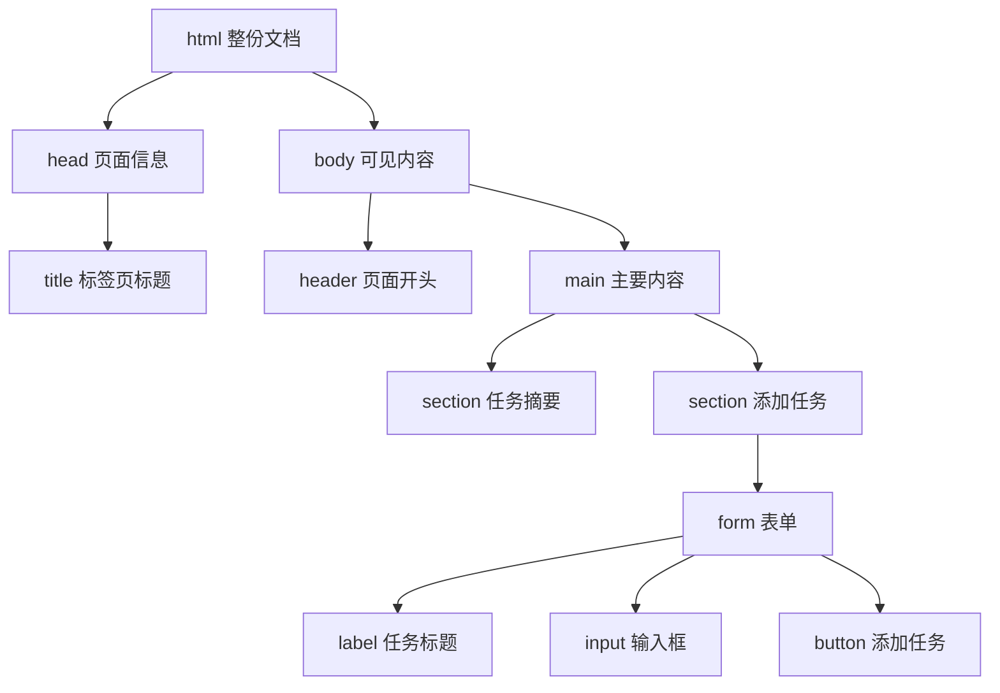

# 第 08 章：HTML 从零入门

## 本章目标

学完后，你能够：

1. 看懂 HTML 的标签、元素、属性、文字节点和嵌套关系；
2. 独立写出一份完整、合法的 HTML 文档；
3. 根据内容含义选择标题、段落、列表、表单和按钮；
4. 创建带标签、必填校验和正确按钮类型的表单；
5. 解释语义化 HTML 为什么会影响键盘操作和无障碍体验；
6. 用开发者工具检查标题层级、控件名称和 DOM 层级；
7. 看懂课程实验页的完整 HTML 骨架。

## 开始前需要会什么

- 已完成第 07 章；
- 知道 HTML 负责内容结构，CSS 负责外观，JavaScript 负责行为；
- 会在 VS Code 中创建、保存并打开 `index.html`；
- 知道 Elements 面板显示的是浏览器解析后的 DOM。

本章继续使用普通 HTML，不使用 React。这样你能先看清浏览器真正接收的结构，再学习 React 如何更方便地生成这些结构。

## 新术语表

| 术语 | 普通话解释 |
| --- | --- |
| 标签 / tag | 用尖括号写出的标记，例如 `<p>` 和 `</p>` |
| 元素 / element | 开始标签、内容、结束标签共同形成的完整结构 |
| 属性 / attribute | 写在开始标签中，为元素提供额外信息 |
| 文字节点 / text node | 元素内部真正显示的文字内容 |
| 嵌套 / nesting | 一个元素写在另一个元素内部 |
| 父、子、兄弟 | DOM 树中元素之间的位置关系 |
| 空元素 / void element | 不包住内容、也没有结束标签的元素，例如 `input` |
| 语义 / semantics | 元素表达的内容角色和意义，而不仅是外观 |
| 表单 / form | 收集并提交用户输入的一组控件 |
| 控件 / control | 输入框、选择框、按钮等可操作元素 |
| 无障碍名称 | 辅助技术用来称呼一个控件的名称 |
| 焦点 / focus | 当前接收键盘输入的页面元素 |
| ARIA | 在原生语义不足时补充无障碍信息的一组属性规范 |

## 先建立直觉

HTML 像一本结构清楚的教材：

- `h1` 是全书主标题；
- `h2` 是章节标题；
- `p` 是正文段落；
- `ul` 和 `li` 是项目列表；
- `form` 是要填写的一组内容；
- `button` 是明确可执行的动作。

如果把所有内容都写成 `div`，人眼可能仍能通过 CSS 看懂，但浏览器、屏幕阅读器和键盘用户难以判断“哪个是按钮、哪个是标题”。语义化不是为了追求某种代码风格，而是让结构本身就能说明用途。

一个重要原则：**先根据内容含义选择 HTML，再用 CSS 改外观。不要因为某个标签默认看起来大或小就选择它。**

## 图解

一个简化的 HTML 文档树：



元素关系示例：

```html
<ul>
  <li>复习单词</li>
  <li>整理作文</li>
</ul>
```

- `ul` 是两个 `li` 的父元素；
- 两个 `li` 互为兄弟元素；
- “复习单词”是第一个 `li` 中的文字节点。

## 跟我一步一步做

在第 07 章的练习目录中新建 `html-08` 文件夹，再在其中创建 `index.html`。不要覆盖上一章文件，保留它用于比较。

### 第一步：写出文档外壳

```html
<!doctype html>
<html lang="zh-CN">
  <head>
    <meta charset="UTF-8" />
    <meta name="viewport" content="width=device-width, initial-scale=1.0" />
    <title>学习任务实验室</title>
  </head>
  <body>
  </body>
</html>
```

保存并用浏览器打开。现在页面主体为空，但标签页标题应显示“学习任务实验室”。

### 第二步：添加页面标题和主要区域

在 `body` 内加入：

```html
<header>
  <h1>学习任务实验室</h1>
  <p>练习创建、筛选和完成学习任务。</p>
</header>

<main id="main-content">
  <section aria-labelledby="summary-title">
    <h2 id="summary-title">任务摘要</h2>
    <p>总任务：0</p>
    <p>已完成：0</p>
  </section>
</main>
```

这里用一个页面级 `h1` 表示整页主题，`h2` 表示主要分区。`aria-labelledby` 让分区明确引用标题；后面你会看到，很多情况下原生标题已经很有帮助，ARIA 只是补充关系。

### 第三步：添加任务表单

在 `main` 中、摘要 `section` 后加入：

```html
<section aria-labelledby="form-title">
  <h2 id="form-title">添加任务</h2>

  <form id="task-form">
    <div>
      <label for="task-title">任务标题</label>
      <input
        id="task-title"
        name="title"
        type="text"
        required
        autocomplete="off"
      />
    </div>

    <div>
      <label for="task-subject">所属科目</label>
      <select id="task-subject" name="subject">
        <option value="英语">英语</option>
        <option value="数学">数学</option>
        <option value="政治">政治</option>
        <option value="专业课">专业课</option>
        <option value="其他">其他</option>
      </select>
    </div>

    <button type="submit">添加任务</button>
  </form>
</section>
```

点击“任务标题”文字，焦点应进入输入框。按 `Tab`，焦点依次移动到科目选择框和添加按钮。空着标题点击提交，浏览器应显示必填提示。

### 第四步：添加筛选和列表

继续在 `main` 内加入：

```html
<section aria-labelledby="list-title">
  <div>
    <h2 id="list-title">任务列表</h2>
    <div aria-label="筛选任务">
      <button type="button" aria-pressed="true">全部</button>
      <button type="button" aria-pressed="false">未完成</button>
      <button type="button" aria-pressed="false">已完成</button>
    </div>
  </div>

  <ul id="task-list">
    <li>
      <span>英语</span>
      <strong>整理阅读错题</strong>
      <button type="button">标记完成</button>
    </li>
  </ul>
</section>
```

筛选按钮现在不会真的筛选，因为还没有 JavaScript。但它们已经具备按钮语义和按下状态。`ul` 告诉浏览器其中是一组同类项目，`li` 表示一个任务。

### 第五步：添加跳转链接和状态区

把下面链接放在 `body` 内最前面：

```html
<a href="#main-content">跳到主要内容</a>
```

在 `main` 末尾加入：

```html
<section aria-labelledby="data-title">
  <h2 id="data-title">示例数据</h2>
  <button type="button">加载示例任务</button>
  <p aria-live="polite" id="request-status">尚未加载。</p>
</section>
```

“跳到主要内容”帮助键盘用户绕过重复页头。`aria-live="polite"` 让状态文字变化时可以被辅助技术适时读出，但不会粗暴打断当前内容。

### 第六步：只用键盘检查

刷新页面，不碰鼠标：

1. 按 `Tab`；
2. 确认可以聚焦跳转链接；
3. 按 `Enter` 跳到主要内容；
4. 继续按 `Tab`，确认输入框、选择框和每个按钮都可到达；
5. 用 `Shift+Tab` 反向移动。

如果你不知道焦点在哪里，先不用担心。浏览器可能提供很淡的默认轮廓，第 09 章会用 CSS 做出清晰焦点样式。

## 完整示例

课程参考页已经包含更完整的语义骨架：

- [查看完整 HTML 实验页](../labs/web-basics/index.html)
- [查看尚未完成视觉设计的 CSS](../labs/web-basics/styles.css)

建议把参考页和自己的练习页左右并排，按下面顺序比较：

1. 文档元信息；
2. 跳转链接；
3. 页头；
4. 主内容和分区；
5. 表单标签与控件；
6. 筛选按钮；
7. 任务列表；
8. 请求状态区；
9. 最后的模块脚本引用。

不要直接复制后宣布完成。先预测每一段在页面中的作用，再用浏览器验证。

## 逐段解释

### 开始标签、结束标签和内容

```html
<p>今天复习英语。</p>
```

`<p>` 是开始标签，`</p>` 是结束标签，中间文字是内容。不是所有元素都必须有结束标签：`meta`、`input` 等空元素不能包住内容。

### 属性如何提供信息

```html
<input id="task-title" name="title" type="text" required />
```

- `id` 是页面内唯一标识，可被标签、CSS 和 JavaScript 引用；
- `name` 是提交表单数据时使用的字段名；
- `type` 说明输入类型；
- `required` 是布尔属性，只要存在就表示必填。

不要在同一页面给两个元素相同 `id`。浏览器可能仍显示，但引用关系和 JavaScript 查找会变得不可靠。

### `label` 为什么不能省

占位文字不是标签。输入后占位文字会消失，屏幕阅读器也可能无法得到稳定名称。

```html
<label for="task-title">任务标题</label>
<input id="task-title" name="title" />
```

`for` 的值必须与输入框 `id` 完全相同。这样点击文字也能聚焦控件，并建立明确的无障碍名称。

### 按钮的类型

表单里的 `<button>` 默认通常是提交按钮。为了避免误提交，应明确写出：

- `type="submit"`：提交表单；
- `type="button"`：普通操作按钮；
- `type="reset"`：恢复表单初始值，实际产品中要谨慎使用。

### 按钮和链接不是同一种东西

- 前往另一个页面或位置：使用 `a`；
- 改变当前页面状态或执行操作：使用 `button`。

不要用可点击 `div` 冒充按钮。原生按钮自动具备键盘聚焦、回车/空格激活、禁用状态和辅助技术角色；`div` 没有这些能力。

### 标题层级

标题不是按字号选择。常见结构是一个说明全页主题的 `h1`，主要分区使用 `h2`，分区内部再用 `h3`。不要仅因为想要更小字体就从 `h1` 跳到 `h4`，字号交给 CSS。

### 注释和缩进

```html
<!-- 任务筛选区：行为将在 JavaScript 章节实现 -->
```

注释帮助解释“为什么”，不应重复明显代码。缩进不会改变大多数视觉结果，但能让父子关系一眼可见。统一使用两个空格即可。

### 浏览器会修复错误，但不要依赖它

下面代码缺少 `</p>`：

```html
<p>第一段
<p>第二段</p>
```

浏览器会根据 HTML 规则推断第一段结束位置，所以页面可能“看起来正常”。不同错误可能产生意外 DOM；应在 Elements 面板检查解析结果并修正源码。

## 运行并观察

### 观察 DOM 层级

打开 Elements，展开 `html` → `body` → `main`。确认每个 `section` 都位于 `main` 内，表单控件位于 `form` 内，任务条目位于 `ul` 内。

### 观察浏览器校验

不填写标题直接提交。浏览器应阻止提交并聚焦输入框。这来自 `required`，不是 JavaScript。它改善即时体验，但真实应用仍需在 JavaScript和后端重新校验，因为用户可以绕过前端限制。

### 观察无障碍树

在开发者工具 Accessibility（辅助功能）区域选中输入框，检查名称是否为“任务标题”；选中按钮，检查角色是否为 button。不同浏览器的入口名称略有不同。

### 故意制造并修复错误

暂时把 `label for="task-title"` 改为 `for="wrong-id"`，刷新后点击标签。输入框不再聚焦。恢复正确值并再次验证。

## 常见错误与修复

### 标签交叉关闭

错误：`<strong><span>内容</strong></span>`。元素必须像盒子一样内层先关闭：`<strong><span>内容</span></strong>`。

### 重复使用同一个 `id`

给每个需要引用的元素唯一 `id`。类名可以重复，`id` 不应重复。

### 用占位文字代替标签

保留可见 `label`。如果视觉设计确实需要隐藏标签，也应使用专门的视觉隐藏样式，而不是删除名称。

### 用 `div` 处理点击

改成 `button type="button"`。除非你能完整实现键盘、焦点、角色、状态和禁用行为，否则不要重造原生控件。

### 一个页面到处都是 `h1`

按内容层级组织标题。技术规范允许某些复杂情况存在多个 `h1`，但对这个应用页面，一个清晰的页面 `h1` 最易理解和维护。

### 把 `<br>` 当作布局间距

段落之间的空间交给 CSS 的 `margin` 或 `gap`。`br` 表示同一段内容中的强制换行，不是排版垫片。

### 在 HTML 中写 `onclick="..."`

内联事件把结构和行为混在一起，也更难测试和维护。本课程在 JavaScript 中用 `addEventListener` 绑定事件。

## 在“学习空间”项目里找到它

项目的静态 HTML 外壳在：

- [`index.html`](../../../index.html)

它提供 React 挂载位置。应用页面的大部分结构由 React 组件通过 JSX 生成，例如：

- [`src/app/App.tsx`](../../../src/app/App.tsx)

JSX 看起来像 HTML，但它写在 JavaScript/TypeScript 中，有一些差异，例如 CSS 类使用 `className`。无论写法如何，浏览器最终看到的仍是 DOM 元素。

本章不要修改生产源码。先用独立实验理解原生 HTML；后面进入 React 时再把这套语义原则迁移过去。

## 必做练习

### 练习一：修复错误表单

找出并修复下面至少五个问题：

```html
<h3>添加任务</h3>
<input id="title" placeholder="任务标题">
<div onclick="saveTask()">保存</div>
<button>取消</button>
<h1>任务列表</h1>
```

### 练习二：按钮还是链接

为以下场景选择 `button` 或 `a`，并说明理由：

1. 打开“英语资料库”页面；
2. 把当前任务标记完成；
3. 跳到当前页任务列表；
4. 重新加载示例数据；
5. 下载一份报告文件。

### 练习三：标题大纲

为“学习任务实验室”设计一个 `h1`、三个 `h2`，并在其中一个分区加入两个 `h3`。只写标题结构，不写 CSS。

### 练习四：键盘检查

完全不用鼠标完成：跳到主要内容、进入任务标题、选择科目、到达添加按钮、反向回到输入框。记录无法识别焦点的位置，留给第 09 章改善。

### 练习五：解释每个属性

用自己的话解释下面各属性的作用：`lang`、`charset`、`viewport`、`for`、`id`、`name`、`type`、`required`、`aria-live`。

## 选做挑战

给任务表单增加“计划日期”：

```html
<label for="task-date">计划日期</label>
<input id="task-date" name="date" type="date" />
```

再给示例任务加入：

```html
<time datetime="2026-10-14">10 月 14 日</time>
```

解释输入控件中的日期值与 `time` 元素中的机器可读日期分别服务于什么场景。

## 答案与思路

### 练习一

- “添加任务”应放在合理标题层级，通常是 `h2`；
- 输入框需要可见 `label`，并用 `for="title"` 关联；
- `input` 应提供 `name` 和适合的 `type`，标题通常还应 `required`；
- 保存动作使用 `button type="submit"`；
- 取消动作使用 `button type="button"`，否则在表单中可能误提交；
- “任务列表”不应为了默认大字体使用另一个 `h1`，应按层级使用 `h2`；
- 不在 HTML 中使用内联 `onclick`。

### 练习二

1. 页面导航使用 `a`；
2. 改状态使用 `button`；
3. 页内跳转使用带片段地址的 `a`；
4. 执行重新加载使用 `button`；
5. 有真实文件地址时使用 `a`，可加 `download` 属性；若需要先生成文件，则生成动作本身可能先由按钮触发。

### 练习三

一种合理答案：`h1 学习任务实验室`；三个 `h2` 分别是“任务摘要”“添加任务”“任务列表”；任务列表内的两个 `h3` 可以是不同日期分组。结构取决于内容关系，不是固定模板。

### 练习四

原生链接、输入框、选择框和按钮默认都能进入键盘焦点顺序。若某个可点击 `div` 无法到达，说明它不是合格控件；若能到达但看不清焦点，第 09 章通过 `:focus-visible` 修复视觉反馈。

### 练习五

- `lang`：文档主要语言；
- `charset`：字符编码；
- `viewport`：移动设备布局视口设置；
- `for` 与 `id`：建立标签和控件引用；
- `name`：表单字段名；
- `type`：控件或按钮类型；
- `required`：表示必填；
- `aria-live`：通知辅助技术某一区域的动态文字需要被读出。

## 本章自检

- [ ] 我能解释标签、元素、属性和文字节点的区别；
- [ ] 我能画出父、子、兄弟关系；
- [ ] 我能写完整 HTML 文档外壳；
- [ ] 我的输入框具有可见且正确关联的标签；
- [ ] 我知道什么时候使用按钮，什么时候使用链接；
- [ ] 我能按语义安排 `h1`、`h2` 和 `h3`；
- [ ] 我只用键盘走完了页面主要控件；
- [ ] 我能在辅助功能树中找到控件名称和角色。

## 本章小结

HTML 的价值不只是“把文字放到页面上”，而是把内容关系写清楚。正确的标题、表单、标签、列表、链接和按钮让鼠标、键盘、屏幕阅读器以及未来的 JavaScript 都获得可靠基础。浏览器虽然会尽量修复错误标记，但开发者仍应维护合法、清晰、可预测的结构。

## 下一章

下一章为这份结构加入 CSS：从选择器、层叠、盒模型开始，逐步做成清晰、现代并适合 Windows 与 Android 平板宽度的响应式页面。

继续：[第 09 章：CSS 从零入门](09-CSS从零入门.md)
