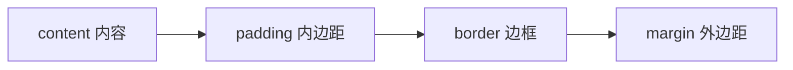
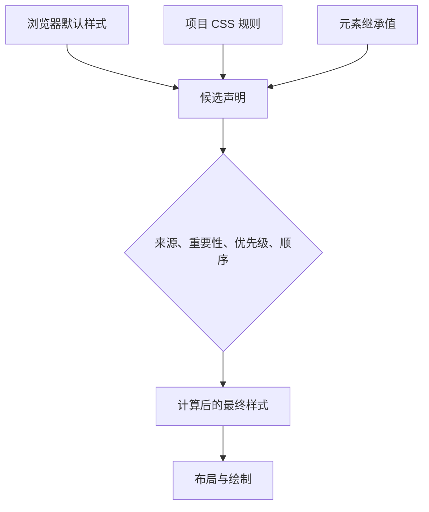

# 第 09 章：CSS 从零入门

## 本章目标

学完后，你能够：

1. 读懂选择器、声明、属性和值；
2. 解释层叠、继承和优先级的基本规则；
3. 用盒模型计算元素实际占用空间；
4. 使用颜色、字体、间距、边框和圆角建立统一视觉；
5. 分清 Flexbox 与 Grid 的使用场景；
6. 写出适应桌面、Android 平板和手机宽度的响应式布局；
7. 用开发者工具找到样式不生效和横向滚动的原因；
8. 理解“好看”来自系统化规则，而不是不断堆装饰。

## 开始前需要会什么

- 能写出第 08 章的 HTML 骨架；
- 知道 `class`、`id` 和元素的父子关系；
- 会用开发者工具选中元素；
- 能区分页面内容结构和视觉外观。

继续使用自己的 `html-08` 练习目录。把它复制为 `css-09`，然后在新目录中练习，避免破坏上一章成果。

## 新术语表

| 术语 | 普通话解释 |
| --- | --- |
| 规则 / rule | 一个选择器和一组声明组成的完整 CSS 片段 |
| 选择器 / selector | 指定哪些元素应用样式的部分 |
| 声明 / declaration | `属性: 值` 形式的一项样式设置 |
| 层叠 / cascade | 多条规则冲突时浏览器决定最终值的机制 |
| 继承 / inheritance | 某些属性从父元素传给子元素的行为 |
| 优先级 / specificity | 同源规则冲突时比较选择器针对程度的方法 |
| 盒模型 / box model | 内容、内边距、边框、外边距组成的尺寸模型 |
| 设计令牌 / design token | 集中保存颜色、圆角、阴影等设计值的变量 |
| Flexbox | 主要沿一个方向排列项目的布局系统 |
| Grid | 同时控制行和列的二维布局系统 |
| 响应式布局 | 根据可用空间调整排列，而不是只适配一块屏幕 |
| 媒体查询 | 按视口或设备特征应用一组 CSS 规则 |
| 断点 / breakpoint | 布局需要明显切换时使用的条件宽度 |

## 先建立直觉

CSS 不是“给页面上色”的小工具，而是一套约束系统。浏览器会为每个元素回答四类问题：

1. 它匹配哪些规则？
2. 每个属性最终取哪个值？
3. 它占多大空间、位于哪里？
4. 它以什么颜色、字体和边框绘制？

设计一个舒服的界面不等于把颜色全部变淡，也不等于加入大量渐变。更可靠的方法是：先规定少量颜色、字号、间距、圆角，再让所有组件复用。页面可以多彩，但层级必须清楚、按钮必须可辨认、文字必须易读。

响应式也不是“给手机再写一套页面”。同一份 HTML 根据可用宽度重新排列：宽时两列，窄时一列；按钮不被压扁，文字不溢出，页面不产生横向滚动。

## 图解

盒模型从内向外：



样式决定的大致过程：



Flexbox 与 Grid 的直觉对照：

| 问题 | 更适合 |
| --- | --- |
| 一排按钮如何换行并保持间距 | Flexbox |
| 页面卡片如何形成两列 | Grid |
| 图标和文字如何水平对齐 | Flexbox |
| 多个区域同时控制行与列 | Grid |

这不是绝对规则，而是选择更容易表达布局意图的工具。

## 跟我一步一步做

### 第一步：连接样式文件

在 `index.html` 的 `head` 中加入：

```html
<link rel="stylesheet" href="./styles.css" />
```

在同目录创建 `styles.css`：

```css
body {
  margin: 0;
  color: #182421;
  background: #f4f7f6;
  font-family: "Segoe UI", "Microsoft YaHei", sans-serif;
}
```

保存并刷新。背景和字体应改变。如果完全没变化，先检查文件名和相对路径，不要继续添加更多规则。

### 第二步：认识一条规则

```css
.panel {
  padding: 24px;
  background: white;
  border: 1px solid #d6e1dd;
  border-radius: 20px;
}
```

- `.panel` 是类选择器，匹配 `class` 中含 `panel` 的元素；
- 大括号内每行是一个声明；
- `padding` 是属性；
- `24px` 是值；
- 分号结束声明。

给 HTML 的几个 `section` 添加 `class="panel"`，观察它们同时改变。类适合复用；不要为了样式给每块卡片分别写一个独有 `id`。

### 第三步：统一盒模型

在 CSS 开头加入：

```css
* {
  box-sizing: border-box;
}
```

默认 `content-box` 下，声明 `width: 300px` 后还会额外加内边距与边框。`border-box` 让声明宽度包含内容、内边距和边框，更容易预测布局。

例如：宽度 300px、左右内边距各 20px、左右边框各 1px：

- `content-box` 实际边框外宽度为 `300 + 40 + 2 = 342px`；
- `border-box` 实际边框外宽度仍为 `300px`，内容空间被相应缩小。

### 第四步：建立设计令牌

```css
:root {
  --color-background: #f4f7f6;
  --color-surface: #ffffff;
  --color-text: #182421;
  --color-muted: #60706b;
  --color-accent: #25705e;
  --color-border: #d6e1dd;
  --radius-small: 12px;
  --radius-large: 20px;
}
```

使用变量：

```css
.panel {
  color: var(--color-text);
  background: var(--color-surface);
  border: 1px solid var(--color-border);
  border-radius: var(--radius-large);
}
```

以后更换主色只改一个值。变量名描述用途，而不是写成 `--green-1` 后到处猜它负责什么。

### 第五步：用 Grid 建立页面布局

给包住几个分区的 `main` 加 `class="page-shell"`：

```css
.page-shell {
  display: grid;
  grid-template-columns: minmax(0, 0.8fr) minmax(18rem, 1.2fr);
  gap: 1rem;
}
```

- `display: grid` 开启网格；
- 两段值定义两列；
- `fr` 按比例分配剩余空间；
- `minmax()` 指定最小与最大范围；
- 第一列的 `minmax(0, ...)` 很重要，它允许内容收缩，减少长内容把整页撑宽；
- `gap` 是项目之间的统一间距。

### 第六步：用 Flexbox 排按钮

```css
.filter-group {
  display: flex;
  flex-wrap: wrap;
  align-items: center;
  gap: 0.75rem;
}
```

主轴默认从左到右，`align-items` 控制交叉轴对齐。`flex-wrap: wrap` 允许空间不足时换行，避免按钮被挤成难以点击的小块。

### 第七步：加入响应式断点

```css
@media (max-width: 760px) {
  .page-shell,
  form {
    grid-template-columns: minmax(0, 1fr);
  }
}
```

当视口不超过 760px 时切换单列。断点不是某个具体设备型号，而是内容开始拥挤的临界点。拖动浏览器宽度，找出布局何时不再舒服，再决定断点。

### 第八步：保证触控和键盘可用

```css
button,
input,
select {
  min-height: 44px;
  font: inherit;
}

button:focus-visible,
input:focus-visible,
select:focus-visible,
a:focus-visible {
  outline: 3px solid #176bff;
  outline-offset: 3px;
}

@media (pointer: coarse) {
  button,
  input,
  select {
    min-height: 48px;
  }
}
```

Android 平板多为粗略指针，48px 高度能减少误触。不要用 `outline: none` 删除焦点提示；如果默认样式不好看，应替换成清晰样式。

## 完整示例

查看课程实验页的最终基础样式：

- [完整 CSS](../labs/web-basics/styles.css)
- [对应 HTML](../labs/web-basics/index.html)

参考样式包含：

- 集中的颜色、圆角和阴影变量；
- 响应式字号 `clamp()`；
- 两列到一列的 Grid 切换；
- 可换行的 Flexbox 按钮组；
- 44～48px 触控目标；
- 清晰的键盘焦点；
- 任务完成、错误状态和禁用状态；
- 减少动态效果偏好的处理。

这份样式有少量柔和背景光，但没有半透明玻璃和大面积深色背景。它的重点是可读和可解释，便于你逐项修改并观察结果。

## 逐段解释

### 常见选择器

```css
p {}                 /* 所有 p 元素 */
.panel {}            /* class 含 panel */
#task-list {}         /* id 为 task-list */
.panel > p {}        /* panel 的直接 p 子元素 */
button:hover {}      /* 鼠标悬停状态 */
[aria-pressed="true"] {} /* 属性和值匹配 */
```

选择器应该刚好表达范围。太宽会误伤其他页面，太长则难覆盖和维护。

### 层叠和源码顺序

如果优先级相同，后出现的规则胜出：

```css
.note { color: green; }
.note { color: blue; }
```

最终为蓝色。但如果更高优先级规则存在，后写不一定胜出。不要用大量 `!important` 强行解决；先在 DevTools 的 Styles 面板查看哪条声明被划掉以及为什么。

### 继承

文字颜色和字体通常会继承，所以在 `body` 设置后，子元素大多沿用。`margin`、`padding`、`border` 通常不继承。不能靠直觉猜，开发者工具的 Computed 面板会显示最终来源。

### 单位

- `px`：适合边框、最小触控尺寸等明确尺寸；
- `rem`：相对根字号，适合间距和字体；
- `%`：相对包含块；
- `vw`：相对视口宽度，单独用于大标题容易过大或过小；
- `fr`：Grid 中分配剩余空间；
- `ch`：大致以字符宽度衡量行长。

推荐使用 `clamp(最小值, 弹性值, 最大值)` 控制标题，避免无限随屏幕增长。

### 外边距折叠

普通文档流中，相邻块级元素的垂直外边距可能合并，不是简单相加。布局组件优先使用父容器的 `gap`，更容易得到稳定间距。

### `min-width: 0` 为什么重要

Grid 或 Flex 项目的默认最小尺寸可能由内容决定。长单词、地址或大控件会拒绝收缩，从而产生横向滚动。在允许内容收缩的项目上加入 `min-width: 0`，再配合文字换行。

### 不要用固定高度容纳动态内容

`height: 300px` 可能在大字体、错误提示或窄屏时裁掉内容。优先让内容决定高度；如果确实需要最低视觉高度，使用 `min-height`。

## 运行并观察

### 用 DevTools 改变量

选中 `:root`，把 `--color-accent` 临时改为紫色。观察所有引用它的元素一起变化。刷新后恢复，证明 DevTools 修改仍是临时的。

### 检查盒模型

选中一个 `.panel`，查看 Computed 面板的盒模型图。分别找到内容、padding、border 和 margin 数值，再与源码对应。

### 模拟三种视口

在浏览器设备工具栏依次输入：

1. `1280 × 800`；
2. `1024 × 768`；
3. `390 × 844`。

每种宽度检查：

- 页面能否垂直滚动；
- 是否出现横向滚动条；
- 表单控件是否完整；
- 按钮是否拥挤或重叠；
- 焦点轮廓是否被容器裁掉；
- 文字放大后是否仍可读。

### 定位横向溢出

在 Console 临时运行：

```js
[...document.querySelectorAll("*")]
  .filter((element) => element.scrollWidth > element.clientWidth)
```

这只是排查线索，不是万能答案。选中返回元素，检查固定宽度、长文本、默认最小尺寸和绝对定位。

## 常见错误与修复

### CSS 完全不生效

确认 `link` 路径、文件名和保存状态；在 Network 面板检查 `styles.css` 是否为 200，而不是盲目提高优先级。

### 写了规则但被划掉

在 Styles 面板查看胜出的选择器。尽量调整组件结构或选择器范围，不要立即加 `!important`。

### 平板上出现横向滚动

检查固定 `width`、过大的 `min-width`、不可换行内容和 Grid 子项。常用修复是弹性列、`minmax(0, 1fr)`、项目 `min-width: 0` 和按钮换行。

### 用很多 `margin-left` 把东西推到位

改用 Grid/Flex 的对齐和 `gap`。手工偏移通常只在当前窗口看似正确。

### 所有文字都变成一种浅灰色

辅助文字可以弱化，但主标题、正文、按钮和状态需要明确对比。简约不等于低对比，也不等于所有内容没有层级。

### 动画令人不适或影响操作

减少非必要动画，并尊重 `prefers-reduced-motion`。交互反馈应短、稳定，不要让关键按钮不断漂浮。

### Android 触控按钮太小

不仅看文字大小，还要看完整点击区域。使用最小高度和足够内边距，并让相邻按钮留出间隔。

## 在“学习空间”项目里找到它

项目的主要全局样式入口是：

- [`src/app/app.css`](../../../src/app/app.css)

具体页面还可能有自己的样式文件或组件类名。阅读真实项目时按下面顺序查找：

1. 在 Elements 中找到元素的类名；
2. 在项目中搜索类名；
3. 查看匹配规则和媒体查询；
4. 在 Computed 中确认最终值；
5. 再决定修改全局令牌还是局部组件。

不要只看截图猜 CSS。实际结果还会受到父容器宽度、路由布局、浏览器缩放和 Tauri 窗口尺寸影响。

## 必做练习

### 练习一：盒模型计算

元素使用默认 `content-box`：`width: 240px`、左右 `padding: 16px`、左右 `border: 2px`、左右 `margin: 10px`。计算边框外宽度和包含外边距的总占用宽度。再说明使用 `border-box` 后的变化。

### 练习二：选择器匹配

写出匹配以下目标的选择器：

1. 所有按钮；
2. 类名为 `panel` 的元素；
3. `panel` 的直接段落子元素；
4. 当前按下的筛选按钮；
5. 获得可见键盘焦点的输入框。

### 练习三：选择 Flex 还是 Grid

判断并解释：筛选按钮行、两列页面框架、任务条目的文字和按钮、十二个等宽统计格。

### 练习四：制造并修复溢出

给表单加入 `width: 900px`，在 390px 视口观察横向滚动。然后移除固定宽度，用 `width: 100%`、容器最大宽度和响应式列修复。

### 练习五：替换设计令牌

只修改 `--color-accent` 和 `--color-accent-soft`，做出一套低饱和紫色主题。检查白字按钮的对比度，不合格则重新选色。

## 选做挑战

不用新增 HTML，为不同科目的任务设计细小色条。要求：颜色不是唯一识别方式，科目文字仍保留；深浅模式不是本章目标；在 390px 和 1024px 宽度下都不溢出。

## 答案与思路

### 练习一

`content-box` 的边框外宽度为 `240 + 16×2 + 2×2 = 276px`，加外边距后的总占用为 `296px`。改成 `border-box` 后，声明的 240px 已包含内边距和边框，含外边距总占用为 260px。

### 练习二

```css
button {}
.panel {}
.panel > p {}
[aria-pressed="true"] {}
input:focus-visible {}
```

### 练习三

- 筛选按钮行：Flex，主要处理单方向排列和换行；
- 两列页面框架：Grid，明确控制列；
- 任务文字和右侧按钮：Flex；窄屏可改为纵向；
- 十二个等宽统计格：Grid，使用重复列和 `minmax()` 更自然。

### 练习四

固定 900px 超过窄视口。修复不只是隐藏 `overflow-x`，而是让内容真正收缩和重排。隐藏滚动条可能把内容永久藏在屏幕外。

### 练习五

答案没有唯一色值。关键检查：主题变量被集中替换、正文仍清晰、主按钮文字与背景有足够对比、焦点颜色仍能辨认。

## 本章自检

- [ ] 我能解释规则、选择器、声明、属性和值；
- [ ] 我知道层叠、继承和优先级分别解决什么问题；
- [ ] 我能计算基本盒模型尺寸；
- [ ] 我使用变量集中管理了视觉值；
- [ ] 我能根据问题选择 Flexbox 或 Grid；
- [ ] 我在 1280、1024 和 390px 宽度检查了页面；
- [ ] 页面没有横向滚动；
- [ ] 所有交互控件有清晰焦点并适合触控；
- [ ] 我能用 DevTools 找到最终样式来源。

## 本章小结

CSS 通过选择、层叠、继承和布局规则把结构变成界面。稳定设计依赖少量可复用令牌、清晰文字层级和可预测间距；稳定响应式布局依赖弹性尺寸、内容驱动断点、Grid/Flex 重排以及真实视口检查。不要用隐藏溢出、固定高度和大量偏移掩盖结构问题。

## 下一章

下一章开始学习 JavaScript：值、变量、条件、数组、对象和函数，并让任务表单、完成按钮与筛选按钮真正工作起来。

继续：[第 10 章：JavaScript 基础一](10-JavaScript基础一.md)
