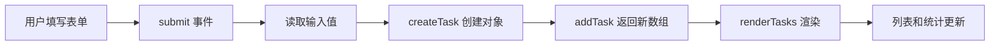
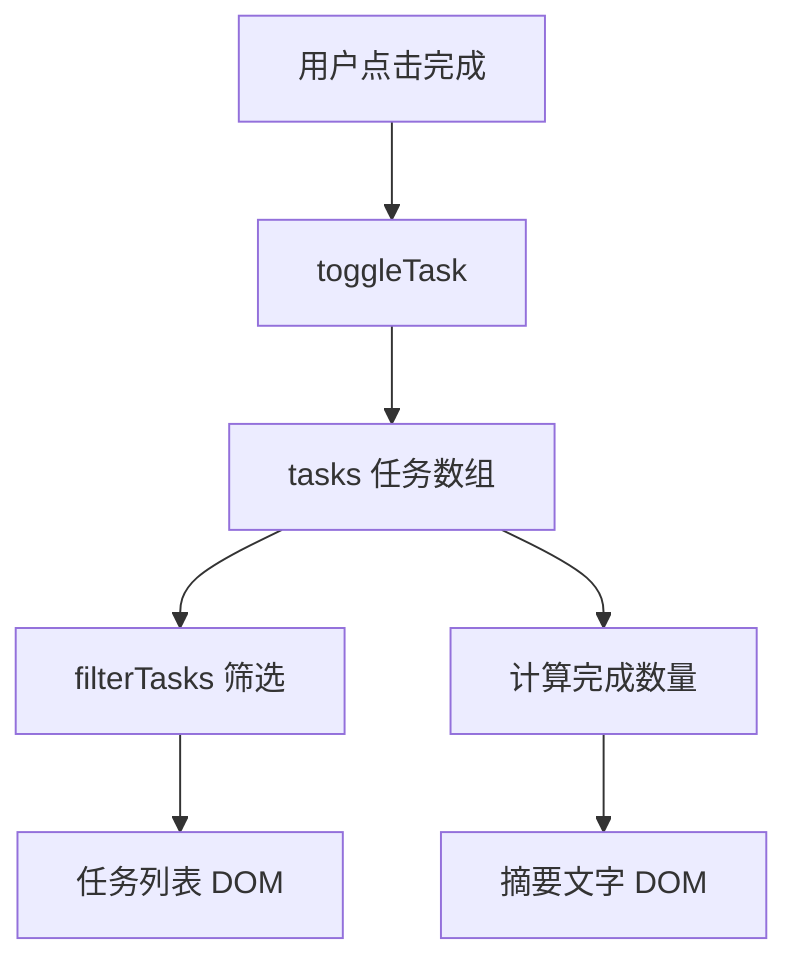

# 第 10 章：JavaScript 基础一

## 本章目标

学完后，你能够：

1. 区分值、变量、表达式和语句；
2. 使用字符串、数字、布尔值、`null`、数组和对象；
3. 使用条件、循环和函数表达业务规则；
4. 解释 `=` 与 `===` 的根本区别；
5. 查询 DOM 元素并监听表单提交、按钮点击；
6. 从输入框读取值并安全地创建页面内容；
7. 独立实现任务新增、完成切换、筛选和统计更新；
8. 理解刷新后数据消失的原因。

## 开始前需要会什么

- 能读懂实验页的 HTML；
- 能用 CSS 找到类选择器并理解页面布局；
- 知道 DOM 是浏览器根据 HTML 建立的对象树；
- 已完成第 07～09 章练习。

本章代码开始变多。不要一次复制到底。每学一块语法，就在控制台或独立文件里运行一个最小例子，再回到完整实验页。

## 新术语表

| 术语 | 普通话解释 |
| --- | --- |
| 值 / value | 程序处理的数据，例如文字、数字和真假 |
| 变量 / variable | 为一个值建立的可引用名称 |
| 表达式 / expression | 执行后会产生值的代码 |
| 语句 / statement | 告诉程序执行一个动作的代码单位 |
| 类型 / type | 值的种类，例如 string、number、boolean |
| 数组 / array | 按顺序保存多个值的容器 |
| 对象 / object | 用属性名组织相关数据的容器 |
| 函数 / function | 可命名、可重复调用的一段逻辑 |
| 参数 / parameter | 函数定义时声明的输入名称 |
| 返回值 / return value | 函数计算后交回调用处的结果 |
| 事件 / event | 提交、点击、输入等已发生的动作 |
| 事件监听器 | 当指定事件发生时运行的函数 |
| 状态 / state | 当前决定页面呈现和行为的数据 |
| 渲染 / render | 根据当前数据创建或更新可见界面 |

## 先建立直觉

HTML 说明“这里有一个添加任务表单”，JavaScript 决定“提交后怎样产生新任务”。一段典型交互可以拆成：

1. 用户填写标题；
2. 浏览器产生提交事件；
3. JavaScript 读取输入；
4. 校验并创建任务对象；
5. 把对象加入任务数组；
6. 根据最新数组重新渲染列表和统计。

这里最重要的不是记住所有语法，而是形成“输入 → 规则 → 新状态 → 界面”的思路。

JavaScript 不是按页面从上到下永远只运行一次。文件加载时会先注册事件监听器，以后每次用户操作，相关函数再被调用。

## 图解



实验页中的数据与界面：



## 跟我一步一步做

### 第一步：在控制台认识值

打开任意练习页的 Console，逐行运行：

```js
"整理阅读错题"
30
true
false
null
```

它们分别是字符串、数字、两个布尔值和表示“明确没有值”的 `null`。注意：`"30"` 是文字，`30` 才是数字。

用 `typeof` 观察：

```js
typeof "英语"
typeof 30
typeof true
```

### 第二步：使用 `const` 和 `let`

```js
const subject = "英语";
let completed = false;

completed = true;
```

`const` 声明名称不能重新指向另一个值；`let` 可以重新赋值。默认优先 `const`，只有变量确实需要重新指向新值时使用 `let`。

不要把 `const` 误解为“对象内部永远不能变化”：

```js
const task = { title: "复习", completed: false };
task.completed = true; // 允许：task 仍指向同一个对象
```

课程后面仍会尽量不直接修改对象，因为不可变更新更容易追踪。

### 第三步：区分赋值与比较

```js
let score = 80;       // = 把右边的值交给左边变量
score === 80;         // === 比较类型和值，结果为 true
score === "80";      // false，数字和字符串类型不同
```

条件中误写 `=` 可能改变数据，而不是判断。初学阶段优先使用严格相等 `===`，避免自动类型转换带来的意外。

### 第四步：建立数组和对象

```js
const task = {
  id: "task-1",
  title: "整理阅读错题",
  subject: "英语",
  completed: false,
};

const tasks = [task];
```

读取属性：

```js
task.title
task["subject"]
tasks[0]
tasks.length
```

对象适合表示一件任务的多个字段，数组适合表示一组任务。数组位置从 0 开始。

### 第五步：条件和循环

```js
if (task.completed) {
  console.log("任务已完成");
} else {
  console.log("任务未完成");
}

for (const currentTask of tasks) {
  console.log(currentTask.title);
}
```

条件括号中的表达式会得到真假。`for...of` 依次取出数组元素，不需要你手工管理下标。

### 第六步：编写函数

```js
function countCompleted(tasks) {
  let count = 0;

  for (const task of tasks) {
    if (task.completed) {
      count += 1;
    }
  }

  return count;
}
```

`tasks` 是参数，调用时传入实际数组。`return` 把计算结果交回调用位置。函数只负责一件明确的事，更容易测试和复用。

### 第七步：创建模块脚本

确认 HTML 末尾已有：

```html
<script type="module" src="./app.js"></script>
```

创建 `app.js`，先查询元素：

```js
const form = document.querySelector("#task-form");
const titleInput = document.querySelector("#task-title");
const taskList = document.querySelector("#task-list");
```

`querySelector` 返回第一个匹配元素。选择器必须与 HTML 一致；拼错时会得到 `null`。

### 第八步：监听提交

```js
form.addEventListener("submit", (event) => {
  event.preventDefault();
  console.log(titleInput.value);
});
```

`addEventListener` 注册监听器。浏览器把事件对象交给函数。表单默认会提交并导航，`preventDefault()` 在这个本地练习中阻止默认导航，让 JavaScript 接管。

填写标题并提交，Console 应显示文字。不要在日志里看到结果就停止；下一步要把它变成任务数据和 DOM。

### 第九步：安全创建 DOM

```js
const item = document.createElement("li");
const title = document.createElement("strong");

title.textContent = titleInput.value;
item.append(title);
taskList.append(item);
```

对用户输入使用 `textContent`。不要这样写：

```js
taskList.innerHTML += `<li>${titleInput.value}</li>`;
```

后者会把输入当 HTML 解析，既可能破坏结构，也可能引入安全问题。`textContent` 明确表示“这只是文字”。

### 第十步：用数据驱动整个界面

课程完整实现把任务保存在数组中：

```js
let tasks = [];
let currentFilter = "all";
```

每次新增、切换或筛选后都调用 `renderTasks()`。渲染函数先清空旧列表，再根据当前数据创建元素。初学时这比“到处只改一小块 DOM”更容易保证统计和列表一致。

## 完整示例

完整交互被拆成两份：

- [页面交互 app.js](../labs/web-basics/app.js)
- [纯任务逻辑 task-store.js](../labs/web-basics/task-store.js)
- [任务逻辑自动测试](../labs/web-basics/task-store.node-test.mjs)

启动本地服务器：

```powershell
cd D:\Desktop\app
npm exec vite -- docs/tutorial/labs/web-basics --port 4174
```

浏览器打开终端显示的本地地址。不要用 `file://` 完成模块练习，因为浏览器对本地模块、跨文件加载和后续 `fetch` 有安全限制。

验证：

1. 添加三个不同科目的任务；
2. 标记其中一个完成；
3. 切换全部、未完成、已完成；
4. 检查摘要数字；
5. 刷新页面，确认任务回到初始状态。

最后一步不是故障：现在只有内存状态，尚未连接数据库或本地存储。

## 逐段解释

### 导入函数

```js
import { addTask, createTask } from "./task-store.js";
```

大括号中的名称必须与另一个模块的具名导出相同。`./` 表示从当前文件所在目录开始寻找。

### 生成任务 ID

浏览器支持时使用：

```js
crypto.randomUUID()
```

ID 让程序能准确找到某一任务，即使两个任务标题相同。课程包含时间戳后备方案，避免某些旧环境没有此函数。

### 渲染空状态

筛选后可能没有可见任务。渲染函数不应留下空白，而应区分：整个数组为空，还是当前筛选没有结果。这是状态设计，不只是文案问题。

### 事件委托

任务按钮是后来动态创建的。代码把一个点击监听器放在任务列表上，再用：

```js
event.target.closest("button[data-task-id]")
```

找到真正按钮。这叫事件委托：利用事件向祖先传播，由稳定的父元素统一处理动态子项。

### 筛选按钮状态

点击筛选按钮后，代码同时更新：

- `currentFilter` 数据；
- 每个按钮的 `aria-pressed`；
- 可见任务列表。

视觉选中状态和辅助技术状态都来自同一个真假值，避免“看起来选中了，但程序认为没选中”。

### 为什么把任务逻辑分离

`task-store.js` 不查询 DOM，只接收数据并返回数据，所以可以直接用 Node 自动测试。`app.js` 负责浏览器事件和渲染。分离后，业务规则不会和页面操作纠缠在一起。

## 运行并观察

### 观察事件对象

在提交监听器内临时加入：

```js
console.log(event.type, event.target);
```

提交一次，确认类型为 `submit`，目标是表单。观察后删除临时日志。

### 观察状态变化

在 `renderTasks()` 开头临时加入：

```js
console.table(tasks);
```

新增和切换时观察数组内容。确认完成状态变化后，原任务标题和科目仍保留。

### 观察安全文字

输入下面内容作为任务标题：

```text
<strong>这只是文字</strong>
```

页面应该原样显示尖括号，而不是把它变成粗体元素。这证明 `textContent` 没有把输入解释成 HTML。

### 观察内存生命周期

添加任务后刷新。数组重新由 `let tasks = []` 初始化。浏览器进程中的旧变量消失，没有任何持久化层替它保存。

## 常见错误与修复

### `Cannot read properties of null`

说明选择器没有找到元素。检查 HTML `id`、脚本加载位置和文件是否是当前页面使用的版本。不要用可选链掩盖本应存在的元素。

### 提交后页面刷新

确认监听的是表单 `submit`，并在回调最前面调用 `event.preventDefault()`。

### 点击动态按钮没反应

如果你只在页面初次加载时给当时存在的按钮绑定监听器，后来创建的按钮不会自动拥有它。使用事件委托，或创建按钮时显式注册监听器。

### `=` 与 `===` 混淆

`task.completed = true` 是修改；`task.completed === true` 是比较。阅读条件语句时先问“这里应该改变，还是判断”。

### 数字和字符串相加得到奇怪结果

`"2" + 1` 得到 `"21"`。表单值通常是字符串，需要数字时显式用 `Number(value)` 并校验结果。

### 用 `innerHTML` 显示用户输入

改用 `textContent` 和 `createElement`。模板字符串方便不等于适合处理不可信输入。

### 刷新后任务消失

本章设计如此。内存变量不是数据库。不要在尚未学习持久化前把它误判为渲染错误。

## 在“学习空间”项目里找到它

真实项目使用 TypeScript 和 React，但仍然有相同概念：

- JavaScript/TypeScript 值和函数；
- 数组形式的任务数据；
- 点击、提交等事件；
- 状态变化后重新渲染；
- 组件生成 DOM 元素。

从应用入口开始观察：

- [`src/app/App.tsx`](../../../src/app/App.tsx)

暂时不要试图理解整个文件。搜索 `useState`、`onClick`、`onSubmit` 或 `.map(`，看看 React 如何表达“状态、事件、列表”。第 13 章之后会系统学习 TypeScript、Vite 与 React。

## 必做练习

### 练习一：判断类型和值

预测以下结果，再到 Console 验证：

```js
typeof "25"
typeof 25
25 === "25"
Boolean("")
Boolean("false")
```

### 练习二：写函数

编写 `makeSummary(total, completed)`，返回如“2 / 5 已完成”的字符串。测试 0、普通数字和全部完成三种情况。

### 练习三：数组遍历

用 `for...of` 统计任务数组中完成项数量，不使用课程现成函数。

### 练习四：DOM 安全

说明为什么用户输入不应直接放入 `innerHTML`。用 `createElement` 和 `textContent` 创建包含科目、标题、按钮的 `li`。

### 练习五：完成一条交互链

不看答案，用自己的话写出“从点击添加到页面出现任务”的至少六个步骤，并指出哪一步更新数据，哪一步更新 DOM。

## 选做挑战

增加“只看数学”筛选，但不要修改任务对象结构。先扩展 `filterTasks` 的测试，再改实现和按钮。完成后思考：如果科目越来越多，固定按钮是否仍是最佳界面？

## 答案与思路

### 练习一

- `typeof "25"` 是 `"string"`；
- `typeof 25` 是 `"number"`；
- 严格比较为 `false`；
- 空字符串转换为 `false`；
- 非空字符串 `"false"` 转换为 `true`，因为它不是布尔值本身。

### 练习二

```js
function makeSummary(total, completed) {
  return `${completed} / ${total} 已完成`;
}
```

参数顺序要与输出语义一致，并分别调用验证。

### 练习三

```js
let count = 0;
for (const task of tasks) {
  if (task.completed) count += 1;
}
```

后面会学习用 `filter` 表达同一逻辑。

### 练习四

`innerHTML` 会解析标签，用户输入可能成为意外 DOM 或脚本攻击入口。`textContent` 把内容当普通文字。按钮等真实结构由开发者用 `createElement` 明确创建。

### 练习五

一种完整链路：用户输入 → 提交事件 → 阻止默认导航 → 读取并校验值 → 创建任务对象 → 返回包含新任务的新数组 → 重新筛选和渲染 → 更新统计 → 清空表单并恢复焦点。

## 本章自检

- [ ] 我能区分字符串、数字、布尔值、数组和对象；
- [ ] 我能解释 `const`、`let`、`=` 和 `===`；
- [ ] 我能写带参数和返回值的函数；
- [ ] 我能用 `querySelector` 找到元素；
- [ ] 我能监听提交并阻止默认导航；
- [ ] 我使用 `textContent` 显示用户输入；
- [ ] 我能新增、切换和筛选任务；
- [ ] 我知道为什么刷新后数据会消失；
- [ ] 我能描述数据变化到 DOM 更新的完整链路。

## 本章小结

JavaScript 用值和数据结构表示状态，用函数表达规则，用事件响应用户动作，再根据新状态更新 DOM。页面交互不是散落的点击效果，而是一条可解释的数据链。把纯任务逻辑与 DOM 操作分开，可以降低理解难度，也为测试和未来迁移到 React 打下基础。

## 下一章

下一章继续学习作用域、模块、`map`、`filter`、`find`、展开语法、不可变更新和错误处理，并用断点真正观察代码如何执行。

继续：[第 11 章：JavaScript 基础二](11-JavaScript基础二.md)
