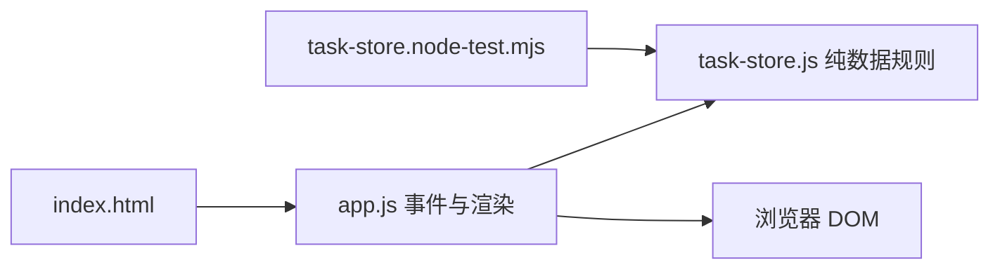
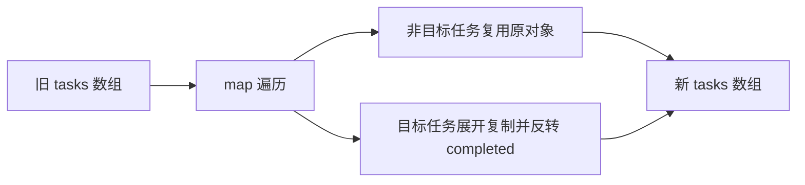
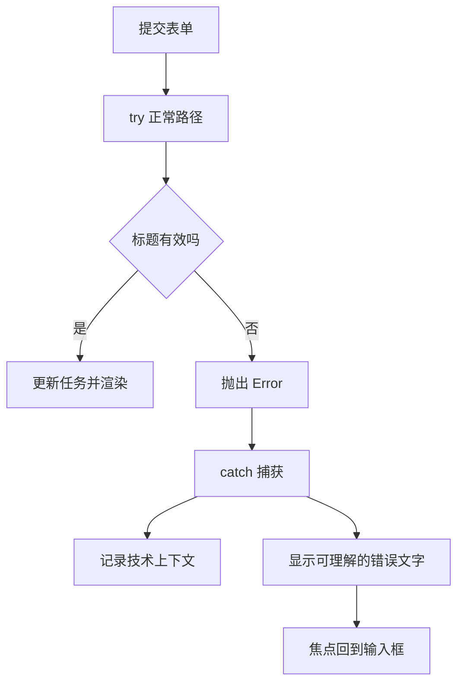

# 第 11 章：JavaScript 基础二

## 本章目标

学完后，你能够：

1. 区分全局、函数和块级作用域；
2. 使用 `export` 和 `import` 拆分模块；
3. 用 `map`、`filter`、`find` 处理数组；
4. 用展开语法创建新数组和新对象；
5. 解释可变更新与不可变更新的差别；
6. 用 `try/catch` 把错误转换成可理解的界面状态；
7. 避免把对象直接显示成 `[object Object]`；
8. 使用断点、单步执行、作用域和调用栈定位错误；
9. 看懂实验页的模块边界和完整状态更新路径。

## 开始前需要会什么

- 会声明变量、数组和对象；
- 会写带参数和返回值的函数；
- 会监听事件并用 DOM API 更新页面；
- 已亲手完成第 10 章的新增、切换和筛选；
- 知道自动测试用于验证预期，而不是证明程序绝无问题。

## 新术语表

| 术语 | 普通话解释 |
| --- | --- |
| 作用域 / scope | 一个名称在哪些代码区域内可被访问 |
| 模块 / module | 具有独立作用域、可显式导入导出的代码文件 |
| 导出 / export | 允许其他模块使用某个函数或值 |
| 导入 / import | 从另一个模块取得它公开的名称 |
| 回调函数 / callback | 作为参数交给另一个函数、稍后由它调用的函数 |
| 不可变更新 | 不修改旧数组或对象，而是创建带有变化的新值 |
| 引用 / reference | 对象和数组在内存中的身份关系 |
| 异常 / exception | 代码无法按正常路径继续时抛出的错误 |
| 调用栈 / call stack | 当前函数如何一层层被调用的记录 |
| 断点 / breakpoint | 暂停执行并检查当前数据的位置 |
| 单步越过 / step over | 执行当前行后停在下一行，不进入被调用函数内部 |

## 先建立直觉

随着功能增长，把所有代码堆在 `app.js` 会越来越难理解。我们把规则分成两类：

- `task-store.js`：只处理任务数据，不知道页面长什么样；
- `app.js`：监听浏览器事件、调用数据函数、把结果渲染到 DOM。

这个边界像图书馆前台与书库规则：前台负责和读者交互，书库规则负责登记、查找与状态变化。两边通过明确输入和返回值合作。

不可变更新则像保留修改前的表格，再生成一份包含新结果的表格。它会多创建一些对象，但让“修改前后有什么不同”更清楚，也正是后续 React 状态更新的基础。

错误处理不是把所有错误藏起来。好的做法是：用户能修复的问题显示清楚说明；意外技术错误保留足够日志；界面恢复到可继续操作的状态。

## 图解

模块关系：



不可变切换：



错误路径：



## 跟我一步一步做

### 第一步：观察作用域

在独立 `scope.js` 中写：

```js
const pageName = "任务实验室";

function makeLabel(subject) {
  const prefix = "科目";

  if (subject) {
    const result = `${prefix}：${subject}`;
    return result;
  }

  return `${prefix}：其他`;
}
```

- `pageName` 在整个模块内可见；
- `subject` 和 `prefix` 只在函数内可见；
- `result` 只在 `if` 的大括号内可见。

在函数外访问 `prefix` 或 `result` 会得到 `ReferenceError`。缩小作用域能减少名称冲突和意外修改。

### 第二步：导出和导入

在 `task-store.js` 中：

```js
export function createTask(id, title, subject) {
  // 省略函数体
}
```

在 `app.js` 中：

```js
import { createTask } from "./task-store.js";
```

具名导入必须拼写一致，并写出正确相对路径和扩展名。模块拥有自己的顶层作用域，不会自动把名称塞进 `window`。

浏览器模块应通过本地开发服务器运行：

```powershell
npm exec vite -- docs/tutorial/labs/web-basics --port 4174
```

直接用 `file://` 打开时，模块和后续网络请求可能被浏览器安全策略阻止。

### 第三步：用 `find` 查一个任务

```js
function findTask(tasks, id) {
  return tasks.find((task) => task.id === id);
}
```

`find` 逐项调用回调，返回第一个条件为真的元素；没有匹配项返回 `undefined`。它不会返回数组。

### 第四步：用 `filter` 取得一部分任务

```js
function filterTasks(tasks, filter) {
  if (filter === "pending") {
    return tasks.filter((task) => !task.completed);
  }

  if (filter === "completed") {
    return tasks.filter((task) => task.completed);
  }

  return [...tasks];
}
```

`filter` 总是返回数组。回调为真的元素被保留，原数组不被删除内容。

### 第五步：用 `map` 切换一项

```js
function toggleTask(tasks, id) {
  return tasks.map((task) => (
    task.id === id
      ? { ...task, completed: !task.completed }
      : task
  ));
}
```

逐层看：

1. `map` 为每个旧元素产生一个新数组元素；
2. ID 不匹配时复用原任务对象；
3. ID 匹配时 `{ ...task }` 复制原属性；
4. 后写的 `completed` 覆盖复制值；
5. `!` 把真假反转；
6. 最终得到一个新数组。

### 第六步：验证没有修改原值

```js
const original = [
  { id: "1", title: "复习", completed: false },
];
const changed = toggleTask(original, "1");

console.log(original[0].completed); // false
console.log(changed[0].completed);  // true
console.log(original === changed);  // false
```

`===` 比较对象或数组时比较引用身份，不会逐字段比较。两个内容相同但独立创建的对象也不严格相等。

### 第七步：给提交加入错误处理

```js
form.addEventListener("submit", (event) => {
  event.preventDefault();

  try {
    const task = createTask(
      makeTaskId(),
      titleInput.value,
      subjectSelect.value,
    );

    tasks = addTask(tasks, task);
    renderTasks();
    showStatus(`已添加任务：${task.title}`, "success");
  } catch (error) {
    console.error("添加任务失败", error);
    showStatus(getErrorMessage(error), "error");
    titleInput.focus();
  }
});
```

`try` 包住可能失败的动作。`createTask` 遇到空标题会 `throw new Error(...)`，执行立即跳到 `catch`，因此不会加入无效任务。

### 第八步：安全取得错误消息

JavaScript 可以抛出任意值，不保证一定是 `Error`：

```js
function getErrorMessage(error) {
  return error instanceof Error ? error.message : "发生了未知错误";
}
```

不要直接：

```js
status.textContent = error;
```

对象转字符串后常显示 `[object Object]`，用户无法理解。技术细节留在 `console.error`，界面显示明确、可行动的消息。

### 第九步：恢复焦点和界面状态

成功后清空表单并把焦点放回标题输入，方便连续录入；失败后也把焦点移到需要修正的位置。错误提示使用 `aria-live` 状态区，因此辅助技术能感知变化。

## 完整示例

对照以下文件：

- [纯任务规则](../labs/web-basics/task-store.js)
- [任务规则测试](../labs/web-basics/task-store.node-test.mjs)
- [事件、错误和渲染](../labs/web-basics/app.js)

运行纯逻辑测试：

```powershell
node --test docs/tutorial/labs/web-basics/task-store.node-test.mjs
```

预期 9 项测试通过。然后启动浏览器实验，尝试空标题提交。因为实验页使用 `novalidate`，浏览器不会先替我们显示默认必填气泡，错误会进入课程自己的 `try/catch`，状态区显示“任务标题不能为空”。

这能让你观察应用校验，但不表示原生 HTML 校验无用。真实项目通常同时保留适当 HTML 约束和程序校验。

## 逐段解释

### 回调函数

```js
tasks.filter((task) => !task.completed)
```

`filter` 接收一个函数。它决定每个元素是否留下。箭头函数的 `task` 是当前元素，表达式结果自动返回。

写成完整形式：

```js
tasks.filter((task) => {
  return !task.completed;
});
```

有大括号时必须显式 `return`，否则每次回调都返回 `undefined`，筛选结果为空。

### 展开语法是浅复制

```js
const copy = { ...task };
```

只复制第一层属性。如果对象中有嵌套对象，内外两个任务仍可能共享嵌套引用。当前任务结构是扁平的，所以足够；复杂数据要逐层设计更新。

### 不可变不是 JavaScript 强制规则

JavaScript 允许 `tasks.push(task)` 和直接修改属性。课程主动选择返回新数组，因为：

- 测试更容易比较修改前后；
- 调用者不必担心传入数据被暗中改变；
- React 通常依靠新引用识别状态变化；
- 调试时能保留旧值。

### 错误的三个层次

1. 用户输入错误：空标题，应给出可修复提示；
2. 可预期环境失败：网络离线，应提供重试；
3. 程序缺陷：访问 `null` 属性，应记录上下文并修复代码。

不要把第三类伪装成“请重试”，也不要把完整技术栈直接显示给普通用户。

### 调用栈如何读

错误堆栈通常最上方是错误类型和消息，后面列出函数调用位置。先找自己项目文件中的第一处行号，再沿调用关系向上理解“谁调用了它”。第三方库内部行号通常不是第一调查点。

## 运行并观察

### 设置第一个断点

1. 启动实验页；
2. 打开 Sources；
3. 找到 `app.js`；
4. 在提交监听器第一行行号处点击；
5. 填标题并提交。

页面暂停后，查看 Scope 中的 `event`、`titleInput` 和 `tasks`。用 Step over 逐行执行，观察任务何时被创建、数组何时换成新引用、渲染何时发生。

### 进入数据函数

在 `toggleTask` 调用处暂停，使用 Step into 进入 `task-store.js`。观察 `map` 回调对目标任务和非目标任务分别返回什么。

### 比较引用

在 Console 执行：

```js
const before = tasks;
```

再完成一次新增后执行：

```js
before === tasks
```

预期为 `false`。展开两个数组，比较内容差异。

### 复现空标题错误

在 `createTask` 的 `throw` 行设置断点，提交全空格标题。观察 `normalizedTitle` 已经是空字符串，然后单步进入 `catch`，确认状态区最终得到 `error.message`，不是整个对象。

## 常见错误与修复

### `import` 名称不存在

浏览器会提示模块没有对应导出。检查拼写、大小写、`export` 和文件路径。不要把具名导入与默认导入混用。

### 直接打开文件导致模块被拦截

使用本地服务器地址，而不是 `file://`。确认终端仍在运行，并检查 Network 面板模块请求状态。

### `map` 后数据没有变化

检查回调是否返回了对象；有大括号的箭头函数可能漏写 `return`。也检查 ID 类型和值是否一致。

### 用 `filter` 查单个任务

`filter` 返回数组；只要一项时使用 `find`。若没有结果，记得处理 `undefined`。

### 捕获错误后什么也不做

空 `catch {}` 会抹掉证据。至少记录上下文，并把界面恢复到可操作状态。

### 页面出现 `[object Object]`

不要把对象直接赋给 `textContent` 或模板字符串。对 `Error` 使用 `.message`，其他对象选择明确字段或用 `JSON.stringify` 仅作开发调试。

### 断点总是不停

确认浏览器加载的是当前文件、断点不是灰色、代码路径确实执行。可临时用 `debugger;` 验证，但完成后删除。

## 在“学习空间”项目里找到它

真实 React + TypeScript 项目会大量使用模块、数组方法和不可变更新。可以在 `src` 中搜索：

- `import` / `export`：模块边界；
- `.map(`：列表渲染或数据变换；
- `.filter(`：筛选与删除；
- `try` / `catch`：错误路径；
- `set...(`：React 状态更新。

从 [`src/app/App.tsx`](../../../src/app/App.tsx) 进入，但一次只追一条数据路径。不要试图一口气读完全部页面。先画出“事件 → 函数 → 服务 → 状态 → 界面”的链。

## 必做练习

### 练习一：作用域判断

指出下面每个变量可访问的范围，并预测哪一行报错：

```js
const a = 1;
function demo() {
  const b = 2;
  if (b > 1) {
    const c = 3;
    console.log(a, b, c);
  }
  console.log(c);
}
```

### 练习二：选择数组方法

为以下需求选择 `map`、`filter` 或 `find`：按 ID 找任务、取得全部未完成、给每项增加显示序号、删除指定任务、切换指定任务状态。

### 练习三：证明不可变

写一段代码证明 `addTask` 没改变原数组，`toggleTask` 没改变原任务的 `completed`。

### 练习四：修复错误显示

下面代码为何可能显示 `[object Object]`？写出稳妥版本：

```js
catch (error) {
  message.textContent = error;
}
```

### 练习五：断点报告

用断点完成一次新增，记录五个时间点：事件进入、对象创建前、对象创建后、数组更新后、DOM 渲染后。每个时间点写出 `tasks.length`。

## 选做挑战

在先写测试的前提下实现：

```js
removeTask(tasks, id)
```

要求返回新数组、未知 ID 时内容不变、原数组不被修改。然后为任务项增加删除按钮，并在删除后正确更新空状态和统计。

## 答案与思路

### 练习一

`a` 在整个模块可见；`b` 只在 `demo` 函数内；`c` 只在 `if` 块内。第二个 `console.log(c)` 抛出 `ReferenceError`。

### 练习二

- 按 ID 找一项：`find`；
- 全部未完成：`filter`；
- 每项增加显示序号：`map`；
- 删除指定任务：`filter` 保留 ID 不同的项；
- 切换指定任务：`map` 为目标返回新对象。

### 练习三

保存旧引用和字段，再调用函数，比较新旧数组 `!==`、旧长度不变、旧对象字段不变。不要只看控制台展开结果，因为有些控制台会延迟读取对象。

### 练习四

```js
catch (error) {
  console.error("操作失败", error);
  message.textContent = error instanceof Error
    ? error.message
    : "发生了未知错误";
}
```

### 练习五

初始为 0 时，事件进入、创建前、创建后仍为 0，因为只产生了任务对象；执行 `tasks = addTask(...)` 后为 1；渲染后仍为 1，只是 DOM 与数据同步。若初始数量不同，按同样关系推导。

## 本章自检

- [ ] 我能解释模块和作用域的作用；
- [ ] 我能正确导入具名导出；
- [ ] 我会根据需求选择 `map`、`filter` 和 `find`；
- [ ] 我能说明展开语法是浅复制；
- [ ] 我能证明任务更新没有修改原数组；
- [ ] 我能区分用户错误和程序缺陷；
- [ ] 错误状态不会显示 `[object Object]`；
- [ ] 我使用断点观察了作用域和调用栈；
- [ ] 我能画出任务从事件到渲染的调用路径。

## 本章小结

模块让代码拥有清晰边界，数组方法让数据变换更直接，不可变更新让前后状态可比较。错误处理既要向用户提供可行动信息，也要为开发者保留证据。断点、作用域和调用栈能让你看到代码真实执行过程，比反复猜测或随处打印更可靠。

## 下一章

下一章学习异步、Promise、`async/await` 和网络请求，让实验页出现清晰的加载、成功、失败与重试状态，并解释为什么休眠等待不会阻塞整个应用。

继续：[第 12 章：异步、Promise 与网络请求](12-异步Promise与网络请求.md)
