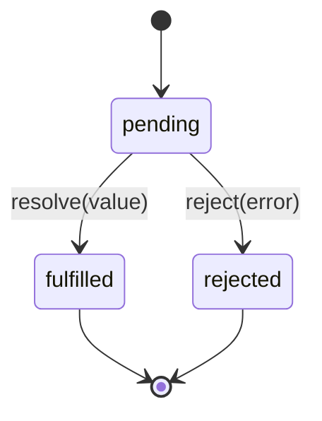
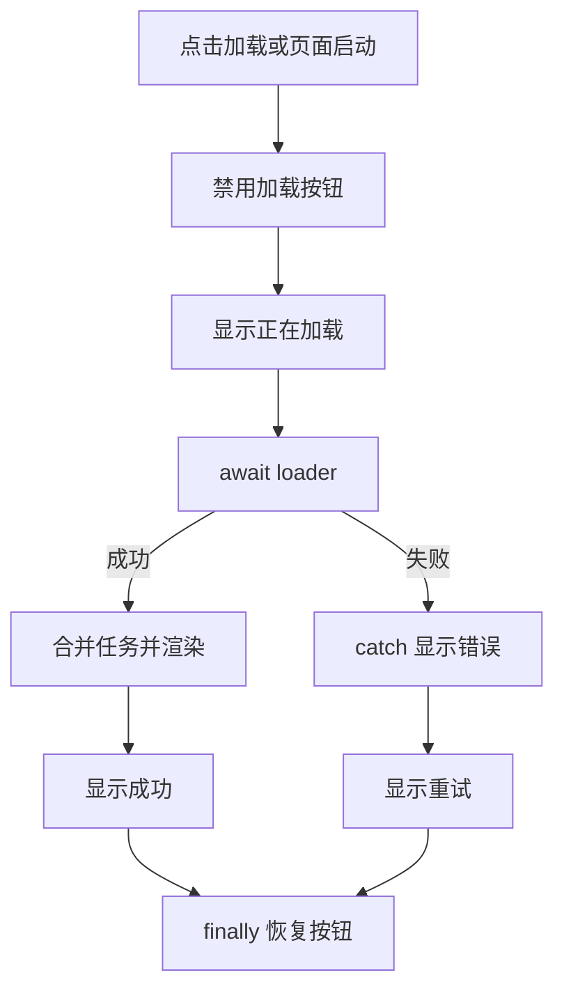
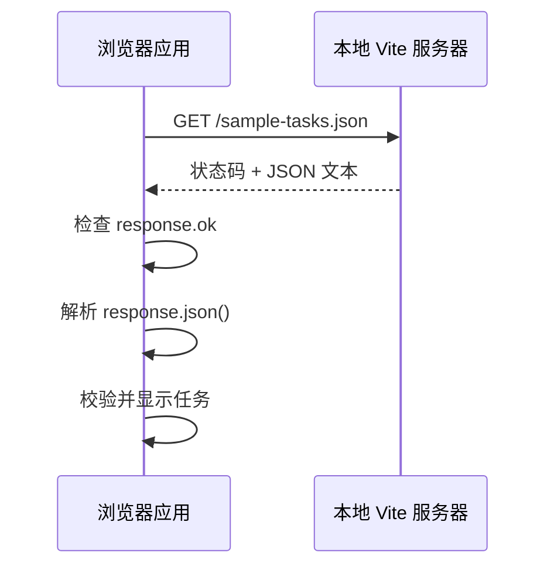

# 第 12 章：异步、Promise 与网络请求

## 本章目标

学完后，你能够：

1. 解释同步与异步工作的差别；
2. 说出 Promise 的 pending、fulfilled、rejected 三种状态；
3. 使用 `async`、`await`、`try/catch/finally`；
4. 理解等待时 JavaScript 没有“卡死整台电脑”；
5. 用 `fetch` 发起本地 HTTP 请求并检查 `response.ok`；
6. 区分网络失败、HTTP 错误和 JSON 解析错误；
7. 为异步界面设计空闲、加载、成功、失败和重试；
8. 防止重复点击，并在成功或失败后恢复控件；
9. 用开发者工具观察请求、限速和离线错误。

## 开始前需要会什么

- 会写函数、数组和对象；
- 理解模块导入导出；
- 会使用 `try/catch`；
- 能运行本地 Vite 服务器；
- 已完成第 10、11 章的任务实验。

本章不连接真实互联网接口，也不需要 API 密钥。我们先使用稳定的模拟接口和本地 JSON，把异步思维学清楚。

## 新术语表

| 术语 | 普通话解释 |
| --- | --- |
| 同步 / synchronous | 当前工作完成后才继续下一步 |
| 异步 / asynchronous | 启动耗时工作，完成结果在以后到达 |
| Promise | 表示一个未来成功值或失败原因的对象 |
| pending | Promise 仍在等待结果 |
| fulfilled | Promise 已成功并具有结果 |
| rejected | Promise 已失败并具有原因 |
| `async` | 声明函数会返回 Promise，并允许在其中使用 `await` |
| `await` | 暂停当前异步函数后续步骤，等待 Promise 结束 |
| HTTP | 客户端与服务器交换请求、响应的常用协议 |
| 请求 / request | 客户端发给服务器的方法、地址、头和可能的数据 |
| 响应 / response | 服务器返回的状态、头和响应体 |
| 状态码 | 用数字描述 HTTP 处理结果，例如 200、404、500 |
| JSON | 常用于交换结构化数据的文本格式 |
| 超时 / timeout | 等待超过允许时长后主动终止或视为失败 |
| 重试 / retry | 失败后再次执行可恢复操作 |

## 先建立直觉

想象餐厅点餐：服务员把订单交给后厨，不会站在灶台前什么都不做，而会继续服务其他桌。后厨完成后发出通知，服务员再把菜送回对应桌。

类比到网页：

- 调用异步函数像提交订单；
- Promise 像取餐凭证，代表未来结果；
- fulfilled 像出餐成功；
- rejected 像食材不足导致订单失败；
- `await` 像当前这张订单的后续步骤先等结果；
- 页面仍可执行其他由浏览器安排的工作。

类比有边界：JavaScript 的调度不是餐厅员工，网络也不是后厨。要记住的是，`await` 暂停的是**当前异步函数的后续执行**，不是让整个电脑停止。

## 图解

Promise 状态只能从 pending 走向一次最终状态：



实验页加载流程：



HTTP 请求的简化边界：



## 跟我一步一步做

### 第一步：创建一个定时 Promise

在 Console 运行：

```js
const result = new Promise((resolve) => {
  setTimeout(() => resolve("完成"), 1000);
});
```

立即查看 `result`，它可能显示 pending；一秒后再次查看，变为 fulfilled。Promise 的状态一旦成功或失败，就不会回到 pending，也不会换成另一个最终状态。

### 第二步：用 `await` 得到结果

```js
async function demo() {
  console.log("开始");
  const value = await result;
  console.log(value);
}

demo();
console.log("函数外继续");
```

常见输出顺序：开始 → 函数外继续 → 完成。`demo` 遇到 `await` 后让出控制权，外部同步代码继续执行；Promise 完成后，`demo` 才从暂停点继续。

### 第三步：创建稳定的模拟接口

课程的 `fake-api.js`：

```js
export function loadStarterTasks({ delay = 600, shouldFail = false } = {}) {
  return new Promise((resolve, reject) => {
    setTimeout(() => {
      if (shouldFail) {
        reject(new Error("模拟加载失败"));
        return;
      }

      resolve(STARTER_TASKS.map((task) => ({ ...task })));
    }, delay);
  });
}
```

可配置延迟让你看见加载状态；`shouldFail` 让失败可以稳定复现，而不是拔网线碰运气；返回复制对象，避免调用者改到模块内部样本。

### 第四步：写完整加载流程

```js
async function runTaskLoad(loader, successMessage) {
  setLoading(true);
  showStatus("正在加载示例任务…", "loading");

  try {
    const loadedTasks = await loader();
    tasks = mergeTasks(tasks, loadedTasks);
    renderTasks();
    showStatus(successMessage, "success");
  } catch (error) {
    console.error("加载示例任务失败", error);
    showStatus(getErrorMessage(error), "error");
  } finally {
    setLoading(false);
  }
}
```

执行顺序：先禁用控件并显示加载；`await` 等结果；成功更新数据，失败进入 `catch`；无论如何都执行 `finally` 恢复控件。

不要把 `setLoading(false)` 只写在成功分支，否则失败后按钮会永久禁用。

### 第五步：请求本地 JSON

```js
async function loadTasksFromJson() {
  const response = await fetch("./sample-tasks.json");

  if (!response.ok) {
    throw new Error(`请求失败：${response.status}`);
  }

  return response.json();
}
```

`fetch` 在收到 404 或 500 响应时通常仍会成功返回 `Response` 对象，不会自动抛错。因此必须检查 `response.ok`。真正断网、地址无法连接等情况才通常让 `fetch` 自身 rejected。

### 第六步：理解 JSON 是文本格式

`sample-tasks.json` 内容：

```json
[
  {
    "id": "json-politics",
    "title": "整理政治框架图",
    "subject": "政治",
    "completed": false
  }
]
```

JSON 要求属性名使用双引号，不支持注释、函数或尾随逗号。`response.json()` 读取响应体并解析；格式错误时它返回的 Promise 会 rejected，于是进入 `catch`。

### 第七步：加入重试

失败时保存一个可再次调用的加载函数，显示重试按钮：

```js
lastRetry = retryLoader;
retryButton.hidden = false;
```

点击重试时重新走同一套加载状态流程，而不是复制一套简化逻辑。模拟失败按钮的重试会改走成功模拟器，方便稳定验证“失败 → 重试 → 成功”。

### 第八步：保留现有任务

加载失败时不要清空当前任务。成功后用 ID 合并新数据，重复加载不会无限复制同一示例任务。用户已经输入的其他任务继续保留。

这是重要的界面规则：一次刷新失败不应毁掉当前可用数据。

## 完整示例

相关文件：

- [模拟接口](../labs/web-basics/fake-api.js)
- [本地 JSON](../labs/web-basics/sample-tasks.json)
- [完整异步界面逻辑](../labs/web-basics/app.js)
- [实验页面](../labs/web-basics/index.html)

启动：

```powershell
cd D:\Desktop\app
npm exec vite -- docs/tutorial/labs/web-basics --port 4174
```

完成以下验证：

1. 页面打开时显示“正在加载”，随后出现两条初始任务；
2. 加载中按钮不可重复点击；
3. 点击“模拟加载失败”，显示明确错误和“重新尝试”；
4. 点击重试，恢复成功状态；
5. 点击“从本地 JSON 加载”，出现政治与专业课任务；
6. 重复加载，固定示例不会不断复制；
7. 自己添加的任务在加载失败后仍保留；
8. 状态区从未显示 `[object Object]`。

## 逐段解释

### `async` 函数总是返回 Promise

```js
async function answer() {
  return 42;
}
```

调用 `answer()` 得到的不是直接数字，而是 fulfilled 为 42 的 Promise。需要 `await answer()` 或 `.then(...)` 取得值。

### 忘记 `await` 会发生什么

```js
const tasks = loadStarterTasks();
console.log(tasks.length);
```

这里 `tasks` 是 Promise，不是数组，`length` 不表示任务数量。加上 `await`，并确保代码位于 `async` 函数或支持顶层 await 的模块环境。

### `try/catch` 只捕获被等待的拒绝

```js
try {
  loadStarterTasks({ shouldFail: true });
} catch (error) {
  // 通常不会捕获到这个异步拒绝
}
```

应写：

```js
try {
  await loadStarterTasks({ shouldFail: true });
} catch (error) {
  // 可以处理
}
```

### `finally` 不代表成功

`finally` 在成功和失败后都会执行，适合恢复按钮、结束加载动画、释放资源。不要在其中显示“加载成功”。

### HTTP 成功与业务成功不同

200 只说明 HTTP 层成功返回；响应数据仍可能缺字段或不符合业务约定。真实项目要校验数据形状，不能因为 JSON 能解析就完全信任。

### 404、500 与网络错误

- 404：服务器收到了请求，但资源不存在；
- 500：服务器处理时发生错误；
- 网络错误：请求可能根本没有获得 HTTP 响应；
- JSON 解析错误：获得响应，但响应体不是有效 JSON。

它们都可以进入界面失败状态，但日志和诊断信息应保留差异。

### 超时并非 `fetch` 自动保证

网络可能长时间无结果。现代浏览器可用 `AbortController` 配合计时器实现超时取消。本章先理解概念，真实服务接入时再封装统一超时、取消和错误类型。

## 运行并观察

### 查看 Network 面板

打开 Network，点击“从本地 JSON 加载”。找到 `sample-tasks.json`，检查：

- Request URL；
- Method 是否 GET；
- Status 是否 200；
- Response 或 Preview 内容；
- Timing 各阶段。

### 模拟慢速网络

在 Network 的 Throttling 选择较慢配置，再请求 JSON。确认加载状态持续可见、按钮保持禁用、完成后恢复。测试后改回 No throttling。

### 模拟离线

选择 Offline，再请求 JSON。确认：

- 现有任务不消失；
- 状态区显示错误而不是永久加载；
- 出现重试；
- 恢复在线并点击重试后成功。

### 模拟 404

在 DevTools Sources 临时把路径改为 `./missing.json`，或在自己的练习副本中修改。请求会返回 404；因为代码检查 `response.ok`，错误消息包含状态码。验证后恢复正确路径。

### 模拟非法 JSON

在练习副本把 JSON 尾部加入非法逗号，刷新请求。`response.ok` 可能仍为真，但 `response.json()` 失败。观察调用栈，再恢复文件。

## 常见错误与修复

### 把 Promise 当成最终数组

检查函数是否异步，调用处是否缺少 `await`。Console 显示 `Promise {<pending>}` 是线索。

### 只处理成功，不处理失败

任何文件、网络或解析操作都可能失败。设计功能时同时写加载、成功、失败和恢复路径。

### 404 没有进入 `catch`

`fetch` 不会因为所有 HTTP 错误自动 rejected。明确检查 `response.ok` 并主动 `throw`。

### 失败后按钮一直禁用

把恢复放进 `finally`，并检查 `finally` 自身没有再次抛错。

### 重复点击产生重复数据

加载中禁用触发按钮；合并时使用稳定 ID 去重。两者分别解决并发重复和重复加载。

### 错误时先清空旧数据

先保留成功状态，只有新数据确实到达并校验后再替换或合并。失败应显示在旧内容旁，不要让用户一无所有。

### 直接用 `file://` 请求 JSON

浏览器可能因安全策略失败。通过 Vite 本地服务器打开页面，确认地址以 `http://localhost` 或 `http://127.0.0.1` 开头。

### 把 API 密钥写进前端

任何打包到前端或 Android 客户端的密钥都可能被提取。需要保密的 AI 或第三方密钥应由受控后端保存和使用，前端只调用自己的服务。

## 在“学习空间”项目里找到它

真实项目的异步工作可能来自：

- 调用 Tauri 命令；
- 读取本地数据库；
- 导入图片或文件；
- AI 整理资料；
- 双端同步与网络接口。

在 `src` 中搜索 `async`、`await`、`invoke(`、`fetch(`、`try` 和 `catch`，一次追踪一条路径。重点检查：

1. 谁触发请求；
2. 加载状态存在哪里；
3. 成功数据如何进入页面；
4. 失败如何显示；
5. 控件是否在 `finally` 恢复；
6. 数据是否经过服务层，而不是页面直接拼数据库操作。

本课程不修改应用接口或数据库结构。这里建立的异步模型会在后续 Tauri、AI 和同步章节继续使用。

## 必做练习

### 练习一：预测输出顺序

```js
console.log("A");
setTimeout(() => console.log("B"), 0);
Promise.resolve().then(() => console.log("C"));
console.log("D");
```

先预测，再运行。现阶段记住 Promise 回调通常早于计时器回调；更完整的事件循环会在后续进阶章节展开。

### 练习二：修复缺失的 `await`

```js
async function showCount() {
  const tasks = loadStarterTasks();
  console.log(tasks.length);
}
```

指出错误，并写出修正版。

### 练习三：处理 rejected Promise

调用 `loadStarterTasks({ shouldFail: true })`，用 `try/catch/finally` 分别记录错误消息和“清理完成”。

### 练习四：处理 404

写一个 `loadJson(url)`，检查 `response.ok`，错误中包含状态码，成功时返回解析数据。

### 练习五：设计状态表

为 idle、loading、success、error 写出：状态文字、按钮是否禁用、重试是否显示、旧任务是否保留。

### 练习六：恢复验证

模拟失败后检查重试按钮；重试成功后检查加载按钮恢复、重试隐藏、任务合并、错误消息消失。记录每一步证据。

## 选做挑战

使用 `AbortController` 为练习副本的 JSON 请求增加 5 秒超时。区分超时取消与其他错误，确保 `finally` 总能恢复按钮。不要把超时写进生产项目，先只在课程实验理解行为。

## 答案与思路

### 练习一

通常顺序为 A、D、C、B。同步代码先运行；Promise 的微任务在当前同步栈结束后处理；计时器回调进入后续任务。`setTimeout(..., 0)` 不是“立刻执行”。

### 练习二

```js
async function showCount() {
  const tasks = await loadStarterTasks();
  console.log(tasks.length);
}
```

### 练习三

```js
try {
  await loadStarterTasks({ shouldFail: true });
} catch (error) {
  console.log(error instanceof Error ? error.message : "未知错误");
} finally {
  console.log("清理完成");
}
```

### 练习四

```js
async function loadJson(url) {
  const response = await fetch(url);
  if (!response.ok) {
    throw new Error(`请求失败：${response.status}`);
  }
  return response.json();
}
```

### 练习五

| 状态 | 文字 | 加载按钮 | 重试 | 旧任务 |
| --- | --- | --- | --- | --- |
| idle | 尚未加载 | 可用 | 隐藏 | 保留 |
| loading | 正在加载 | 禁用 | 隐藏 | 保留 |
| success | 加载成功 | 可用 | 隐藏 | 合并新数据 |
| error | 可理解错误 | 可用 | 显示 | 保留 |

### 练习六

关键不是只看到最终成功，而是证明每个状态转换正确：失败没有毁掉旧数据；按钮没有永久禁用；重试复用同一加载流程；成功后错误状态被新状态替换。

## 本章自检

- [ ] 我能说出 Promise 三种状态；
- [ ] 我知道 `await` 暂停的是当前异步函数后续；
- [ ] 我能用 `try/catch/finally` 完整处理请求；
- [ ] 我会检查 `response.ok`；
- [ ] 我能区分网络、HTTP 和 JSON 解析失败；
- [ ] 加载时会禁用重复操作；
- [ ] 成功和失败后控件都会恢复；
- [ ] 失败不会清空已有任务；
- [ ] 我验证了模拟失败、离线、404 和重试；
- [ ] 我知道密钥不能安全地写进前端。

## 本章小结

异步代码把“现在启动”和“以后得到结果”分开。Promise 表示未来结果，`async/await` 让异步流程更接近顺序阅读，`try/catch/finally` 则确保成功、失败和恢复都有明确路径。可靠界面必须显示加载状态、防止重复操作、保留已有数据、提供重试，并区分 HTTP、网络和解析问题。

## 下一章

Web 基础篇到这里完成。下一阶段将学习 TypeScript、Vite 和 React：理解项目为何使用 `.tsx`、类型怎样提前发现错误、组件与状态如何建立真实应用界面，并把本阶段的 HTML、CSS、JavaScript 思维迁移到“学习空间”源码。

返回：[课程总目录](../00-课程总目录.md)
