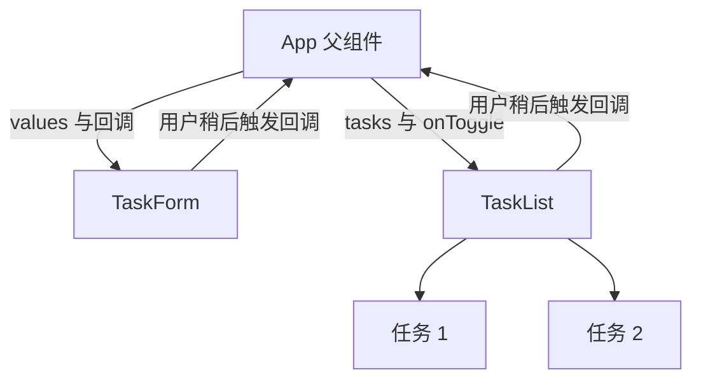

# 第 16 章：React 组件与 JSX——把页面拆成能组合的积木

> 本章只学习“如何描述界面”。表单暂时不会真的保存，按钮也暂时不会改变任务；这些行为会在第 17 章加入。先把显示和交互分开学，理解会轻松很多。

## 本章目标

完成本章后，你能够：

1. 用自己的话解释 React 组件是什么；
2. 看懂 JSX 中的标签、花括号和 `className`；
3. 通过 props 把数据和回调交给子组件；
4. 用 `map` 把任务数组渲染成列表，并正确设置 `key`；
5. 使用条件渲染显示空状态或错误；
6. 判断一个区域是否值得拆成独立组件。

本章配套文件：

- [`App.tsx`](../labs/react-basics/src/App.tsx)
- [`TaskForm.tsx`](../labs/react-basics/src/components/TaskForm.tsx)
- [`TaskList.tsx`](../labs/react-basics/src/components/TaskList.tsx)

## 开始前需要会什么

你只需要知道：

- 函数可以接收参数并返回结果；
- 对象用键和值保存一组相关数据；
- 数组的 `map` 会把每一项转换成新的结果；
- TypeScript 可以描述对象和函数的类型。

如果这些概念还不熟，可以先复习第 8、9、13 章。你不需要先会传统网页模板，也不需要背 React API。

## 新术语表

| 术语 | 白话解释 |
|---|---|
| React | 用组件构建用户界面的 JavaScript 库 |
| 组件 | 返回一块界面的普通函数，名称通常以大写字母开头 |
| JSX | 让我们在 JavaScript/TypeScript 中用类似 HTML 的写法描述界面 |
| props | 父组件传给子组件的数据和函数 |
| 渲染 | React 根据当前数据计算应该显示什么 |
| 组合 | 一个组件里面使用其他组件 |
| 条件渲染 | 根据条件决定显示哪块界面 |
| `key` | React 用来识别列表项目身份的稳定标记 |
| 回调 | 先交给别人、等某件事发生后再调用的函数 |
| 语义化标签 | 能表达结构意义的标签，如 `main`、`form`、`ul`、`button` |

## 先建立直觉

把应用界面想成一套乐高：

- `App` 是底板，决定整体如何组合；
- `TaskForm` 是“添加任务”积木；
- `TaskList` 是“展示任务”积木；
- 每条任务是列表中的重复结构；
- props 是积木接口上的插口。

组件不是为了把文件拆得越碎越好，而是为了给一块有明确责任、会重复使用、或足够复杂的界面取一个名字。

以下两种写法都能显示标题：

```tsx
function PageTitle() {
  return <h1>今日任务</h1>;
}
```

```tsx
const title = "今日任务";
const element = <h1>{title}</h1>;
```

第一段把界面封装成组件；第二段展示了如何用花括号进入 JavaScript 表达式。

## 图解



箭头的重点是：

1. 数据从父组件向下传；
2. 子组件不能偷偷修改父组件的数据；
3. 子组件通过回调告诉父组件“发生了什么”；
4. 真正的数据修改将在第 17 章由父组件完成。

这叫做**单向数据流**。它让我们能顺着一个方向查问题，而不是猜某个数据被哪里暗中改掉了。

## 跟我一步一步做

### 第一步：认识最小组件

```tsx
function Greeting() {
  return <p>今天也继续学习。</p>;
}
```

它有三个特征：

1. 是函数；
2. 名称 `Greeting` 以大写字母开头；
3. 返回 JSX。

使用组件时像写自定义标签：

```tsx
<Greeting />
```

小写的 `<greeting>` 会被浏览器当成未知 HTML 标签，所以 React 组件必须用大写开头。

### 第二步：理解 JSX 与 HTML 的区别

JSX 看起来像 HTML，但它实际位于 TypeScript 文件中。

```tsx
const taskTitle = "整理阅读错题";

return (
  <section className="task-card">
    <h2>{taskTitle}</h2>
    <button type="button">完成</button>
  </section>
);
```

注意：

- CSS 类写 `className`，不是 `class`；
- JavaScript 表达式放在 `{}` 中；
- 多行 JSX 通常放进圆括号；
- 标签必须闭合，如 `<input />`；
- 一个组件要返回一个共同的根节点，也可以用空标签 `<>...</>` 作为 Fragment。

### 第三步：定义 props 类型

任务列表需要父组件给它任务和切换函数：

```tsx
interface TaskListProps {
  tasks: StudyTask[];
  onToggle: (id: string) => void;
}

function TaskList({ tasks, onToggle }: TaskListProps) {
  // 返回列表界面
}
```

`TaskListProps` 就像组件的使用说明书。编辑器会阻止下面这些错误：

- 忘记传 `tasks`；
- 把字符串传给 `tasks`；
- `onToggle` 不接收任务 ID；
- 使用不存在的 prop 名称。

### 第四步：渲染列表

```tsx
<ul>
  {tasks.map((task) => (
    <li key={task.id}>
      <strong>{task.title}</strong>
      <span>{task.subject}</span>
    </li>
  ))}
</ul>
```

`map` 不会修改原数组。它把每个 `task` 转换成一个 `<li>`。

为什么 `key` 使用 `task.id`？因为 ID 表示任务的身份，即使标题改变或排序改变，它仍然是同一个任务。不要随手用数组位置作为会变化列表的 key，否则 React 可能把输入状态或动画对应到错误项目。

### 第五步：通过回调上报事件

```tsx
<button type="button" onClick={() => onToggle(task.id)}>
  {task.completed ? "恢复" : "完成"}
</button>
```

这里不是立刻执行 `onToggle`，而是创建一个函数，点击后才执行。

错误写法：

```tsx
<button onClick={onToggle(task.id)}>完成</button>
```

它会在渲染时立即调用函数，而且 `onClick` 得到的不是函数。

### 第六步：加入条件渲染

```tsx
if (tasks.length === 0) {
  return <p>当前筛选条件下没有任务。</p>;
}
```

也可以在 JSX 内使用三元表达式：

```tsx
{task.completed ? "恢复" : "完成"}
```

或者用逻辑与运算显示可选内容：

```tsx
{error ? <p role="alert">{error}</p> : null}
```

当两个分支都重要时，三元表达式通常比层层 `&&` 更清楚。

## 完整示例

下面是本章任务列表的核心版本：

```tsx
import type { StudyTask } from "../domain/task";

interface TaskListProps {
  tasks: StudyTask[];
  onToggle: (id: string) => void;
}

export function TaskList({ tasks, onToggle }: TaskListProps) {
  if (tasks.length === 0) {
    return <p className="empty-state">当前筛选条件下没有任务。</p>;
  }

  return (
    <ul className="task-list" aria-label="学习任务">
      {tasks.map((task) => (
        <li key={task.id} className="task-item">
          <div>
            <strong className={task.completed ? "is-completed" : undefined}>
              {task.title}
            </strong>
            <span>{task.subject}</span>
          </div>
          <button type="button" onClick={() => onToggle(task.id)}>
            {task.completed ? "恢复" : "完成"}
          </button>
        </li>
      ))}
    </ul>
  );
}
```

完整可运行代码请直接打开本章开头列出的实验文件。教程中的代码片段用于聚焦一个概念，实验文件才是当前阶段的完整结果。

## 逐段解释

`import type` 表示只导入类型。打包后的浏览器代码不需要 `StudyTask` 接口。

`interface TaskListProps` 限定了组件入口。组件内部只依赖它承诺得到的内容。

`if (tasks.length === 0)` 是提前返回。空列表不必继续执行下面的列表渲染。

`aria-label="学习任务"` 给辅助技术一个明确名称。可访问性不是最后再补的装饰，而是组件接口的一部分。

`key={task.id}` 只帮助 React 对齐列表项目，不会作为普通 prop 自动传给子组件。

`className={条件 ? 名称 : undefined}` 根据状态决定是否添加样式类。这里的删除线只是显示结果，数据仍然来自 `task.completed`。

`type="button"` 防止按钮放进表单后意外提交表单。这是很小但很实用的习惯。

## 运行并观察

在项目根目录 `D:\Projects\study-space` 运行：

```powershell
npm exec vite -- docs/tutorial/labs/react-basics --config docs/tutorial/labs/react-basics/vite.config.ts --port 4175
```

浏览器打开终端显示的地址。你应看到：

- 页面标题“React 学习任务实验室”；
- 一个任务名称输入框；
- 一个科目选择框；
- “添加任务”按钮；
- 两条示例任务，其中一条带完成样式；
- 每条任务右侧有按钮。

本章按钮没有反应是预期结果，因为父组件传入的是空回调。下一章才加入 state，让界面真的改变。

再运行类型检查：

```powershell
npm exec tsc -- -p docs/tutorial/labs/react-basics/tsconfig.json
```

没有输出且命令成功，表示组件、props 和 JSX 类型正确。

## 常见错误与修复

### 错误 1：组件名称小写

现象：组件没有按预期渲染，或类型检查提示未知标签。

修复：把 `taskList` 改成 `TaskList`，使用 `<TaskList />`。

### 错误 2：返回相邻的多个根节点

修复：用一个语义化容器包住，或使用 Fragment：

```tsx
<>
  <h2>标题</h2>
  <p>说明</p>
</>
```

### 错误 3：使用 `class`

修复：JSX 中写 `className`。

### 错误 4：列表缺少稳定 key

修复：使用数据库或模型中的稳定 ID，不要用随机数，也不要在每次渲染时生成新 ID。

### 错误 5：事件渲染时就执行

修复：需要传参时写 `onClick={() => onToggle(task.id)}`。

### 错误 6：把对象直接显示出来

`<p>{task}</p>` 不是有效的 React 文本，也不能让用户理解数据。明确选择 `task.title`、`task.subject` 等字段。错误信息也要先缩小为字符串，避免出现 `[object Object]`。

### 错误 7：拆得过细

如果一个组件只有一行、不会复用、没有自己的含义，而且拆出后阅读更困难，就先不要拆。组件边界服务于理解与变化，而不是追求文件数量。

## 在“学习空间”项目里找到它

真实应用的入口组合位于 [`src/app/App.tsx`](../../../src/app/App.tsx)。你会看到路由、Provider 和应用级组件被组合在一起。

页面与组件主要位于：

- `src/pages`：路由对应的完整页面；
- `src/components`：可复用或有明确职责的界面块；
- `src/app`：应用外壳、路由和全局装配。

阅读真实代码时按这个顺序：

1. 找页面导出的组件函数；
2. 看它接收哪些 props；
3. 看它组合了哪些子组件；
4. 再进入其中一个子组件；
5. 暂时跳过不认识的 Hook 和服务，后续章节会解释。

本章不要改真实应用。实验室就是安全练习场。

## 必做练习

1. 在 `sampleTasks` 中增加一条“背诵核心考点”的政治任务。
2. 给 `TaskList` 增加 `heading` prop，并在列表前显示它。
3. 当任务完成时，在标题后显示“已完成”文本，而不只依赖删除线。
4. 暂时把任务数组改成 `[]`，确认空状态出现，再恢复原数据。
5. 用键盘 Tab 键依次移动到输入框、下拉框和按钮，观察焦点是否可见。

## 选做挑战

创建一个 `TaskSummary` 组件，接收：

```ts
interface TaskSummaryProps {
  total: number;
  completed: number;
}
```

让它显示“已完成 1 / 3”。不要把完整任务数组传进去，因为这个组件只需要两个数字。

思考：传得越少为什么越容易复用和测试？

## 答案与思路

练习 1 的新增对象可以是：

```ts
{
  id: "task-3",
  title: "背诵核心考点",
  subject: "政治",
  completed: false,
}
```

练习 2：

```tsx
interface TaskListProps {
  heading: string;
  tasks: StudyTask[];
  onToggle: (id: string) => void;
}

// 返回的共同根节点中
<h3>{heading}</h3>
```

练习 3：

```tsx
<strong>
  {task.title}
  {task.completed ? "（已完成）" : null}
</strong>
```

挑战题：父组件先计算数字，再传给摘要组件。这样摘要组件不知道任务对象长什么样，也不会承担统计责任。

## 本章自检

不看上文，尝试回答：

- [ ] React 组件和普通函数有什么共同点？
- [ ] JSX 中为什么写 `className`？
- [ ] props 的数据从哪个方向流动？
- [ ] 为什么列表的 key 应该使用稳定 ID？
- [ ] `onClick={fn()}` 与 `onClick={() => fn()}` 有什么区别？
- [ ] 什么情况下应该拆组件，什么情况下不必拆？
- [ ] 为什么真实按钮要使用 `button`，而不是可点击的 `div`？

有两项答不上来时，重新完成“跟我一步一步做”，不要靠背答案继续赶进度。

## 本章小结

React 组件是“输入 props，输出界面”的函数。JSX 让界面结构与生成它的数据放在一起；props 建立清楚的父子接口；单向数据流让变化可追踪；稳定 key 帮助 React 正确识别列表项目。

这一章的实验页面已经具备结构，但还没有记忆能力。输入框不变化、按钮不生效并不是失败，而是我们有意把“显示”与“状态”分开学习。

## 下一章

进入[第 17 章：React 状态与事件](17-React状态与事件.md)。你会加入 `useState`、受控表单、提交事件和不可变更新，让这套静态组件真正能够添加、完成和筛选任务。
