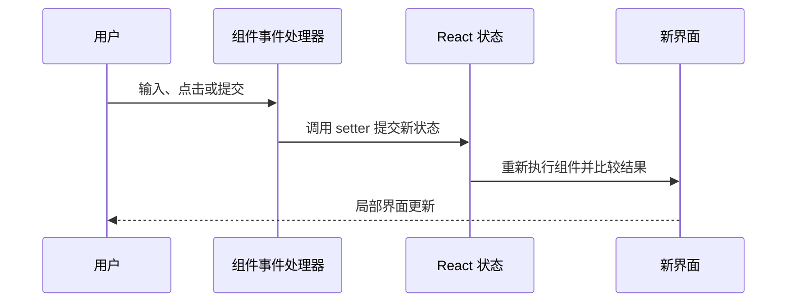

# 第 17 章：React 状态与事件——让静态界面真正工作

> 上一章的组件能显示数据，但不会记住用户操作。本章加入状态、事件与受控表单，让任务可以添加、完成、恢复和筛选。

## 本章目标

学完后，你能够：

1. 区分普通变量、props 和 state；
2. 用 `useState` 保存组件需要记住的数据；
3. 看懂 React 的“状态快照”；
4. 正确处理输入、提交和点击事件；
5. 使用函数式、不可变更新；
6. 把共享状态提升到共同父组件；
7. 为筛选按钮和错误提示加入可访问状态。

## 开始前需要会什么

请先完成第 16 章，并确认你理解：组件、props、回调、列表 `key` 和单向数据流。不了解 Hook 没关系，本章从第一个 Hook 开始。

## 新术语表

| 术语 | 白话解释 |
|---|---|
| state | 组件要记住、变化后会重新渲染的数据 |
| Hook | 让函数组件使用 React 能力的函数，名称以 `use` 开头 |
| `useState` | 创建一份状态和对应更新函数的 Hook |
| 状态快照 | 每次渲染看到的是当次固定的一份状态 |
| 重新渲染 | 状态更新后，React 再执行组件函数计算新界面 |
| 受控输入 | 输入框的值由 React state 决定 |
| 不可变更新 | 创建新数组或对象，而不是改坏旧值 |
| 提升状态 | 把多个组件共享的数据放到共同父组件 |
| 函数式更新 | 把“如何根据旧值产生新值”的函数交给 setter |

## 先建立直觉

普通变量像写在白板上的临时字：组件函数再次执行时，它会重新初始化。state 像 React 管理的储物柜：每次渲染都能取到当前保存值。

```tsx
let count = 0; // 修改它不会通知 React 更新界面

const [count, setCount] = useState(0); // 更新后 React 会重新渲染
```

`useState` 返回两项：当前值和更新函数。不要直接给状态赋值，也不要直接修改状态中的数组和对象。

## 图解



React 的核心循环可以记成：

```text
状态 → 渲染 → 用户事件 → 更新状态 → 再渲染
```

## 跟我一步一步做

### 第一步：创建任务状态

```tsx
const [tasks, setTasks] = useState<StudyTask[]>(sampleTasks);
```

- `tasks` 是本次渲染看到的数组；
- `setTasks` 用来提交下一份数组；
- `<StudyTask[]>` 明确数组元素类型；
- `sampleTasks` 只作为初始值使用。

不要写：

```tsx
tasks.push(newTask);
```

这会修改旧数组，而且没有调用 setter。正确做法：

```tsx
setTasks((current) => [...current, newTask]);
```

### 第二步：创建表单状态

```tsx
const [form, setForm] = useState<TaskFormValues>({
  title: "",
  subject: "英语",
});
```

更新一个字段时保留其他字段：

```tsx
onTitleChange={(title) =>
  setForm((current) => ({ ...current, title }))
}
```

`...current` 先复制旧对象，后面的 `title` 覆盖同名属性。这是不可变对象更新。

### 第三步：理解受控输入

```tsx
<input
  value={values.title}
  onChange={(event) => onTitleChange(event.currentTarget.value)}
/>
```

用户输入后，浏览器触发 `onChange`；回调更新父组件 state；父组件重新渲染，把新 `value` 传回来。这个闭环叫受控输入。

如果给了 `value` 却没有 `onChange`，输入框会像只读一样无法输入。

### 第四步：处理表单提交

```tsx
<form
  onSubmit={(event) => {
    event.preventDefault();
    onSubmit();
  }}
>
```

使用真正的 `<form>` 可以让回车提交。`preventDefault()` 阻止浏览器整页刷新，但不要阻止 React 自己的状态更新。

父组件验证标题：

```tsx
if (!form.title.trim()) {
  setError("请输入任务名称");
  return;
}
```

只有成功后才清空表单，避免失败时丢掉用户已经填写的内容。

### 第五步：切换任务状态

```tsx
onToggle={(id) =>
  setTasks((current) => toggleTask(current, id))
}
```

这里复用了第 13 章测试过的纯函数。组件只负责响应事件，数据转换由领域函数负责。

### 第六步：加入筛选状态

```tsx
const [filter, setFilter] = useState<TaskFilter>("all");

<button
  type="button"
  aria-pressed={filter === "pending"}
  onClick={() => setFilter("pending")}
>
  待完成
</button>
```

`aria-pressed` 不只是样式钩子，也把按钮当前是否选中告诉屏幕阅读器。

筛选后的列表不需要单独保存为 state：

```tsx
const visibleTasks = filterTasks(tasks, filter);
```

能从现有 state 直接算出的值通常不要再存一份，否则两份数据可能不同步。

## 完整示例

核心状态和提交逻辑如下，完整代码见 [`App.tsx`](../labs/react-basics/src/App.tsx)：

```tsx
export function App() {
  const [tasks, setTasks] = useState<StudyTask[]>(sampleTasks);
  const [form, setForm] = useState<TaskFormValues>(initialForm);
  const [filter, setFilter] = useState<TaskFilter>("all");
  const [error, setError] = useState("");

  const handleSubmit = () => {
    if (!form.title.trim()) {
      setError("请输入任务名称");
      return;
    }

    const task = createTask(crypto.randomUUID(), form.title, form.subject);
    setTasks((current) => [...current, task]);
    setForm(initialForm);
    setError("");
  };

  return (
    <TaskForm
      values={form}
      onTitleChange={(title) => setForm((old) => ({ ...old, title }))}
      onSubjectChange={(subject) => setForm((old) => ({ ...old, subject }))}
      onSubmit={handleSubmit}
      error={error}
    />
  );
}
```

## 逐段解释

为什么 setter 接收函数？连续更新或异步更新时，闭包中的 `tasks` 可能是旧快照；`current` 由 React 提供，代表计算这次更新时的最新状态。

为什么表单值放在父组件？`TaskForm` 负责采集，`TaskList` 负责展示，两者都和任务数据有关。把状态放在共同父组件 `App` 后，父组件可以协调两边。

为什么错误也是 state？错误要显示在界面中，并且在成功后消失，因此它也是会影响渲染的数据。

为什么不把完成数量存起来？它可以从 `tasks` 计算：

```tsx
tasks.filter((task) => task.completed).length
```

只保留最少必要 state，程序更不容易不一致。

## 运行并观察

从项目根目录运行：

```powershell
npm exec vite -- docs/tutorial/labs/react-basics --config docs/tutorial/labs/react-basics/vite.config.ts --port 4175
```

依次验证：

1. 输入标题，字符会立即出现在输入框；
2. 切换科目并添加，列表出现新任务；
3. 成功添加后表单被清空；
4. 空标题提交出现“请输入任务名称”；
5. 点击“完成”，任务样式和按钮文字改变；
6. “待完成”“已完成”筛选正确；
7. 页面没有整页刷新。

自动测试命令：

```powershell
npm run test:run -- docs/tutorial/labs/react-basics/src/App.test.tsx
```

## 常见错误与修复

### 修改原数组

错误：`tasks[0].completed = true`。修复：使用 `map` 和对象展开创建新值。

### 读取 setter 后立刻期待变量改变

```tsx
setFilter("pending");
console.log(filter); // 仍是本次渲染的旧快照
```

状态更新会安排下一次渲染，不会改写当前函数手里的快照。

### 事件函数写成调用结果

错误：`onClick={setFilter("pending")}`。修复：`onClick={() => setFilter("pending")}`。

### 输入框不允许输入

检查 `value` 对应的 state 是否真的在 `onChange` 中更新。

### 表单一提交就刷新

在 `onSubmit` 中调用 `event.preventDefault()`，同时确认按钮位于表单内且类型是 `submit`。

### 随机 ID 在渲染中生成

不要在 `map` 或 JSX 中每次生成 ID。只在创建数据的事件发生时生成一次。

## 在“学习空间”项目里找到它

真实应用中，页面状态与事件处理分布在 `src/pages` 和专用 Hook 中。阅读时寻找：

- `useState(`：页面自己保存的临时状态；
- `value=` 与 `onChange=`：受控表单；
- `onClick=`、`onSubmit=`：用户事件入口；
- `set...((current) => ...)`：函数式更新；
- 服务调用：需要持久保存的数据不会只停留在 state。

真实项目比实验复杂，因为任务要跨重启保存，下一章会加入异步服务和 `useEffect`。现在不要把实验代码直接复制进生产页面。

## 必做练习

1. 增加一个“其他”科目的新任务并验证显示。
2. 添加两个任务后连续完成它们，确认计数正确。
3. 在“已完成”筛选中恢复一条任务，解释它为何立即消失。
4. 修改验证规则，让标题少于 2 个字符时提示“任务名称太短”。
5. 给错误提示增加 `aria-live`，再说明 `role="alert"` 已经提供了什么能力。

## 选做挑战

增加“清除已完成”按钮。要求：

- 不直接修改原数组；
- 没有已完成任务时禁用；
- 点击后只保留未完成任务；
- 写一个自动测试。

## 答案与思路

短标题验证：

```tsx
const title = form.title.trim();
if (!title) {
  setError("请输入任务名称");
  return;
}
if (title.length < 2) {
  setError("任务名称太短");
  return;
}
```

清除已完成：

```tsx
const completedCount = tasks.filter((task) => task.completed).length;

<button
  type="button"
  disabled={completedCount === 0}
  onClick={() => setTasks((current) => current.filter((task) => !task.completed))}
>
  清除已完成
</button>
```

恢复任务后，它不再满足 `completed` 筛选条件，所以重新渲染时不会出现在当前列表；数据没有被删除。

## 本章自检

- [ ] 能说明 state 为什么不是普通变量；
- [ ] 能写出一条 `useState`；
- [ ] 能解释状态快照；
- [ ] 能用对象和数组展开进行不可变更新；
- [ ] 能解释受控输入的数据闭环；
- [ ] 能正确阻止表单整页刷新；
- [ ] 能说明为何派生值通常不单独保存为 state；
- [ ] 能给切换按钮提供 `aria-pressed`。

## 本章小结

state 是 React 记住变化的方式，事件是变化的入口。每次渲染读取一份状态快照，setter 提交下一份状态，React 再计算界面。受控输入、不变更新、函数式 setter 和状态提升共同建立了可预测的交互模型。

目前数据只存在内存中，刷新页面就会恢复初始值。真正的应用还要从服务加载、处理等待和失败，并避免旧请求覆盖新结果。

## 下一章

进入[第 18 章：Effect 与数据加载](18-effect与数据加载.md)。我们会先用测试描述加载、失败、重试和防重复提交，再把异步逻辑收进 `useTasks` Hook。
