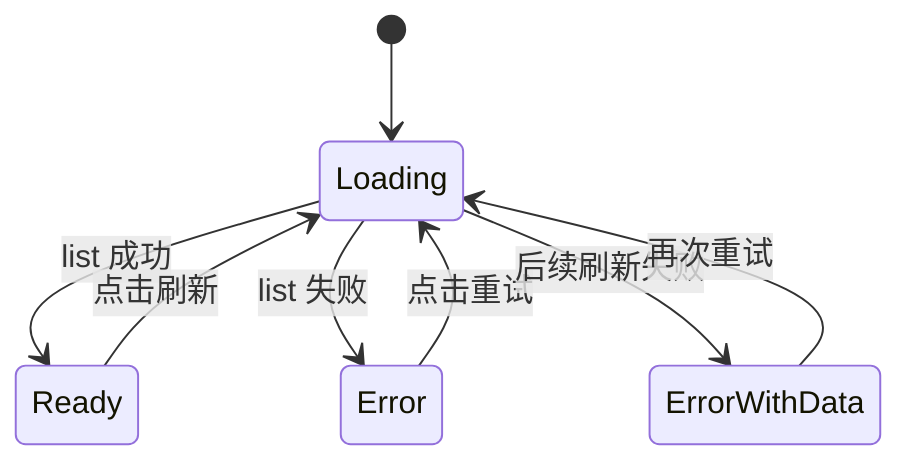

# 第 18 章：Effect 与数据加载——处理等待、失败和过期结果

> 真正的应用不能假设数据立刻到达、永不失败。本章把异步任务逻辑移入 `useTasks`，并让界面对加载、成功、失败和重试都有清楚反应。

## 本章目标

学完后，你能够：

1. 解释“渲染必须保持纯粹”的含义；
2. 知道什么是副作用，何时使用 `useEffect`；
3. 看懂依赖数组和清理函数；
4. 为加载、空数据、成功和失败设计不同界面；
5. 把异步流程封装成自定义 Hook；
6. 使用 `unknown` 安全转换错误；
7. 防止重复提交和过期请求覆盖新结果；
8. 理解开发环境 Strict Mode 为什么可能多执行一次 Effect。

## 开始前需要会什么

你需要完成第 17 章，理解 state、事件、受控表单和函数式更新。`Promise` 的基础在第 9、14 章已经介绍；忘记时只需记住：异步函数会在未来成功返回或失败抛错。

## 新术语表

| 术语 | 白话解释 |
|---|---|
| 副作用 | 渲染计算之外与外部世界同步的行为，如请求数据、计时器、订阅 |
| `useEffect` | React 提交界面后运行副作用的 Hook |
| 依赖数组 | Effect 使用的外部值清单，值变化时重新同步 |
| 清理函数 | 下次 Effect 或卸载前撤销旧同步工作的函数 |
| 自定义 Hook | 用 `use` 开头、组合其他 Hook 的复用逻辑函数 |
| 竞态 | 多个异步任务完成顺序不同，旧结果覆盖新结果 |
| UI 状态 | 用户此刻能看到的加载、空、成功、失败等阶段 |
| Strict Mode | 开发环境额外检查不安全副作用的 React 模式 |

## 先建立直觉

渲染像照相：给组件同一份 props 和 state，就应该得到同一张界面照片。不要在拍照过程中请求数据、改数据库或启动计时器。

Effect 像拍完照片后执行的同步工作：

```tsx
useEffect(() => {
  // 与外部系统同步
  return () => {
    // 撤销上一次同步
  };
}, [依赖]);
```

点击“添加任务”是明确的用户事件，服务调用应直接放在事件流程里；页面出现后自动加载数据，才是典型 Effect。

## 图解



失败不等于必须清空旧数据。首次加载失败没有数据可显示；后续刷新失败时，旧数据仍然有价值，所以保留它并同时提示错误。

## 跟我一步一步做

### 第一步：用联合类型描述阶段

```ts
type TasksStatus =
  | { kind: "loading" }
  | { kind: "ready" }
  | { kind: "error"; message: string };
```

`kind` 是辨别字段。只有错误分支有 `message`，TypeScript 会在判断后自动缩小类型。

### 第二步：建立自定义 Hook

```tsx
export function useTasks(service: TaskService) {
  const [tasks, setTasks] = useState<StudyTask[]>([]);
  const [status, setStatus] = useState<TasksStatus>({ kind: "loading" });
  // 返回页面需要的数据和操作
}
```

Hook 不渲染 JSX。它负责状态与流程，页面负责把状态翻译成界面。

### 第三步：写可重用的 reload

```tsx
const reload = useCallback(async () => {
  setStatus({ kind: "loading" });
  try {
    const loaded = await service.list();
    setTasks(loaded);
    setStatus({ kind: "ready" });
  } catch (error: unknown) {
    setStatus({ kind: "error", message: errorMessage(error) });
  }
}, [service]);
```

依赖中有 `service`，因为函数使用了它。`useCallback` 保持函数身份稳定，避免依赖它的 Effect 每次渲染都重跑。

### 第四步：页面出现时加载

```tsx
useEffect(() => {
  void reload();
}, [reload]);
```

`void` 表明我们有意不在 Effect 回调中等待 Promise。Effect 本身不能直接写成 `async`，因为 Effect 返回值必须是清理函数或 `undefined`，不能是 Promise。

### 第五步：忽略过期结果

实验用递增版本号：

```tsx
const requestVersion = useRef(0);

const version = ++requestVersion.current;
const loaded = await service.list();
if (version !== requestVersion.current) return;
```

清理时增加版本号：

```tsx
return () => {
  requestVersion.current += 1;
};
```

这样旧请求完成后发现版本已经过期，就不会写入 state。真实 HTTP 请求还可以结合 `AbortController` 取消网络工作。

### 第六步：安全显示错误

```ts
function errorMessage(error: unknown): string {
  return error instanceof Error ? error.message : "发生未知错误";
}
```

不要写 `String(error)` 后直接显示，也不要把对象放进 JSX，否则可能出现 `[object Object]`，甚至泄露不该显示的内部信息。

### 第七步：防止重复保存

```tsx
if (isSaving) return false;
setIsSaving(true);
try {
  const created = await service.create(input);
  setTasks((current) => [...current, created]);
  return true;
} finally {
  setIsSaving(false);
}
```

界面同时禁用输入与按钮，并显示“正在保存…”。用户能理解当前状态，也不容易连续产生重复任务。

## 完整示例

完整 Hook 在 [`useTasks.ts`](../labs/react-basics/src/hooks/useTasks.ts)，关键返回值是：

```tsx
return {
  tasks,
  status,
  isSaving,
  reload,
  create,
  toggle,
};
```

页面使用它：

```tsx
const { tasks, status, isSaving, reload, create, toggle } = useTasks(service);

{status.kind === "loading" && tasks.length === 0
  ? <p role="status">正在加载任务…</p>
  : null}

{status.kind === "error"
  ? (
      <div role="alert">
        <p>{status.message}</p>
        <button onClick={() => void reload()}>重新加载</button>
      </div>
    )
  : null}
```

完整行为测试见 [`TasksPage.test.tsx`](../labs/react-basics/src/test/TasksPage.test.tsx)。

## 逐段解释

`useRef` 保存跨渲染数据，但修改它不会触发渲染，因此适合请求版本这类“逻辑记忆”。

`try/catch/finally` 分别负责正常流程、失败流程和无论成败都要恢复的保存状态。

创建函数返回 `boolean`，页面只有在成功时才清空表单。服务失败时，用户输入会被保留。

后续刷新失败没有调用 `setTasks([])`，因此旧任务继续可用。错误提示与已有内容可以同时存在。

## 运行并观察

运行实验：

```powershell
npm exec vite -- docs/tutorial/labs/react-basics --config docs/tutorial/labs/react-basics/vite.config.ts --port 4175
```

刷新页面时先短暂出现加载状态，随后任务出现。保存期间控件会禁用。点击“刷新任务”会重新调用服务。

运行自动测试：

```powershell
npm run test:run -- docs/tutorial/labs/react-basics/src/test/TasksPage.test.tsx
```

测试覆盖：加载后成功、失败后重试、刷新失败保留数据、防重复提交。

## 常见错误与修复

### 在组件函数顶层直接请求

每次渲染都会再请求并更新 state，造成循环。把“出现后同步”放进 Effect，把“点击后执行”放进事件。

### Effect 使用了值却遗漏依赖

不要通过关闭规则掩盖警告。先问：这个 Effect 真的是同步外部系统吗？用到的变化值应进入依赖，函数可用 `useCallback` 稳定。

### 把 Effect 写成 async

在 Effect 内定义异步函数并调用，或调用已定义的 `reload`；Effect 回调本身保持同步。

### 失败时清空一切

首次加载失败与刷新失败不同。已有数据通常应保留，除非业务明确要求它已失效。

### Strict Mode 下看到两次请求

开发环境会执行额外的挂载、清理、再挂载检查。让 Effect 可以清理、让服务操作具备正确语义，而不是删除 Strict Mode。

### 显示 `[object Object]`

错误先保持 `unknown`，再转换为用户能理解的字符串。不要直接渲染后端原始对象。

## 在“学习空间”项目里找到它

真实应用中可以查找：

- `useEffect(`：页面与外部状态同步的位置；
- `src/services`：浏览器或 Tauri 服务接口与实现；
- 页面中的 `loading`、`error`、`retry`：异步 UI 状态；
- `src/app/App.tsx`：服务和 Provider 如何从应用边界进入页面。

真实项目可能使用更完整的服务层、缓存或 Tauri 命令，但思路相同：组件不要假定数据立刻成功，也不要把原始错误对象扔给用户。

## 必做练习

1. 把内存服务延迟从 300ms 改为 1000ms，观察加载状态，再恢复。
2. 临时让 `list()` 抛出 `new Error("练习错误")`，验证重试界面。
3. 解释为什么刷新失败后任务仍在。
4. 给“刷新任务”按钮增加加载期间禁用状态。
5. 阅读异步测试中的 `deferred`，说明它如何让测试控制 Promise 完成时间。

## 选做挑战

给 `toggle` 增加独立的 `updatingIds` 状态：正在切换的任务按钮单独禁用，其他任务仍可操作。不要用一个全局布尔值锁住整个列表。

## 答案与思路

刷新按钮可以写成：

```tsx
<button
  type="button"
  disabled={status.kind === "loading"}
  onClick={() => void reload()}
>
  {status.kind === "loading" ? "刷新中…" : "刷新任务"}
</button>
```

`deferred` 暂时保存 Promise 的 `resolve` 与 `reject`。测试先断言加载界面，再主动完成 Promise，因此不会依赖不稳定的真实等待时间。

## 本章自检

- [ ] 能举出三个副作用例子；
- [ ] 能说明为什么渲染中不能直接请求数据；
- [ ] 能解释 Effect 依赖与清理；
- [ ] 能区分首次失败和刷新失败；
- [ ] 能把 `unknown` 错误安全变成文本；
- [ ] 能解释竞态与过期结果；
- [ ] 能说明 Strict Mode 双执行的目的；
- [ ] 能写出加载、错误和重试界面。

## 本章小结

Effect 用于组件与外部系统的同步，不是所有逻辑的收纳箱。自定义 Hook 把任务加载和写入流程集中管理，页面则清楚展示每一种用户可见状态。可靠界面不仅处理成功，也认真处理等待、失败、重试、重复操作和过期结果。

## 下一章

进入[第 19 章：React Router 与应用外壳](19-React-Router与应用外壳.md)。我们会把任务和学习笔记分成不同地址，建立稳定导航与独立滚动的应用结构。
