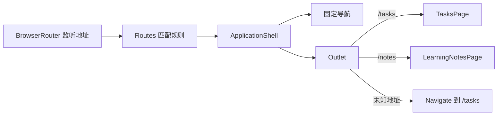

# 第 19 章：React Router 与应用外壳——让页面拥有地址

> 当应用不止一个页面时，“现在在哪”“后退去哪里”“刷新后显示什么”都应由 URL 表达。本章建立任务页、笔记页和稳定应用外壳。

## 本章目标

学完后，你能够：

1. 区分 URL、路径、路由和导航；
2. 使用 `BrowserRouter`、`Routes`、`Route` 和 `Navigate`；
3. 使用 `NavLink` 表示当前页面；
4. 用嵌套路由与 `Outlet` 复用应用外壳；
5. 建立固定导航、主内容独立滚动的桌面布局；
6. 在窄屏改成顶部导航，避免横向溢出；
7. 用 `MemoryRouter` 测试路由页面。

## 开始前需要会什么

请先理解组件组合、props 和异步页面状态。你不需要了解服务器路由；本章处理的是浏览器内部页面切换。

## 新术语表

| 术语 | 白话解释 |
|---|---|
| URL | 浏览器地址栏中的完整地址 |
| path | URL 中标识页面的路径，如 `/tasks` |
| route | “某个路径应该显示哪个组件”的规则 |
| router | 读取地址、匹配路由并管理历史记录的工具 |
| navigation | 从一个地址前往另一个地址 |
| history | 浏览器记录的前进、后退页面栈 |
| 嵌套路由 | 父路由提供共同外壳，子路由填入内容 |
| `Outlet` | 子路由内容在父布局中的插槽 |
| `NavLink` | 能根据当前地址标记活动状态的链接 |
| 应用外壳 | 多个页面共同使用的品牌、导航和内容框架 |

## 先建立直觉

把应用想成学校：

- 应用外壳是教学楼；
- 导航是楼层指示牌；
- URL 是教室门牌；
- 页面组件是教室里的内容；
- `Outlet` 是教学楼预留给不同教室的空间。

如果只用 state 切换页面，地址栏不会变化，刷新、收藏、后退和直接打开都变得困难。路由让页面状态进入浏览器已经熟悉的地址系统。

## 图解



## 跟我一步一步做

### 第一步：在根部提供 Router

[`main.tsx`](../labs/react-basics/src/main.tsx) 中：

```tsx
<StrictMode>
  <BrowserRouter>
    <App />
  </BrowserRouter>
</StrictMode>
```

Router 要包住所有需要读取或修改路由的组件。不要在每个页面各建一个 Router。

本项目安装的是 `react-router` 8，因此从它导入。网上旧教程常写 `react-router-dom`，不要不看项目版本就照抄。

### 第二步：建立共同外壳

```tsx
function ApplicationShell() {
  return (
    <div className="app-shell">
      <aside className="sidebar">
        <nav aria-label="实验导航">
          <NavLink to="/tasks">任务</NavLink>
          <NavLink to="/notes">笔记</NavLink>
        </nav>
      </aside>
      <div className="main-scroll">
        <Outlet />
      </div>
    </div>
  );
}
```

`NavLink` 最终仍是链接，所以支持键盘、地址预览和浏览器历史。不要用普通 `div` 模拟导航。

### 第三步：声明嵌套路由

```tsx
<Routes>
  <Route element={<ApplicationShell />}>
    <Route index element={<Navigate to="/tasks" replace />} />
    <Route path="/tasks" element={<TasksPage service={service} />} />
    <Route path="/notes" element={<LearningNotesPage />} />
    <Route path="*" element={<Navigate to="/tasks" replace />} />
  </Route>
</Routes>
```

- `index` 匹配应用根地址；
- `replace` 替换本次历史记录，后退时不会在重定向之间绕圈；
- `*` 捕获未知地址；
- 子页面出现在父路由的 `Outlet` 中。

### 第四步：拆出页面组件

任务交互迁移到 [`TasksPage.tsx`](../labs/react-basics/src/pages/TasksPage.tsx)，笔记内容放在 [`LearningNotesPage.tsx`](../labs/react-basics/src/pages/LearningNotesPage.tsx)。

页面组件负责一整条路由的内容；按钮、表单和列表仍由更小组件负责。

### 第五步：实现独立滚动

```css
#root {
  height: 100vh;
  overflow: hidden;
}

.app-shell {
  display: grid;
  grid-template-columns: 14rem minmax(0, 1fr);
  height: 100vh;
}

.sidebar { overflow-y: auto; }
.main-scroll { min-width: 0; min-height: 0; overflow-y: auto; }
```

`minmax(0, 1fr)` 和 `min-width: 0` 很重要：它们允许右侧列收缩，避免内部长内容把整个页面撑出横向滚动。

### 第六步：处理窄屏

```css
@media (max-width: 480px) {
  #root { height: auto; overflow: visible; }
  .app-shell { display: block; height: auto; }
  .sidebar {
    position: sticky;
    top: 0;
    flex-direction: row;
  }
}
```

手机或窄窗口不强塞侧栏，而是变成顶部导航。平板宽度通常仍保留侧栏，主内容独立滚动。

## 完整示例

路由入口的完整骨架：

```tsx
export function App({ service = defaultService }: AppProps) {
  return (
    <Routes>
      <Route element={<ApplicationShell />}>
        <Route index element={<Navigate to="/tasks" replace />} />
        <Route path="/tasks" element={<TasksPage service={service} />} />
        <Route path="/notes" element={<LearningNotesPage />} />
        <Route path="*" element={<Navigate to="/tasks" replace />} />
      </Route>
    </Routes>
  );
}
```

配套文件是 [`App.tsx`](../labs/react-basics/src/App.tsx) 和 [`app.css`](../labs/react-basics/src/app.css)。

## 逐段解释

`Routes` 从其子规则中选择匹配项；`Route` 只是配置，不会生成可见 DOM。

无 `path` 的父 `Route` 用来提供布局。子路由变化时，侧栏不需要重复写，只有 `Outlet` 内容更换。

`NavLink` 会在当前路径匹配时得到 `active` 类，CSS 用它显示当前页。视觉高亮与语义导航来自同一个地址事实。

`BrowserRouter` 使用真实浏览器历史；测试没有真实地址栏，所以用 `MemoryRouter` 并提供 `initialEntries`。

## 运行并观察

运行实验后验证：

1. 根地址自动进入 `/tasks`；
2. 点击“笔记”，地址变成 `/notes`；
3. 当前导航项高亮；
4. 浏览器后退回到任务页；
5. 直接输入 `/notes` 能打开笔记；
6. 未知地址会回到任务页；
7. 桌面端只滚动右侧内容；
8. 390px 宽度没有整个页面的横向滚动。

运行测试与类型检查：

```powershell
npm run test:run -- docs/tutorial/labs/react-basics/src
npm exec tsc -- -p docs/tutorial/labs/react-basics/tsconfig.json
```

## 常见错误与修复

### Router 外使用 NavLink

错误通常提示只能在 Router 上下文使用。确认根入口已包裹 `BrowserRouter`，测试包裹 `MemoryRouter`。

### 路径切换但内容不显示

检查父布局是否包含 `<Outlet />`，以及子 `Route` 是否嵌套在父路由内部。

### 用按钮代替链接

去另一个地址应优先使用链接；执行保存、删除等动作才用按钮。

### 导航跟随正文滚走

检查滚动责任：应用根固定视口高度，侧栏和主内容各自管理溢出，不要让 `body` 承担桌面端全部滚动。

### 出现横向滚动

检查网格列是否使用 `minmax(0, 1fr)`，主内容是否有 `min-width: 0`，固定宽元素是否超过容器。

### 刷新子路径在部署后 404

这是服务器回退配置问题：服务器需把未知前端路径返回 `index.html`。Tauri 本地应用和普通网站的部署方式不同，不能只看开发服务器表现。

## 在“学习空间”项目里找到它

真实项目的路由装配在 [`src/app/App.tsx`](../../../src/app/App.tsx)，应用框架可在 `src/layouts` 中查找。对照时重点观察：

- 哪些路径对应哪些页面；
- 哪些页面共享应用外壳；
- 导航如何知道当前页面；
- 服务或 Provider 在路由外还是页面内；
- Android 平板与桌面端如何处理可用宽度和滚动。

实验只是最小模型，不代表真实应用必须使用相同文件名或路由数量。

## 必做练习

1. 在任务页与笔记页之间切换，再使用浏览器前进、后退。
2. 新增 `/about` 页面，显示“这是路由练习”。
3. 为导航加入第三个 `NavLink`。
4. 直接打开一个不存在的路径，观察重定向。
5. 用浏览器响应式模式检查 1024×768 与 390×844。

## 选做挑战

把笔记页改成懒加载：使用 `lazy` 和 `Suspense`，并提供有意义的加载界面。先理解普通路由，再做这项性能优化。

## 答案与思路

新增页面：

```tsx
function AboutPage() {
  return <main className="page-content"><h1>这是路由练习</h1></main>;
}

<Route path="/about" element={<AboutPage />} />
```

导航：

```tsx
<NavLink to="/about">关于</NavLink>
```

如果内容被侧栏遮挡，不要靠给每个页面写不同的左边距补丁；应修正统一外壳的网格结构。

## 本章自检

- [ ] 能区分 URL、路径、路由和导航；
- [ ] 能说明 BrowserRouter 放在哪里；
- [ ] 能解释 Outlet 的作用；
- [ ] 能解释 NavLink 与按钮的区别；
- [ ] 能处理根地址和未知地址；
- [ ] 能说明为什么主内容需要 `min-width: 0`；
- [ ] 能用 MemoryRouter 测试指定地址；
- [ ] 能验证桌面、平板和窄屏滚动结构。

## 本章小结

路由让应用页面拥有可刷新、可收藏、可前进后退的地址。嵌套路由把共同外壳与变化内容分开，`NavLink` 提供真实导航和当前状态，正确的网格与溢出设置则让桌面和平板滚动稳定。

## 下一章

进入[第 20 章：前端架构与服务接口](20-前端架构与服务接口.md)。我们会梳理页面、组件、Hook、领域函数和服务各自的责任，并解释为什么替换数据来源时界面不应重写。
