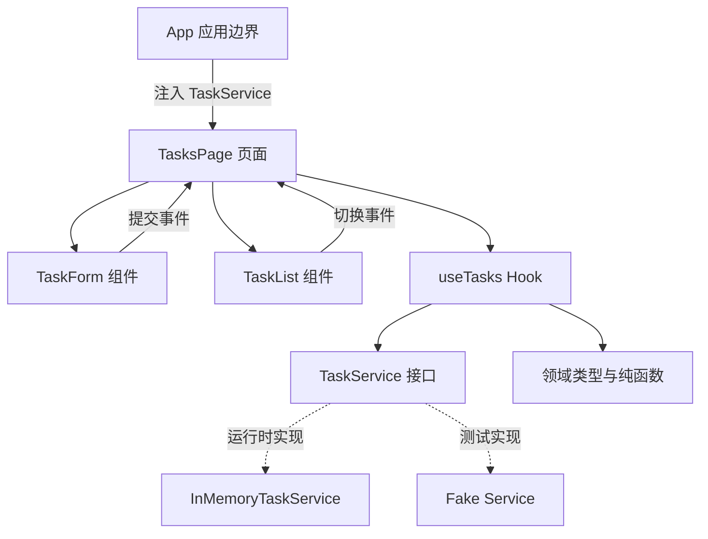

# 第 20 章：前端架构与服务接口——从一次点击看懂整个应用

> 架构不是画得很复杂的图，而是回答“每段代码负责什么、可以依赖谁、替换一层会不会拖垮其他层”。本章用完整任务流程串起前八章。

## 本章目标

学完后，你能够：

1. 区分页面、组件、Hook、领域函数和服务；
2. 解释依赖方向为什么应从界面指向抽象接口；
3. 用 TypeScript `interface` 定义服务契约；
4. 从应用边界注入服务，而不是在组件里创建；
5. 使用内存实现与测试 fake 替换真实数据来源；
6. 追踪一次“点击 → 服务 → 状态 → 渲染”的完整流程；
7. 判断逻辑应该放在哪一层；
8. 把实验结构映射到“学习空间”真实项目。

## 开始前需要会什么

请先完成第 13～19 章。本章不引入大量新语法，而是把类型、组件、状态、Effect、路由和测试组合成一幅完整地图。

## 新术语表

| 术语 | 白话解释 |
|---|---|
| 架构 | 代码如何分工、连接和约束的整体安排 |
| 领域 | 应用真正关心的业务概念，如学习任务、科目、完成状态 |
| 服务接口 | 界面需要的数据能力合同，不关心具体存储方式 |
| 实现 | 真正完成接口承诺的代码 |
| 依赖注入 | 从外部把依赖交给使用者，而不是使用者内部写死 |
| 应用边界 | 程序启动和组装各层的位置 |
| fake | 为测试准备的可控简化实现 |
| 耦合 | 两段代码彼此知道多少、互相牵制多深 |
| 关注点分离 | 不同责任放到不同位置，各自保持清楚 |

## 先建立直觉

把应用想成餐厅：

- 页面是前厅，组织完整用餐体验；
- 组件是桌椅与菜单，负责局部呈现和输入；
- Hook 是服务流程，协调订单状态；
- 领域函数是菜品规则，例如“空标题不能成为任务”；
- 服务接口是前厅与厨房约定的出餐单；
- 服务实现可能是内存、浏览器存储、Tauri 或远程服务器；
- 应用边界决定今天接哪个厨房。

前厅只需相信出餐合同，不应知道厨房用燃气还是电磁炉。

## 图解



依赖箭头的重要规则：页面和 Hook 可以依赖服务接口；它们不应依赖数据库细节或 Tauri 命令格式。

## 跟我一步一步做

### 第一步：从领域模型开始

[`domain/task.ts`](../labs/react-basics/src/domain/task.ts) 定义应用谈论的数据：

```ts
export interface StudyTask {
  id: string;
  title: string;
  subject: StudySubject;
  completed: boolean;
}
```

领域模型不依赖 React，不包含按钮颜色，也不调用数据库。它表达“学习任务是什么”。

### 第二步：定义服务合同

[`services/task-service.ts`](../labs/react-basics/src/services/task-service.ts)：

```ts
export type CreateTaskInput = Pick<StudyTask, "title" | "subject">;

export interface TaskService {
  list(): Promise<StudyTask[]>;
  create(input: CreateTaskInput): Promise<StudyTask>;
  toggle(id: string): Promise<StudyTask>;
}
```

接口说明能力，不说明数据放在哪里。`Promise` 让内存实现和未来的磁盘、Tauri、网络实现使用同一种调用方式。

### 第三步：实现一份内存服务

```ts
export class InMemoryTaskService implements TaskService {
  async list() { /* 返回克隆后的任务 */ }
  async create(input: CreateTaskInput) { /* 创建并保存 */ }
  async toggle(id: string) { /* 找到并切换 */ }
}
```

实验实现故意加入延迟，帮助你观察真实异步 UI。它对输入和输出做复制，避免调用者绕过服务直接修改内部数组。

### 第四步：让 Hook 只依赖接口

```tsx
export function useTasks(service: TaskService) {
  // 调用 service.list/create/toggle
}
```

Hook 不写 `new InMemoryTaskService()`，因此它不知道具体实现。这是降低耦合的关键一步。

### 第五步：从应用边界注入

```tsx
const defaultService = new InMemoryTaskService();

export function App({ service = defaultService }: AppProps) {
  return <TasksPage service={service} />;
}
```

生产实验不传参数，使用默认内存服务；测试传 fake。组件层无需为测试增加特殊分支。

### 第六步：测试替换能力

```tsx
const create = vi.fn(async (input) => ({
  id: "created",
  ...input,
  completed: false,
}));

render(<App service={fakeService({ create })} />);
```

测试能记录 `create` 收到了什么，不需要真的写数据库，也不需要等待网络。这证明接口边界有效。

### 第七步：追踪一次添加任务

1. 用户在 `TaskForm` 输入标题；
2. 输入事件通过回调更新 `TasksPage` 表单 state；
3. 用户提交表单；
4. 页面验证并调用 `useTasks.create`；
5. Hook 把 `isSaving` 设为 true；
6. Hook 调用注入的 `service.create`；
7. 服务返回完整 `StudyTask`；
8. Hook 用函数式更新加入任务；
9. React 重新渲染；
10. `TaskList` 从新 props 显示任务；
11. 页面看到成功后清空表单；
12. `finally` 恢复保存状态。

每一步只有一个主要责任，出错时可以沿链条定位。

## 完整示例

应用边界：

```tsx
interface AppProps {
  service?: TaskService;
}

export function App({ service = defaultService }: AppProps) {
  return (
    <Routes>
      <Route element={<ApplicationShell />}>
        <Route path="/tasks" element={<TasksPage service={service} />} />
      </Route>
    </Routes>
  );
}
```

页面边界：

```tsx
export function TasksPage({ service }: { service: TaskService }) {
  const { tasks, status, create, toggle } = useTasks(service);
  // 把状态与回调交给显示组件
}
```

测试边界：

```tsx
const service = fakeService({
  list: vi.fn(async () => [firstTask]),
});

renderWithService(service);
```

## 逐段解释

为什么服务返回 Promise？即使当前内存操作很快，未来 Tauri 命令、SQLite 或网络调用都是异步的。接口提前表达真实边界，替换实现时页面无需改调用方式。

为什么组件不直接调用 Tauri？否则组件同时承担显示、平台判断、序列化、错误翻译和数据操作，很难在浏览器测试，也很难复用到 Android。

为什么服务不返回 JSX？服务负责数据能力，界面文案和布局属于页面与组件。

为什么纯函数独立？`filterTasks`、`toggleTask` 不依赖 React 和外部环境，可以快速、稳定地单元测试。

## 运行并观察

运行实验：

```powershell
npm exec vite -- docs/tutorial/labs/react-basics --config docs/tutorial/labs/react-basics/vite.config.ts --port 4175
```

运行全部实验测试：

```powershell
npm run test:run -- docs/tutorial/labs/react-basics/src
```

关注测试“通过注入的服务完成创建与切换”：它证明界面调用的是外部提供的服务，并验证 `create`、`toggle` 参数。

再运行严格类型检查：

```powershell
npm exec tsc -- -p docs/tutorial/labs/react-basics/tsconfig.json
```

## 常见错误与修复

### 在组件中 new 服务

每次渲染可能创建新实例，Effect 依赖不断变化，测试也难以替换。把实现放在应用边界创建，再注入页面或 Provider。

### 接口泄露数据库字段

界面只应看到业务需要的数据。数据库行结构、表名和序列化格式留在实现内部做转换。

### 所有逻辑都放页面

把纯业务变换移到领域函数，把异步状态流程移到 Hook，把存取细节移到服务。页面保留组合与页面级交互。

### 为每个函数都建一层

架构不是层数比赛。只有当责任不同、变化原因不同或需要替换测试时才建立边界。

### fake 与真实接口不一致

让 fake 明确实现同一个 `TaskService` 类型，TypeScript 会在接口变化时提醒测试同步更新。

### 把错误原样穿透所有层

服务可保留技术原因，Hook 或页面应转换为安全、可行动的用户信息，同时保留日志所需上下文。

## 在“学习空间”项目里找到它

建议按以下顺序阅读真实项目：

1. [`src/app/App.tsx`](../../../src/app/App.tsx)：应用装配和路由；
2. `src/pages`：完整业务页面；
3. `src/components`：局部可复用界面；
4. `src/services`：前端调用的数据能力；
5. `src/services/learning-items/learning-item.types.ts`：真实领域类型示例；
6. `src-tauri`：桌面/Android 原生后端和命令边界。

真实项目可能通过 Provider 而非逐层 props 注入服务，也可能根据运行环境选择浏览器实现或 Tauri 实现。两者仍遵守相同原则：上层依赖能力合同，平台细节留在边界。

不要看到接口就假定某个功能已经完成。必须继续打开具体实现和测试，区分“计划”“类型声明”和“真实可用路径”。

## 必做练习

1. 画出点击“完成”从 `TaskList` 到服务再回到界面的箭头。
2. 在 fake 中让 `toggle` 抛错，观察原任务是否保留。
3. 新建一份只读服务，让 `create` 抛出“当前为只读模式”。
4. 写下五个文件各自一句话责任：`App`、`TasksPage`、`TaskList`、`useTasks`、`TaskService`。
5. 在真实项目中只读追踪一个按钮到服务接口，不修改生产代码。

## 选做挑战

实现 `LocalStorageTaskService`，遵守相同 `TaskService` 接口。然后只修改应用边界的一行，把内存实现替换为本地存储实现。组件、页面和 Hook 不得修改。

注意：解析本地数据时要验证结构，不能仅用类型断言假装外部数据可信。

## 答案与思路

五层责任参考：

- `App`：组装路由、外壳与具体服务实现；
- `TasksPage`：组织任务页状态、表单与列表；
- `TaskList`：根据 props 展示任务并上报点击；
- `useTasks`：管理异步任务状态和服务调用；
- `TaskService`：声明任务数据能力合同。

切换流程：

```text
TaskList 点击
→ onToggle(id)
→ TasksPage 调用 hook.toggle(id)
→ TaskService.toggle(id)
→ 返回 changed task
→ setTasks(map 替换同 ID 项)
→ React 重新渲染 TaskList
```

## 本章自检

- [ ] 能区分五层责任；
- [ ] 能解释接口与实现的区别；
- [ ] 能说明为什么服务从外部注入；
- [ ] 能用 fake 替换内存实现；
- [ ] 能追踪一次完整用户操作；
- [ ] 能判断一段逻辑更适合组件、Hook、领域还是服务；
- [ ] 能说明浏览器实现与 Tauri 实现如何共享接口；
- [ ] 能避免把“有类型”误判为“功能已完成”。

## 本章小结

良好前端架构不是为了显得高级，而是让代码可理解、可替换、可测试。页面组织体验，组件负责显示与输入，Hook 协调异步状态，领域层表达规则，服务接口隔离数据来源，应用边界完成组装。

你现在已经从 TypeScript 类型走到了可运行的 React 多页面实验，并能解释一次操作如何穿过各层。下一阶段会进入 Tauri、Rust 与 SQLite，学习这些服务能力在桌面和 Android 端如何真正落地。

## 下一章

进入课程第 4 篇的第 21 章：认识 Tauri 2。开始前先完成第 13～20 章阶段验收，确保你能独立运行实验、定位一个组件、解释一条异步流程并替换 fake 服务。
