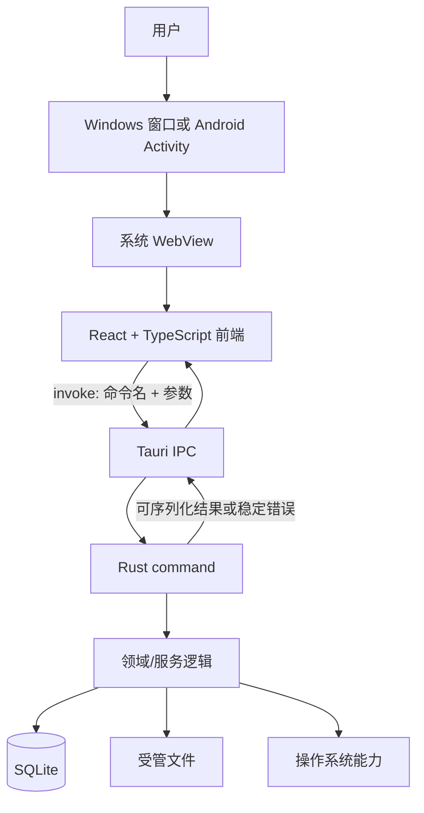
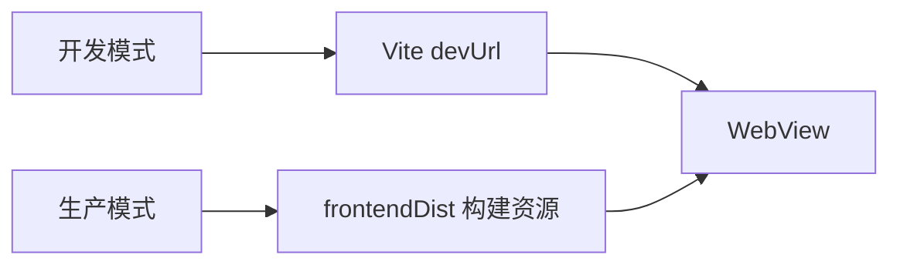

# 第 21 章：Tauri 2 是什么——网页怎样成为桌面与 Android 应用

> 浏览器里能运行的 React 页面还不是完整的 Windows 或 Android 应用。Tauri 为前端加上原生窗口、Rust 后端、系统权限和打包能力。本章先建立全景图，不急着写复杂 Rust。

## 本章目标

学完后，你能够：

1. 区分网页、WebView、原生壳和 Rust 后端；
2. 解释 Tauri 应用启动后有哪些部分；
3. 看懂 `tauri.conf.json` 中最重要的配置；
4. 区分开发服务器与生产前端资源；
5. 说明浏览器预览为什么不能代表真实 Tauri 功能；
6. 找到项目的 Rust 入口、命令注册和能力配置；
7. 解释 Windows 与 Android 共用什么、不同在哪里；
8. 安全地运行只读检查，不创建第二份真实应用数据。

## 开始前需要会什么

你需要知道：

- React 前端由 Vite 开发和构建；
- URL 与路由决定前端页面；
- 前端服务接口可以有不同实现；
- 终端命令必须在正确目录运行。

暂时不需要会 Rust。看到 `.rs` 文件时先把它当成“原生后端源码”，语法会在第 23～25 章解释。

## 新术语表

| 术语 | 白话解释 |
|---|---|
| Tauri | 用 Web 前端与 Rust 原生后端构建跨平台应用的框架 |
| WebView | 操作系统提供的网页显示区域，负责绘制 HTML/CSS/JavaScript |
| 原生壳 | 创建窗口、接入系统能力并承载 WebView 的应用外层 |
| Rust 后端 | 处理本地文件、数据库、系统能力和安全边界的原生代码 |
| IPC | 前端与原生后端之间传递消息的通道 |
| command | 允许前端调用的一项 Rust 能力 |
| capability | Tauri 2 中描述窗口能使用哪些权限的配置 |
| 开发服务器 | 开发时由 Vite 提供前端文件并支持热更新的临时服务 |
| 前端资源 | 生产构建后的 HTML、CSS、JavaScript 文件 |
| bundle | 把程序、资源、图标和配置组成安装包或应用包 |

## 先建立直觉

把 Tauri 应用想成一家有前台和后厨的店：

- React 是前台：展示内容、接收点击、组织体验；
- WebView 是店面空间：让前台界面可以被看见；
- IPC 是传菜窗口：前台提交明确订单；
- Rust 是后厨：访问数据库、文件和系统；
- Tauri 原生壳是整栋店：创建窗口、管理权限、启动各部分；
- `tauri.conf.json` 是开店配置：名字、窗口大小、开发地址、生产资源等。

浏览器只打开了“前台效果图”。没有原生壳和 Rust 后厨时，数据库命令、托盘、原生文件对话框等能力可能不可用。因此“浏览器看起来正常”不等于“桌面应用完整正常”。

## 图解



开发与生产的前端来源不同：



## 跟我一步一步做

### 第一步：找到 Tauri 目录

从项目根目录 `D:\Desktop\app` 查看：

```powershell
Get-ChildItem .\src-tauri
```

应看到：

- `Cargo.toml`：Rust 包和依赖清单；
- `tauri.conf.json`：主要 Tauri 配置；
- `src`：Rust 源码；
- `capabilities`：Tauri 2 权限能力；
- `icons`：打包图标；
- `build.rs`：构建脚本入口。

这里只查看，不删除、移动或重建任何文件。

### 第二步：阅读主配置

打开 [`src-tauri/tauri.conf.json`](../../../src-tauri/tauri.conf.json)。重点关注四组字段。

应用身份：

```json
{
  "productName": "我的考研空间",
  "version": "0.5.5",
  "identifier": "com.studyspace.desktop"
}
```

这些是当前隔离分支中的实际值，不代表教程要修改品牌。`identifier` 是系统识别应用的重要稳定标识，不应随意改动。

开发与构建：

```json
{
  "build": {
    "beforeDevCommand": "npm run dev",
    "devUrl": "http://localhost:1420",
    "beforeBuildCommand": "npm run build",
    "frontendDist": "../dist"
  }
}
```

开发时 Tauri 先启动 Vite，再让 WebView 打开 `devUrl`。生产构建先执行前端构建，再把 `frontendDist` 中的静态资源打入应用。

窗口配置包含标题、初始尺寸和最小尺寸。安全配置中的 CSP 限制页面能加载哪些来源，不能为了省事随意关闭。

### 第三步：找到 Rust 入口

打开 [`src-tauri/src/main.rs`](../../../src-tauri/src/main.rs)。桌面应用通常从 `main` 启动，再调用库中的 `run`。

然后打开 [`src-tauri/src/lib.rs`](../../../src-tauri/src/lib.rs)，寻找：

```rust
.invoke_handler(tauri::generate_handler![
    // 一组已经注册的 command
])
```

这份列表像“前端可调用能力目录”。Rust 函数写了 `#[tauri::command]` 还不够，通常还要注册后才能通过 `invoke` 找到。

### 第四步：查看能力配置

打开 [`src-tauri/capabilities/default.json`](../../../src-tauri/capabilities/default.json)。它描述哪些窗口可以使用哪些插件或核心能力。

把权限想成门禁：安装了某个插件不等于每个页面自动获得全部权限。最小权限能减少错误调用和安全风险。

### 第五步：区分四种运行方式

| 方式 | 前端在哪里 | Rust 后端 | 适合检查什么 |
|---|---|---|---|
| 浏览器 Vite | 开发服务器 | 通常没有 | 普通布局、纯前端组件 |
| Tauri dev | 开发服务器 | 有 | IPC、数据库、原生窗口和插件 |
| Windows 生产应用 | 打包资源 | 有 | 安装后真实体验、权限与数据目录 |
| Android 应用 | 打包资源 + Android WebView | 有 | 触控、系统选择器、移动权限与生命周期 |

不要在浏览器里看到 Tauri 命令失败就直接判断 Rust 后端坏了；先确认当前是否真的运行在 Tauri 环境。

### 第六步：认识最小启动结构

下面是**示意代码，不属于配套实验，也不要复制进真实项目**：

```rust
#[cfg_attr(mobile, tauri::mobile_entry_point)]
pub fn run() {
    tauri::Builder::default()
        .run(tauri::generate_context!())
        .expect("启动 Tauri 应用失败");
}
```

真实应用还会注册插件、状态、命令、窗口事件和桌面专用行为。本章只需要认出 Builder 是组装入口。

## 完整示例

本章不另外生成第二个 Tauri 安装项目。原因是第二套原生壳会引入额外 Android 生成目录、包标识和平台配置，反而模糊学习重点。

配套的可运行后端实验位于 [`backend-basics/Cargo.toml`](../labs/backend-basics/Cargo.toml)。它是纯 Rust 库：

```toml
[package]
name = "study-space-backend-basics"
version = "0.1.0"
edition = "2021"
publish = false
```

它将承载 Rust、Serde 和 SQLite 练习；Tauri 专属宏使用明确标注的示意片段，并映射到真实项目已经可编译的实现。这样既能运行关键业务代码，又不会创建第二份真实应用数据。

真实 Tauri 配置关系可以概括为：

```text
package.json 的 npm run dev
        ↓
tauri.conf.json 的 beforeDevCommand / devUrl
        ↓
WebView 加载 React 页面
        ↓
lib.rs 注册插件、状态和 commands
        ↓
Rust 服务访问 SQLite、受管附件与系统能力
```

## 逐段解释

`Cargo.toml` 和前端 `package.json` 作用相似：都描述包、版本和依赖，但它们属于不同工具链。

`tauri.conf.json` 连接两边：它知道开发时怎样启动前端，也知道生产时从哪里取得构建资源。

WebView 不是把完整 Chrome 打进每个安装包，而是使用系统提供的网页运行能力。它比“网页”多了原生壳，但前端仍遵循 HTML、CSS 和 JavaScript 规则。

Rust 后端不是传统远程服务器。它与本地应用一起运行，不需要互联网才能访问本地数据库。但 IPC 仍然是边界：参数要验证，返回值要序列化，错误不能泄露内部信息。

Windows 和 Android 可以共用 React 页面、Rust 领域逻辑和大部分命令；窗口、托盘、路径、文件选择器、权限和生命周期会有平台差异。

## 运行并观察

先运行安全的配套实验：

```powershell
cargo test --offline --manifest-path docs/tutorial/labs/backend-basics/Cargo.toml
```

预期看到一个 smoke test 通过。`--offline` 使用已经缓存的依赖，避免课程过程因为网络索引阻塞。

只检查真实 Tauri 配置是否能被 Cargo 读取：

```powershell
cargo check --manifest-path src-tauri/Cargo.toml
```

这会编译检查源码，但不会启动应用，也不会主动打开真实数据库。第一次可能较慢。

如果要启动真实桌面开发模式，应先确认没有另一个开发服务器占用端口，再运行项目已有的 Tauri 开发命令。本章暂不要求启动，以免同时引入端口、窗口和数据目录问题。

## 常见错误与修复

### 把 Vite 页面当成完整桌面应用

现象：布局能显示，但 `invoke`、托盘或原生对话框不可用。

检查地址和启动方式。浏览器中的 `http://localhost...` 只是前端开发服务器；完整能力需要 Tauri 运行环境或项目提供的浏览器替代实现。

### 在错误目录运行命令

现象：找不到 `package.json` 或 `Cargo.toml`。

先运行 `Get-Location`。本教程命令默认从 `D:\Desktop\app` 执行，并显式写 `--manifest-path`。

### 端口已被占用

现象：Vite 报地址无法监听，Tauri 等不到正确开发页面。

先关闭旧开发进程。不要随意改一个端口而忘记同步 `devUrl`。

### 修改 `dist` 后重启又消失

`dist` 是构建产物，会被重新生成。应修改 `src`，再由 Vite 构建。

### 为解决权限错误而开放全部能力

先确认具体插件、命令、窗口和所需权限。广泛开放权限会掩盖配置问题并增加风险。

### 把平台生成目录当源码修改

Android `gen`、Rust `target` 和前端 `dist` 都不应成为日常手改源文件。找到生成它们的配置或源码入口。

## 在“学习空间”项目里找到它

建议按此顺序只读查看：

1. [`src-tauri/tauri.conf.json`](../../../src-tauri/tauri.conf.json)：应用与构建配置；
2. [`src-tauri/Cargo.toml`](../../../src-tauri/Cargo.toml)：Rust 包与依赖；
3. [`src-tauri/src/main.rs`](../../../src-tauri/src/main.rs)：平台入口；
4. [`src-tauri/src/lib.rs`](../../../src-tauri/src/lib.rs)：Tauri Builder 和命令注册；
5. [`src-tauri/capabilities/default.json`](../../../src-tauri/capabilities/default.json)：能力权限；
6. `src/services`：前端怎样选择浏览器或 Tauri 服务实现；
7. `src-tauri/src/commands`：IPC 命令薄层；
8. `src-tauri/src/data`：数据库与文件业务层。

当前项目已经远比最小示例复杂。本章只建立地图，不要求逐行理解真实后端。

## 必做练习

1. 用自己的话画出 React、WebView、IPC、Rust、SQLite 五者关系。
2. 在 `tauri.conf.json` 中找出开发地址和生产资源目录。
3. 在 `lib.rs` 中找到 `invoke_handler`，数一数命令来自哪些模块，不需要逐个阅读。
4. 打开能力配置，记录三个已经允许的能力名称。
5. 解释为什么浏览器预览无法完整验证桌面托盘和本地数据库。
6. 运行隔离实验测试，并记录命令、退出结果和测试数量。

## 选做挑战

对照 Tauri 与 Electron 的概念差异，写一张不超过六行的表格。只比较架构：网页运行环境、原生后端语言、打包方式和系统 WebView 使用方式；不要简单下结论说谁“绝对更好”。

## 答案与思路

关系主线：

```text
用户操作 React 页面
→ WebView 中的前端通过 IPC 请求 command
→ Rust 验证参数并调用领域/数据层
→ SQLite 或文件系统完成本地工作
→ Rust 返回可序列化结果
→ React 更新界面
```

开发地址来自 `build.devUrl`，生产资源来自 `build.frontendDist`。浏览器只能直接运行 Web 前端，不能自动获得 Tauri IPC 和原生插件上下文。

Electron 与 Tauri 的练习答案应描述事实，不做口号式比较：Electron 常随应用携带 Chromium 与 Node.js 运行环境；Tauri 通常使用系统 WebView，并以 Rust 承担原生后端。具体体积、兼容性和开发成本取决于应用与平台。

## 本章自检

- [ ] 能解释 WebView 不是 Rust 后端；
- [ ] 能说出 IPC 的作用；
- [ ] 能找到主要 Tauri 配置和 Rust 入口；
- [ ] 能区分 `devUrl` 与 `frontendDist`；
- [ ] 能区分浏览器、Tauri dev、Windows 生产版与 Android 应用；
- [ ] 能解释 capability 为什么存在；
- [ ] 能指出哪些目录是生成物；
- [ ] 能保证实验不接触真实数据库。

## 本章小结

Tauri 不是把 React“变成 Rust”，而是让 Web 前端运行在原生壳的 WebView 中，并通过受控 IPC 使用 Rust 能力。配置连接开发服务器、生产资源、窗口、安全和打包；命令注册连接前端请求与后端函数；能力配置限制原生权限。

有了这张地图，下一章就能沿着最短路径完成第一次前后端通信，并看清参数、结果和错误怎样穿过边界。

## 下一章

进入[第 22 章：第一次前后端通信](22-第一次前后端通信.md)。你会先用测试写一个纯 Rust 问候函数，再把它包成 Tauri command，并从 TypeScript `invoke` 调用。
