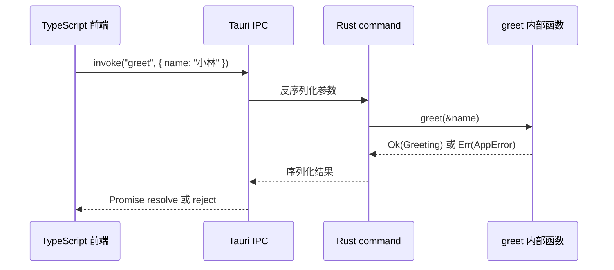

# 第 22 章：第一次前后端通信——从 invoke 到 Rust command

> 本章完成一条最小、完整的通信链：前端传姓名，Rust 验证后返回问候。重点不是问候本身，而是看懂命令名、参数、序列化、注册、结果与错误怎样跨过 IPC 边界。

## 本章目标

学完后，你能够：

1. 解释 Tauri `invoke` 与普通函数调用的区别；
2. 写出带类型的前端调用；
3. 看懂 `#[tauri::command]`；
4. 说明命令为什么必须注册；
5. 理解参数和返回值怎样经过 Serde；
6. 把可测试的业务函数与 Tauri 薄包装分开；
7. 区分“命令不存在”“参数不匹配”“业务验证失败”；
8. 不把内部错误对象直接显示给用户。

## 开始前需要会什么

你需要知道 Promise、`async/await`、TypeScript 接口、服务边界，以及上一章的 React → IPC → Rust 全景图。Rust 语法暂时只需跟着读，第 23～24 章会系统补齐。

## 新术语表

| 术语 | 白话解释 |
|---|---|
| `invoke` | 前端通过 Tauri IPC 请求某个 Rust command |
| command 名称 | 前后端共同约定的调用标识，通常来自 Rust 函数名 |
| 参数载荷 | 前端发给 command 的键值数据 |
| 序列化 | 把程序中的值转换成可跨边界传输的数据 |
| 反序列化 | 把传输数据还原成 Rust 类型 |
| 宏 | Rust 在编译阶段生成或变换代码的工具 |
| 属性宏 | 写在项目上方的 `#[...]` 宏，如 `#[tauri::command]` |
| handler | 接收 IPC 请求并分发给已注册 command 的处理器 |
| 薄命令 | 只做边界解析、状态取得、调度与返回的 command |
| 内部函数 | 不依赖 Tauri、可以直接单元测试的业务函数 |

## 先建立直觉

普通 TypeScript 函数调用像在同一个房间说话：参数直接进入另一个函数。`invoke` 像填写跨部门工单：

1. 写对 command 名；
2. 按约定填写参数字段；
3. 数据必须能被传输；
4. 后端必须登记过该 command；
5. 后端把结果转换成前端能接收的数据；
6. 失败也要以稳定格式返回。

因此这两段并不等价：

```ts
greet("小林");
```

```ts
await invoke<Greeting>("greet", { name: "小林" });
```

第二段跨越了语言和运行环境边界。

## 图解



## 跟我一步一步做

### 第一步：先写可测试的内部函数

配套实验在 [`command.rs`](../labs/backend-basics/src/command.rs)：

```rust
pub fn greet(name: &str) -> Result<Greeting, AppError> {
    let name = name.trim();
    if name.is_empty() {
        return Err(AppError::invalid_name());
    }

    Ok(Greeting {
        message: format!("你好，{name}！"),
    })
}
```

它不依赖 Tauri，所以 `cargo test` 可以直接验证裁剪空格、拒绝空姓名和返回内容。

### 第二步：定义可序列化结果

```rust
#[derive(Debug, PartialEq, Eq, Serialize)]
pub struct Greeting {
    pub message: String,
}
```

`Serialize` 让 Tauri 能把 Rust struct 转换为前端可接收的对象。前端对应类型：

```ts
interface Greeting {
  message: string;
}
```

TypeScript 接口不会在运行时验证后端数据，但能帮助前端代码正确使用返回值。

### 第三步：添加 Tauri command 包装

下面是**Tauri 示意代码**，配套纯 Rust 实验不引入第二套原生壳：

```rust
#[tauri::command]
fn greet_command(name: String) -> Result<Greeting, AppError> {
    greet(&name)
}
```

包装层拥有 `String`，再借用为 `&str` 交给内部函数。command 保持很薄，没有把验证、字符串处理和错误规则重新写一遍。

### 第四步：注册 command

仍是示意：

```rust
tauri::Builder::default()
    .invoke_handler(tauri::generate_handler![greet_command])
    .run(tauri::generate_context!())?;
```

属性宏让函数具备 command 能力，`generate_handler!` 则把它登记到分发表。漏掉任何一步，前端都不能按名称调用。

### 第五步：从 TypeScript 调用

示意前端服务：

```ts
import { invoke } from "@tauri-apps/api/core";

interface Greeting {
  message: string;
}

export async function requestGreeting(name: string): Promise<string> {
  const result = await invoke<Greeting>("greet_command", { name });
  return result.message;
}
```

注意三个约定：

- command 名与注册的 Rust 函数对应；
- 参数对象的 `name` 与 Rust 参数对应；
- 泛型 `Greeting` 表达前端期待的结果形状。

### 第六步：在界面处理等待与失败

```ts
try {
  setStatus("loading");
  const message = await requestGreeting(name);
  setMessage(message);
  setStatus("ready");
} catch (error: unknown) {
  setMessage(toSafeMessage(error));
  setStatus("error");
}
```

`invoke` 返回 Promise。不要假设本地调用永不失败：命令可能未注册、参数可能错误、数据库可能不可用，或输入可能不合法。

### 第七步：运行纯函数测试

在项目根目录运行：

```powershell
cargo test --offline --manifest-path docs/tutorial/labs/backend-basics/Cargo.toml command::tests
```

预期三个命令测试通过。它们不启动窗口，也不读写真实数据。

## 完整示例

可运行内部实现：

```rust
use serde::Serialize;
use crate::error::AppError;

#[derive(Debug, PartialEq, Eq, Serialize)]
pub struct Greeting {
    pub message: String,
}

pub fn greet(name: &str) -> Result<Greeting, AppError> {
    let name = name.trim();
    if name.is_empty() {
        return Err(AppError::invalid_name());
    }

    Ok(Greeting {
        message: format!("你好，{name}！"),
    })
}
```

Tauri 包装与前端调用组合示意：

```rust
#[tauri::command]
fn greet_command(name: String) -> Result<Greeting, AppError> {
    greet(&name)
}
```

```ts
const greeting = await invoke<{ message: string }>(
  "greet_command",
  { name: "小林" },
);
console.log(greeting.message);
```

Tauri 片段之所以标为示意，是因为实验 crate 没有 Tauri 运行时；真实项目中的相同边界由现有 command 和注册列表验证。

## 逐段解释

`name: String` 表示 command 接收拥有所有权的 Rust 字符串。`greet(&name)` 临时借用它，不复制内容。

`Result<Greeting, AppError>` 表示只有两种结果：成功的 Greeting 或明确的 AppError。调用者不能忘记失败分支。

`format!` 创建新字符串；`{name}` 把裁剪后的姓名插入模板。

前端 `invoke<Greeting>` 中的泛型只服务 TypeScript 编译器。边界安全仍依赖 Rust 反序列化、后端验证和必要时的前端运行时检查。

命令名本质是字符串协议。重命名 Rust 函数却忘记更新前端，会在运行时失败，所以真实项目通常把调用集中在 service 文件中。

## 运行并观察

本章安全运行顺序：

```powershell
Get-Location
cargo test --offline --manifest-path docs/tutorial/labs/backend-basics/Cargo.toml command::tests
cargo check --offline --manifest-path docs/tutorial/labs/backend-basics/Cargo.toml
```

预期：

- 当前目录是项目根目录；
- 三个 greeting 测试通过；
- Cargo check 成功且没有启动应用窗口；
- 不会出现数据库、附件或备份文件。

可以临时把测试输入从“小林”改成带空格的名称，先预测结果，再运行。练习结束后恢复文件。

## 常见错误与修复

### `command ... not found`

依次检查：函数是否带 `#[tauri::command]`、是否加入 `generate_handler!`、前端字符串是否完全一致、是否重启了 Rust 开发进程。

### 参数名不匹配

前端传 `{ userName: ... }`，Rust 却接收 `name`，会反序列化失败。按当前 Tauri/Serde 命名规则统一字段，不要靠猜测大小写。

### 返回类型不能序列化

检查成功类型和错误类型是否实现 `Serialize`。不要为了通过编译把返回值改成含糊的字符串。

### 前端出现 `[object Object]`

说明对象被直接拼进文本。解析稳定错误字段，选择面向用户的 `message`；内部详情只写入受控诊断日志。

### 在 command 中堆满 SQL

把验证与领域逻辑放进可测试函数，把数据库访问放进 repository。command 只协调边界，后续章节会完整实现。

### 浏览器中 invoke 失败

普通浏览器没有 Tauri IPC。服务层应根据运行环境使用浏览器实现，或明确告诉开发者必须通过 Tauri dev 检查该功能。

## 在“学习空间”项目里找到它

真实项目中按调用链阅读：

1. 在 `src/services` 搜索 `invoke<` 或 command 名；
2. 在 `src-tauri/src/commands` 找同名 `#[tauri::command]`；
3. 在 [`src-tauri/src/lib.rs`](../../../src-tauri/src/lib.rs) 的 `generate_handler!` 中确认注册；
4. 跟进 command 调用的数据模块；
5. 查对应测试验证哪些行为。

例如 [`src-tauri/src/commands/learning_item_commands.rs`](../../../src-tauri/src/commands/learning_item_commands.rs) 展示真实命令如何取得状态、调度阻塞数据库工作并返回稳定结果。现在只看函数边界，不必理解 SQL。

## 必做练习

1. 把 `greet("  小林  ")` 的每一步输入输出写出来。
2. 解释为什么 `greet` 不加 `#[tauri::command]` 仍然值得保留。
3. 写出前端 `Greeting` 接口和一次 `invoke` 调用。
4. 列出 command 不存在、参数错误、业务验证失败三者的检查顺序。
5. 在真实项目任选一个 command，找到前端调用、Rust 函数和注册位置。
6. 运行三个实验测试并阅读测试名称。

## 选做挑战

为纯函数新增 `language: "zh" | "en"` 概念：中文返回“你好”，英文返回“Hello”。先写失败测试，再实现 Rust enum。不要直接修改真实项目命令。

## 答案与思路

带空格输入先由 `trim()` 得到“小林”，空值检查通过，`format!` 生成“你好，小林！”，最终放入 `Greeting.message`。

纯 `greet` 的价值：不依赖窗口、IPC 或 Tauri runtime，能快速测试；未来命令、CLI 或其他入口都能复用同一规则。

排查顺序：

1. 看错误是否发生在命令分发；
2. 核对命令名和注册；
3. 核对参数字段与类型；
4. 如果命令已进入，再检查业务返回的错误码和消息；
5. 最后跟进服务或数据库层。

## 本章自检

- [ ] 能解释 invoke 为什么返回 Promise；
- [ ] 能写出带泛型返回值的 invoke；
- [ ] 能说明 command 宏与注册缺一不可；
- [ ] 能解释参数为什么要序列化；
- [ ] 能区分 command 包装与内部函数；
- [ ] 能处理 `unknown` 失败而不是显示原始对象；
- [ ] 能找到真实项目中的一条完整调用链；
- [ ] 能在不启动真实应用的情况下测试内部逻辑。

## 本章小结

Tauri 前后端通信是一份明确协议：前端用 command 名和参数调用，IPC 转换数据，Rust command 处理边界并调用可测试的内部逻辑，结果或稳定错误再返回 Promise。薄命令让业务规则脱离框架，既容易测试，也便于将来替换入口。

## 下一章

进入[第 23 章：Rust 基础一](23-Rust基础一.md)。我们会从变量、函数、struct、enum、`String` 与 `&str` 开始，真正读懂本章实验代码。
