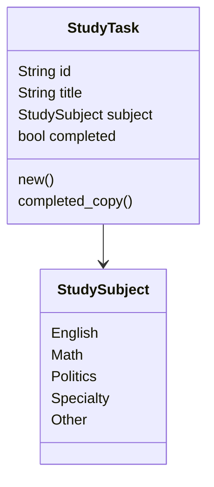

# 第 23 章：Rust 基础一——变量、函数、struct 与 enum

> 本章不追求一次学完整门 Rust，而是先让你读懂“学习任务”模型：变量怎样声明、函数怎样返回值、struct 怎样组织数据、enum 怎样限制合法状态，以及 `String` 与 `&str` 为什么同时存在。

## 本章目标

学完后，你能够：

1. 运行 Rust 测试并读懂成功与失败摘要；
2. 区分不可变变量与 `mut` 可变变量；
3. 识别语句、表达式和函数返回值；
4. 用 struct 表示一条学习任务；
5. 用 enum 表示有限科目；
6. 理解 `impl` 中的方法；
7. 初步区分拥有数据的 `String` 与借用文本的 `&str`；
8. 看懂 `derive` 为类型生成的常用能力。

## 开始前需要会什么

你需要知道 TypeScript 的对象、函数、联合类型与 `Result` 的直觉。Rust 不是 TypeScript 的另一种写法；它会更严格地检查数据类型、所有权和错误处理，但业务建模思想可以迁移。

## 新术语表

| 术语 | 白话解释 |
|---|---|
| crate | Rust 的编译与发布单元，本实验就是一个 crate |
| 变量绑定 | 用名称绑定一个值，如 `let title = ...` |
| `mut` | 明确允许变量绑定的值被修改 |
| 表达式 | 计算后产生值的代码 |
| struct | 把多个命名字段组成一个新类型 |
| enum | 列出一种类型所有允许的变体 |
| `impl` | 为类型实现构造函数或方法的代码块 |
| 关联函数 | 通过 `Type::function()` 调用、不接收 `self` 的函数 |
| 方法 | 接收 `self`、`&self` 或 `&mut self` 的函数 |
| `String` | 拥有、可增长的 UTF-8 文本 |
| `&str` | 对一段 UTF-8 文本的借用视图 |
| derive | 让编译器自动生成 Debug、Clone、比较或序列化等实现 |

## 先建立直觉

TypeScript 更像“先写，运行时再发现部分问题”；Rust 更像“进车间前先过严格安检”。它会要求你说清楚：

- 数据是什么类型；
- 谁拥有它；
- 是否允许改变；
- 失败是否被处理；
- 引用能活多久。

严格不是为了折磨开发者，而是把很多内存、并发和空值错误提前到编译阶段。

## 图解



## 跟我一步一步做

### 第一步：认识变量与可变性

```rust
let title = "整理阅读错题";
let mut completed = false;
completed = true;
```

Rust 默认不可变。只有确实要重新赋值时才写 `mut`。这与 JavaScript 的 `const` 优先原则相似，但 Rust 检查得更严格。

变量可以遮蔽：

```rust
let title = "  整理阅读错题  ";
let title = title.trim();
```

第二个 `title` 是新绑定，不是修改旧字符串。

### 第二步：函数与表达式

```rust
fn task_count(pending: usize, completed: usize) -> usize {
    pending + completed
}
```

最后一行没有分号，因此是返回表达式。若写成 `pending + completed;`，它会变成返回 `()` 的语句，编译器会指出类型不匹配。

### 第三步：用 struct 建模

实验文件 [`model.rs`](../labs/backend-basics/src/model.rs) 定义：

```rust
pub struct StudyTask {
    pub id: String,
    pub title: String,
    pub subject: StudySubject,
    pub completed: bool,
}
```

`pub` 表示其他模块可以使用。没有 `pub` 的项目默认只在当前模块及规则允许的范围可见。

### 第四步：用 enum 限制科目

```rust
pub enum StudySubject {
    English,
    Math,
    Politics,
    Specialty,
    Other,
}
```

它比任意字符串安全：无法产生拼错的 `"Englsh"`。`match` 会要求覆盖所有变体。

```rust
pub fn as_str(self) -> &'static str {
    match self {
        Self::English => "english",
        Self::Math => "math",
        Self::Politics => "politics",
        Self::Specialty => "specialty",
        Self::Other => "other",
    }
}
```

### 第五步：在 impl 中创建任务

```rust
impl StudyTask {
    pub fn new(id: impl Into<String>, title: &str, subject: StudySubject)
        -> Result<Self, AppError>
    {
        let title = title.trim();
        if title.is_empty() {
            return Err(AppError::invalid_title());
        }

        Ok(Self {
            id: id.into(),
            title: title.to_owned(),
            subject,
            completed: false,
        })
    }
}
```

`Self` 在这个 `impl` 中就是 `StudyTask`。`new` 是约定俗成的构造关联函数，不是 Rust 特殊关键字。

### 第六步：理解 String 与 &str

函数只需读取调用者提供的标题，所以参数用 `&str`。任务要长期保存自己的标题，所以字段用 `String`。

```text
&str：借看一段文本，不负责释放
String：拥有一段文本，离开有效范围后负责释放
```

`title.to_owned()` 把借用文本复制成任务自己拥有的 `String`。

## 完整示例

```rust
#[derive(Debug, Clone, Copy, PartialEq, Eq)]
pub enum StudySubject {
    English,
    Math,
    Politics,
    Specialty,
    Other,
}

#[derive(Debug, Clone, PartialEq, Eq)]
pub struct StudyTask {
    pub id: String,
    pub title: String,
    pub subject: StudySubject,
    pub completed: bool,
}
```

这些 derive 的用途：

- `Debug`：测试失败时可打印；
- `Clone`：明确复制拥有的数据；
- `Copy`：只用于像 enum 这样复制成本很小的值；
- `PartialEq, Eq`：允许测试比较。

## 逐段解释

`bool` 只有 `true` 与 `false`。`String`、`bool`、enum 都是字段类型。

`id: impl Into<String>` 允许调用者传 `String` 或 `&str` 等可转换类型。这是泛型的简洁写法，现阶段只需会使用。

`Result<Self, AppError>` 强迫调用者处理验证失败。构造函数不会产生标题为空的任务。

`return Err(...)` 提前结束；最后的 `Ok(Self { ... })` 不加分号，作为函数返回值。

## 运行并观察

```powershell
cargo test --offline --manifest-path docs/tutorial/labs/backend-basics/Cargo.toml model::tests
```

预期五个模型测试通过，包括标题裁剪、空标题拒绝、科目稳定值等。

再检查编译器与代码风格：

```powershell
cargo clippy --offline --manifest-path docs/tutorial/labs/backend-basics/Cargo.toml --all-targets -- -D warnings
```

`-D warnings` 把警告当成失败，帮助教程示例保持干净。

## 常见错误与修复

### `cannot assign twice to immutable variable`

变量默认不可变。判断是否真的需要修改；需要时在声明处写 `let mut`，不需要时创建新绑定。

### `mismatched types`

对照错误中的 expected 与 found。常见原因是 `String` 和 `&str`、数字类型或函数返回值不一致。

### 最后一行多了分号

函数期望返回值却得到 `()`。去掉返回表达式后的分号，或明确写 `return value;`。

### enum 的 match 不完整

不要急着加 `_` 吞掉所有情况。业务 enum 新增变体时，编译器提醒每个重要位置更新通常是好事。

### 所有参数都写 String

只读文本参数优先考虑 `&str`，需要保存所有权时再创建 `String`。先理解含义，不要机械替换。

## 在“学习空间”项目里找到它

打开 [`src-tauri/src/data/models.rs`](../../../src-tauri/src/data/models.rs) 和 `src-tauri/src/data/*/models.rs`，寻找：

- `struct` 表示返回模型或输入模型；
- `enum` 限制状态；
- `derive` 生成序列化和调试能力；
- `impl` 提供验证或转换；
- `String` 与 `Option<String>` 表示必填和可选文本。

先读字段和类型，再读函数。不要从最长的数据库函数开始。

## 必做练习

1. 为 `StudySubject::Politics` 写出 `as_str` 结果。
2. 给 `StudyTask` 增加一个只读方法 `is_pending(&self) -> bool`。
3. 写测试证明新任务默认未完成。
4. 解释为什么构造函数接收 `&str`，字段却保存 `String`。
5. 故意给返回表达式加分号，阅读错误后恢复。

## 选做挑战

新增 `TaskPriority` enum：`Low`、`Normal`、`High`，并为每个变体提供稳定字符串。先写测试，再改模型。不要修改真实项目的数据结构。

## 答案与思路

```rust
pub fn is_pending(&self) -> bool {
    !self.completed
}
```

测试新任务：

```rust
let task = StudyTask::new("1", "复习", StudySubject::Politics).unwrap();
assert!(!task.completed);
```

参数借用能接受多种来源且避免不必要复制；字段必须在构造函数结束后继续存在，因此任务需要拥有标题。

## 本章自检

- [ ] 能区分默认不可变与 `mut`；
- [ ] 能识别返回表达式；
- [ ] 能解释 struct 与 enum 的区别；
- [ ] 能读懂 `impl StudyTask`；
- [ ] 能初步区分 `String` 与 `&str`；
- [ ] 能说明四个 derive 的用途；
- [ ] 能运行模型测试和 Clippy；
- [ ] 能从编译器错误找到 expected 与 found。

## 本章小结

Rust 用严格类型把业务状态说清楚：struct 组合字段，enum 限制合法选项，`impl` 集中构造和方法，`Result` 阻止无效对象悄悄进入系统。`String` 拥有文本，`&str` 借用文本，这为下一章的所有权与借用打下基础。

## 下一章

进入[第 24 章：Rust 基础二](24-Rust基础二.md)。你会理解所有权、移动、借用、`Vec<T>`、`Option<T>`、`Result<T, E>`、`match` 与 `?`。
