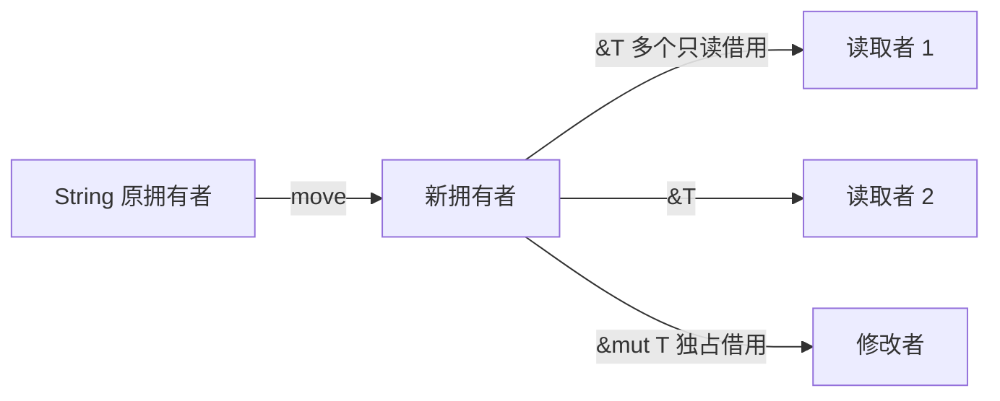
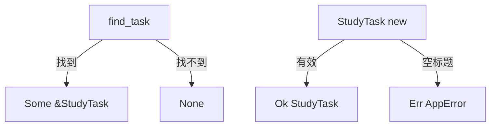

# 第 24 章：Rust 基础二——所有权、借用、Option 与 Result

> Rust 最陌生的部分通常不是语法，而是“谁拥有值、谁只是借用”。本章用任务列表建立直觉，再学习安全表达“可能没有”和“可能失败”。

## 本章目标

学完后，你能够：

1. 用生活类比解释所有权与移动；
2. 区分 `T`、`&T` 与 `&mut T`；
3. 看懂 `Vec<T>` 和切片 `&[T]`；
4. 用 `Option<T>` 表达可能找不到；
5. 用 `Result<T, E>` 表达可能失败；
6. 使用 `match` 处理所有分支；
7. 理解 `?` 如何提前返回错误；
8. 按固定顺序阅读常见借用检查器错误。

## 开始前需要会什么

请先完成第 23 章，能够读懂 `StudyTask`、`StudySubject`、函数参数与返回类型。不要试图一次背下所有所有权规则，先跟踪一个值的生命周期。

## 新术语表

| 术语 | 白话解释 |
|---|---|
| 所有权 | 某个变量负责一个值何时释放 |
| 移动 | 把拥有权交给另一个变量，原拥有者不再可用 |
| 借用 | 临时使用值而不取得所有权 |
| 引用 | 借用产生的 `&T` 或 `&mut T` |
| 可变借用 | 在独占条件下临时修改值 |
| 生命周期 | 引用保证有效的范围 |
| `Vec<T>` | 长度可变化、拥有元素的连续集合 |
| 切片 | 对连续集合一部分或全部的借用视图 |
| `Option<T>` | `Some(T)` 或 `None`，明确表达可能没有 |
| `Result<T, E>` | `Ok(T)` 或 `Err(E)`，明确表达可能失败 |
| `?` | 成功时取出值，失败时提前返回错误 |

## 先建立直觉

把 `String` 想成一本只有一位保管人的实体笔记本：

- 把笔记本交给别人，是移动；
- 让别人临时阅读，是 `&String` 或 `&str` 借用；
- 允许别人临时修改，是 `&mut String` 可变借用；
- 多个人可以同时只读；
- 修改时必须独占，避免一边读一边被改；
- 保管人离开有效范围，笔记本对应的内存被释放。

`Clone` 像复印一本新笔记本，会产生独立数据，但有成本，不应为了绕过编译错误而到处复制。

## 图解





## 跟我一步一步做

### 第一步：观察移动

下面是**故意不能编译的示例**：

```rust
let first = String::from("数学");
let second = first;
println!("{first}");
```

`String` 的拥有权移动给 `second`，因此 `first` 不再可用。编译器防止两个变量以为自己都负责释放同一块内存。

### 第二步：使用只读借用

```rust
fn print_title(title: &str) {
    println!("{title}");
}

let title = String::from("整理错题");
print_title(&title);
println!("{title}");
```

函数只借看，调用结束后 `title` 仍归原变量所有。

### 第三步：认识可变借用

```rust
fn append_done(title: &mut String) {
    title.push_str("（完成）");
}
```

同一时刻不能既保留只读引用又用可变引用修改。错误信息常包含 `cannot borrow ... as mutable because it is also borrowed as immutable`。

### 第四步：Vec 与切片

```rust
let tasks: Vec<StudyTask> = vec![task_one, task_two];
```

函数只需要查看列表时，接收切片而不是取得整个 Vec：

```rust
pub fn find_task<'a>(tasks: &'a [StudyTask], id: &str)
    -> Option<&'a StudyTask>
{
    tasks.iter().find(|task| task.id == id)
}
```

返回引用来自 `tasks`，所以不能比 `tasks` 活得更久。`'a` 是生命周期关系说明，不会延长真实数据生命。

### 第五步：用 Option 表达缺失

```rust
match find_task(&tasks, "task-1") {
    Some(task) => println!("{}", task.title),
    None => println!("没有这条任务"),
}
```

Rust 没有让普通引用突然变成 null。可能没有就写在类型中，调用者必须面对它。

### 第六步：用 Result 表达失败

```rust
match StudyTask::new("1", title, subject) {
    Ok(task) => tasks.push(task),
    Err(error) => println!("{}", error.message),
}
```

`Option` 表达“有或没有”，`Result` 表达“成功或失败，并带原因”。

### 第七步：使用问号传播错误

```rust
fn create_two() -> Result<Vec<StudyTask>, AppError> {
    let first = StudyTask::new("1", "英语", StudySubject::English)?;
    let second = StudyTask::new("2", "数学", StudySubject::Math)?;
    Ok(vec![first, second])
}
```

每个 `?` 的意思是：若为 `Ok` 就取出里面的值；若为 `Err` 就从当前函数提前返回这个错误。

## 完整示例

本章实验核心：

```rust
pub fn find_task<'a>(
    tasks: &'a [StudyTask],
    id: &str,
) -> Option<&'a StudyTask> {
    tasks.iter().find(|task| task.id == id)
}

impl StudyTask {
    pub fn completed_copy(&self) -> Self {
        Self {
            completed: true,
            ..self.clone()
        }
    }
}
```

`completed_copy` 借用原任务并返回新任务。原值不变，方便理解和测试；数据库更新会在后续章节使用不同策略。

## 逐段解释

`tasks.iter()` 产生元素的只读引用，不移动 Vec 中的任务。

`find` 接收判断函数，找到第一项就返回 `Some(&StudyTask)`，否则返回 `None`。

闭包参数 `task` 是借用，比较 ID 不会取得整条任务所有权。

结构体更新语法 `..self.clone()` 复制其他字段，再用前面的 `completed: true` 覆盖完成状态。

显式 `'a` 说明返回引用与 `tasks` 借用相关；`id` 的生命周期不需要进入返回值。

## 运行并观察

```powershell
cargo test --offline --manifest-path docs/tutorial/labs/backend-basics/Cargo.toml model::tests
cargo clippy --offline --manifest-path docs/tutorial/labs/backend-basics/Cargo.toml --all-targets -- -D warnings
```

预期五个模型测试通过，Clippy 无警告。

想深入理解错误时，可以运行：

```powershell
rustc --explain E0382
```

它解释“使用已移动值”。错误编号因示例而异，以终端实际输出为准。

## 常见错误与修复

### `use of moved value`

先找值在哪一步按值传递。可选修复依次是：让函数借用、调整所有权流、确实需要独立副本时才 clone。

### `cannot borrow as mutable`

检查变量是否声明为 `mut`，并检查是否仍存在只读引用。不要盲目增加 `mut`。

### `does not live long enough`

返回的引用指向即将被释放的局部值。通常应让拥有者活得更久，或返回拥有的数据，而不是伪造生命周期标注。

### 对 Option 直接访问字段

先用 `match`、`if let` 或合适的组合方法处理 `Some/None`。不要用 `unwrap` 掩盖正常缺失场景。

### 到处使用 clone

Clone 能消除部分移动错误，却可能隐藏设计问题和性能成本。先判断函数应取得所有权还是只借用。

### 滥用 unwrap

测试准备数据时可以合理使用；真实用户输入、数据库查询、文件和 IPC 边界应转换或传播错误。

## 在“学习空间”项目里找到它

在 `src-tauri/src/data` 中搜索：

- `Vec<`：列表结果；
- `Option<`：可选记录或字段；
- `Result<`：可能失败的操作；
- `?`：错误传播；
- `&Connection`、`&str`：借用连接与文本；
- `.iter()`、`.map()`、`.find()`：集合处理。

真实数据库函数中的生命周期多数可以由编译器推断。实验显式标注是为了看清返回引用来自哪里。

## 必做练习

1. 解释 `let second = first` 后为什么不能再用 `first`。
2. 把 `find_task` 的成功与失败分支分别写成 `match`。
3. 编写 `pending_tasks(tasks: &[StudyTask]) -> Vec<&StudyTask>`。
4. 写一个返回 `Result` 的函数，并用 `?` 连续创建两条任务。
5. 运行 `rustc --explain E0382`，记录你看懂的一句话。

## 选做挑战

实现 `toggle_copy(&self) -> Self`：返回完成状态相反的新任务，原任务保持不变。先写两个测试覆盖未完成到完成、完成到未完成。

## 答案与思路

```rust
pub fn pending_tasks(tasks: &[StudyTask]) -> Vec<&StudyTask> {
    tasks.iter().filter(|task| !task.completed).collect()
}
```

`iter()` 借用元素，因此结果保存引用。返回值不能比输入切片活得更久，编译器会推断这一关系。

```rust
pub fn toggle_copy(&self) -> Self {
    Self {
        completed: !self.completed,
        ..self.clone()
    }
}
```

## 本章自检

- [ ] 能用自己的话解释移动；
- [ ] 能区分所有权、只读借用和可变借用；
- [ ] 能说明切片为什么比取得 Vec 所有权更灵活；
- [ ] 能处理 `Some` 与 `None`；
- [ ] 能处理 `Ok` 与 `Err`；
- [ ] 能解释 `?`；
- [ ] 能按错误位置、移动位置、后续使用位置阅读所有权错误；
- [ ] 不会用大量 clone 或 unwrap 逃避理解。

## 本章小结

所有权规定谁负责释放，借用让函数临时使用数据，引用有效范围由编译器检查。`Vec<T>` 拥有集合，切片借用集合；`Option<T>` 公开表达缺失，`Result<T, E>` 公开表达失败，`?` 让错误传播保持简洁。

## 下一章

进入[第 25 章：Serde、错误与异步边界](25-Serde错误与异步边界.md)。我们会把 Rust 模型安全转换成前端 JSON，建立稳定错误码，并解释阻塞数据库工作为什么不能占住异步运行线程。
