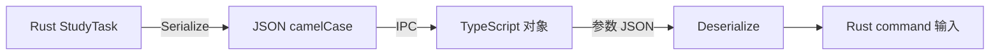
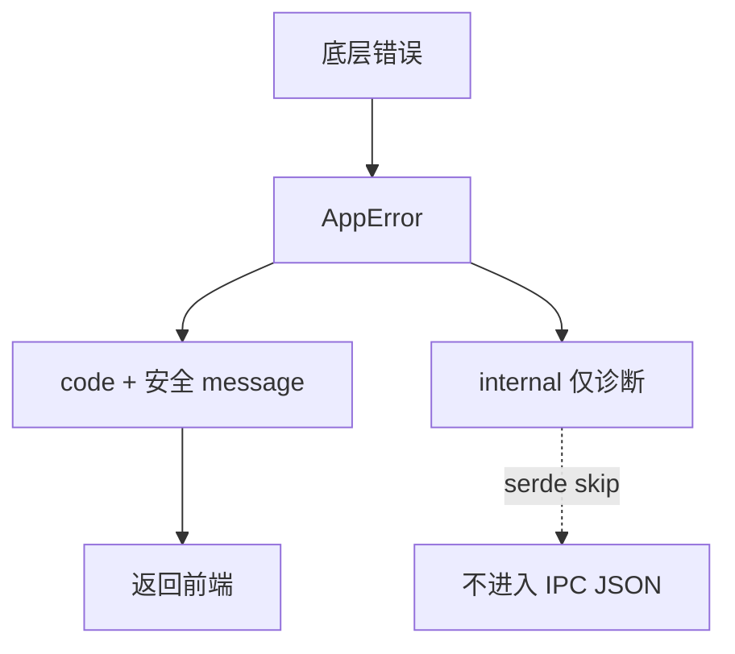

# 第 25 章：Serde、错误与异步边界——安全地跨过 IPC

> 能传输数据不等于边界设计正确。本章让 Rust 模型稳定转换为前端 JSON，把面向用户的错误与内部诊断分开，并解释 SQLite 这类阻塞工作为什么要离开异步执行线程。

## 本章目标

学完后，你能够：

1. 解释序列化和反序列化；
2. 使用 `Serialize`、`Deserialize` 与 `serde` 命名规则；
3. 让 Rust enum 产生稳定前端值；
4. 设计稳定错误码和用户消息；
5. 阻止路径、SQL 和密钥等内部详情穿过 IPC；
6. 区分异步等待与阻塞工作；
7. 解释 `run_blocking` 的用途；
8. 保持 command 薄而可测试。

## 开始前需要会什么

请先完成第 22～24 章，理解 command、struct、enum、`Result` 与 `?`。前端部分需要知道 Promise 和 `unknown` 错误。

## 新术语表

| 术语 | 白话解释 |
|---|---|
| Serde | Rust 生态中序列化与反序列化的通用框架 |
| JSON | 跨语言传输对象、数组、字符串、数字、布尔和 null 的文本格式 |
| wire format | 数据在线程、进程或网络边界上传输时的稳定形状 |
| camelCase | `createdAt` 这种前端常见命名 |
| snake_case | `created_at` 这种 Rust 常见命名 |
| 错误码 | 程序可稳定判断的短标识，如 `storage_failed` |
| 用户消息 | 可直接展示、不会泄露内部信息的说明 |
| 内部详情 | 日志和诊断需要、不能直接给用户的路径或底层错误 |
| 阻塞 | 当前线程必须等工作完成，期间不能处理其他任务 |
| 异步 | 等待外部结果时把执行机会让给其他任务 |

## 先建立直觉

IPC 像海关。Rust 内部对象不能原样搬到 JavaScript，需要装进双方同意的箱子（JSON 形状）。错误也要过关：用户可以收到“暂时无法读取学习数据”和稳定代码，但不应收到电脑私人路径、SQL 内容或凭据。

异步不等于“自动更快”。数据库查询如果在当前线程一直计算，就是阻塞；仅给函数加 `async` 不会让阻塞消失。要把阻塞工作交给专门线程池。

## 图解





## 跟我一步一步做

### 第一步：为模型派生 Serde

[`model.rs`](../labs/backend-basics/src/model.rs)：

```rust
#[derive(Debug, Clone, PartialEq, Eq, Serialize, Deserialize)]
#[serde(rename_all = "camelCase")]
pub struct StudyTask {
    pub id: String,
    pub title: String,
    pub subject: StudySubject,
    pub completed: bool,
}
```

当前字段没有下划线，但以后加入 `created_at` 时，JSON 会自动成为 `createdAt`。

enum 也使用稳定命名：

```rust
#[derive(Serialize, Deserialize)]
#[serde(rename_all = "camelCase")]
pub enum StudySubject {
    English,
    Math,
    Politics,
    Specialty,
    Other,
}
```

### 第二步：测试 JSON 往返

```rust
let json = serde_json::to_string(&task)?;
let restored: StudyTask = serde_json::from_str(&json)?;
assert_eq!(restored, task);
```

“往返”表示 Rust → JSON → Rust 后关键信息不变。它不能替代所有兼容性测试，但能快速发现遗漏 derive 或错误命名。

### 第三步：设计公开错误

[`error.rs`](../labs/backend-basics/src/error.rs)：

```rust
#[derive(Debug, Clone, Error, PartialEq, Eq, Serialize)]
#[error("{message}")]
pub struct AppError {
    pub code: &'static str,
    pub message: String,
    #[serde(skip)]
    pub internal: Option<String>,
}
```

稳定字段是 `code` 与 `message`。`internal` 在 Rust 中保留，却由 `#[serde(skip)]` 排除在前端 JSON 外。

### 第四步：从底层错误构造安全错误

```rust
pub fn storage(internal: impl Into<String>) -> Self {
    Self {
        code: "storage_failed",
        message: "暂时无法读取学习数据".to_owned(),
        internal: Some(internal.into()),
    }
}
```

前端可根据 `code` 选择重试按钮，用户看到安全消息，诊断日志仍可记录内部原因。

### 第五步：理解阻塞边界

SQLite 的同步 API 会占用调用线程直到完成。真实 Tauri command 常采用类似结构：

```rust
#[tauri::command]
async fn list_tasks(state: State<'_, DataState>) -> Result<Vec<StudyTask>, AppError> {
    let manager = state.manager().clone();
    run_blocking(move || manager.with_connection(list_tasks_inner)).await
}
```

这是**结构示意**。具体签名以真实项目 helper 为准。command 取得所需状态，将拥有的数据移动进闭包，再等待阻塞线程池结果。

### 第六步：前端只相信稳定字段

```ts
interface CommandError {
  code: string;
  message: string;
}

function isCommandError(value: unknown): value is CommandError {
  return typeof value === "object"
    && value !== null
    && "code" in value
    && "message" in value;
}
```

不要用 `any` 假设所有 reject 值形状一致，也不要显示整个对象。

## 完整示例

```rust
let error = AppError::storage(
    "C:\\private\\study.db could not be opened",
);
let json = serde_json::to_value(error)?;

assert_eq!(json["code"], "storage_failed");
assert_eq!(json["message"], "暂时无法读取学习数据");
assert!(json.get("internal").is_none());
```

完整测试已放在实验的 `error.rs` 和 `model.rs` 中。它们明确证明内部路径不会序列化，而不是只靠注释承诺。

## 逐段解释

Serde derive 在编译时生成转换实现，不需要手写每个字段。

`rename_all` 统一协议命名，避免每个字段分别标注。已发布字段名属于接口，随意改变会破坏旧前端或备份。

`thiserror::Error` 生成 Rust 错误显示能力；Serde 负责 IPC 数据，两者职责不同。

`#[serde(skip)]` 是安全边界，但内部日志仍需脱敏，不能把密钥原文写进 `internal`。

`spawn_blocking` 或项目封装的 `run_blocking` 解决的是线程占用，不会自动让错误消失，也不会替代事务。

## 运行并观察

```powershell
cargo test --offline --manifest-path docs/tutorial/labs/backend-basics/Cargo.toml
cargo clippy --offline --manifest-path docs/tutorial/labs/backend-basics/Cargo.toml --all-targets -- -D warnings
```

预期 11 个测试通过，其中包括 JSON 往返和内部详情排除。

可以使用：

```powershell
cargo test --offline --manifest-path docs/tutorial/labs/backend-basics/Cargo.toml public_error_json -- --nocapture
```

过滤运行错误序列化测试。测试本身不打印私人路径。

## 常见错误与修复

### `Serialize is not implemented`

检查类型及其所有字段类型是否都可序列化，并确认 serde derive feature 已启用。

### 前后端字段名不一致

明确使用 `rename_all` 或字段级 rename，并用 JSON 形状测试固定协议。

### 把 Debug 文本当公开错误

`format!("{error:?}")` 可能包含路径、SQL 或库内部信息。转换成稳定 AppError，详细原因留在受控日志。

### 给同步数据库函数加 async

函数体仍会阻塞。使用项目统一的阻塞调度 helper，并只移动必要的拥有数据。

### 在阻塞闭包中借用短生命周期状态

闭包可能比 command 当前栈活得久。克隆线程安全 manager 或移动拥有的数据，按编译器提示调整边界。

### 错误码跟随中文消息变化

错误码应稳定、短且面向程序；消息可以改进或本地化。不要用完整中文消息作为程序判断条件。

## 在“学习空间”项目里找到它

重点查看：

- [`src-tauri/src/data/error.rs`](../../../src-tauri/src/data/error.rs)：真实稳定错误结构与底层转换；
- [`src-tauri/src/commands/data_commands.rs`](../../../src-tauri/src/commands/data_commands.rs)：`run_blocking` 与共享数据状态；
- `src-tauri/src/data/*/models.rs`：Serde 模型和字段命名；
- `src-tauri/src/commands/*`：薄命令怎样调度数据层；
- `src/services`：前端如何把未知错误翻译成界面状态。

阅读时确认代码当前真实存在，不把历史设计稿当实现。

## 必做练习

1. 给一个含 `created_at` 的 struct 写 camelCase JSON 预期。
2. 解释 `Serialize` 与 `Deserialize` 的方向。
3. 为 `AppError::invalid_title()` 写 JSON 断言。
4. 列出错误对象中可以给用户和不应给用户的字段。
5. 在真实项目找一处 `run_blocking`，画出 command → helper → repository 流程。

## 选做挑战

新增 `AppError::not_found(resource: &str)`，公开错误码固定为 `not_found`，公开消息不包含内部数据库表名；先写序列化测试。

## 答案与思路

```rust
#[derive(Serialize, Deserialize)]
#[serde(rename_all = "camelCase")]
struct Example {
    created_at: String,
}
```

JSON 为 `{"createdAt":"..."}`。Serialize 是 Rust → 传输格式，Deserialize 是传输格式 → Rust。

可公开：稳定 code、经过设计的用户 message。通常不公开：绝对路径、SQL、堆栈、令牌、密钥、系统用户名、原始第三方响应。

## 本章自检

- [ ] 能解释 Serde 与 JSON 的关系；
- [ ] 能写 Serialize/Deserialize derive；
- [ ] 能固定 camelCase 协议；
- [ ] 能区分公开错误与内部诊断；
- [ ] 能证明 internal 不进入 JSON；
- [ ] 能区分 async 等待与阻塞计算；
- [ ] 能解释 run_blocking；
- [ ] 能说明 command 为什么保持薄。

## 本章小结

Serde 把 Rust 类型转换成稳定 IPC 协议；命名规则和测试保护前后端契约。AppError 将程序可判断的错误码、用户消息与内部诊断分开。同步 SQLite 工作必须进入阻塞线程池，command 只负责边界协调，把规则和数据访问交给可测试的内部层。

## 下一章

进入[第 26 章：数据库从零入门](../05-SQLite与本地数据篇/26-数据库从零入门.md)。下一部分从表、行、列、主键和索引开始，再逐步写 SQL 与 Rust repository。
