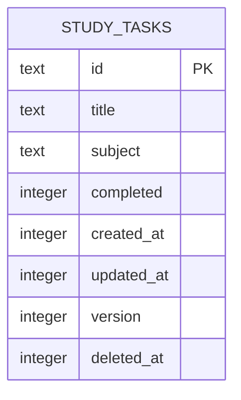

# 第 26 章：数据库从零入门——让学习数据可靠留下来

> state 只负责界面当前记忆，刷新后可能消失；数据库负责按结构长期保存、查询和更新。本章先理解表、行、列、主键、约束和索引，不急着堆 SQL。

## 本章目标

学完后，你能够：

1. 解释为什么复杂本地应用需要数据库；
2. 区分数据库、表、行和列；
3. 解释主键、外键、约束与索引；
4. 为学习任务画出最小表结构；
5. 区分界面模型与数据库记录；
6. 说明 SQLite 文件为何不能手工乱改；
7. 使用内存数据库做安全实验；
8. 找到真实项目的数据库入口和迁移。

## 开始前需要会什么

需要理解对象、数组、Rust struct、`Option` 与服务边界。不会 SQL 没关系，第 27 章从第一条语句开始。

## 新术语表

| 术语 | 白话解释 |
|---|---|
| 数据库 | 按规则长期保存和查询数据的系统 |
| SQLite | 把数据库保存在本地文件中的嵌入式数据库 |
| 表 | 同类数据的结构化集合 |
| 行 | 一条具体记录 |
| 列 | 每条记录共有的字段定义 |
| 主键 | 唯一识别一行的字段 |
| 外键 | 指向另一张表主键的关系字段 |
| 约束 | 阻止不合法数据进入的规则 |
| 索引 | 用额外结构加快特定查询 |
| schema | 数据库中表、列、约束和索引的结构定义 |

## 先建立直觉

表像一本格式固定的登记册：列是表头，行是一条记录，主键是不可重复的档案编号。索引像书后索引：占用额外空间和维护成本，但能更快找到指定内容。

`localStorage` 适合少量简单键值；当应用需要多表关系、排序筛选、事务、迁移和一致备份时，SQLite 更合适。

## 图解



## 跟我一步一步做

### 第一步：从一行任务开始

| id | title | subject | completed |
|---|---|---|---|
| task-1 | 整理阅读错题 | english | 0 |

`id` 唯一识别，`title` 保存标题，`subject` 使用稳定值，SQLite 常用整数 0/1 表示布尔状态。

### 第二步：加入数据规则

实验表要求：标题不能为空；科目必须属于五个值；完成状态只能是 0 或 1；ID 不能重复。这些规则不仅写在界面，也进入数据库约束，防止其他入口写入坏数据。

### 第三步：理解可选字段

`deleted_at` 为空表示正常记录，有时间值表示进入回收站。数据库 NULL 与 Rust `Option<i64>`、TypeScript `number | null` 可以对应，但边界要明确转换。

### 第四步：理解索引

任务常按创建时间排序，因此实验创建 `created_at` 索引。索引不是越多越好：写入时也要维护，必须围绕真实查询设计。

### 第五步：使用内存数据库

[`database.rs`](../labs/backend-basics/src/database.rs) 的测试使用：

```rust
let connection = Connection::open_in_memory()?;
create_schema(&connection)?;
```

数据库只存在于测试进程内存，结束后自动消失，不会触碰用户数据。

## 完整示例

```sql
CREATE TABLE study_tasks (
  id TEXT PRIMARY KEY,
  title TEXT NOT NULL CHECK (length(trim(title)) > 0),
  subject TEXT NOT NULL CHECK (
    subject IN ('english', 'math', 'politics', 'specialty', 'other')
  ),
  completed INTEGER NOT NULL DEFAULT 0 CHECK (completed IN (0, 1)),
  created_at INTEGER NOT NULL,
  updated_at INTEGER NOT NULL,
  version INTEGER NOT NULL DEFAULT 1,
  deleted_at INTEGER
);
```

## 逐段解释

`TEXT` 保存文本，`INTEGER` 保存整数；SQLite 类型系统比 Rust 灵活，所以约束很重要。`NOT NULL` 禁止缺失，`DEFAULT` 提供默认值，`CHECK` 验证范围，`PRIMARY KEY` 保证身份唯一。

`version` 为后续乐观冲突检查准备；`deleted_at` 支持软删除和恢复。

## 运行并观察

```powershell
cargo test --offline --manifest-path docs/tutorial/labs/backend-basics/Cargo.toml database::tests
```

预期三个数据库测试通过，全部使用 `:memory:`。不要用真实应用数据库路径练习。

## 常见错误与修复

### 把数据库当 Excel 手改

应用可能依赖约束、迁移和事务。使用代码、受控工具或备份副本，不直接修改真实文件。

### 没有主键

标题会重复，不能作为身份。为记录使用稳定 ID。

### 所有字段都允许 NULL

先区分“未知/不存在”和“空字符串/零”；必填字段用 NOT NULL。

### 为每一列都建索引

索引有写入与空间成本。根据 WHERE、JOIN、ORDER BY 的真实查询建立。

### 把界面文案直接当数据库值

数据库保存稳定代码 `english`，界面显示“英语”；文案变化不应破坏旧数据。

## 在“学习空间”项目里找到它

查看 [`src-tauri/src/data/database.rs`](../../../src-tauri/src/data/database.rs) 了解连接管理，查看 [`src-tauri/src/data/migrations.rs`](../../../src-tauri/src/data/migrations.rs) 了解结构创建与升级。不要打开或编辑用户实际 SQLite 文件。

## 必做练习

1. 为任务表每列写一句用途。
2. 判断标题、科目和删除时间哪些可为 NULL。
3. 解释为什么标题不能做主键。
4. 画出“科目表—任务表”可能的外键关系。
5. 运行内存数据库测试并确认没有新 `.db` 文件。

## 选做挑战

设计 `study_materials` 表草图，包含 ID、科目、标题、类型、创建时间与软删除字段。只画结构，不修改真实迁移。

## 答案与思路

标题和科目是业务必填；`deleted_at` 未删除时应为 NULL。标题会重复也会被用户修改，不能稳定识别记录。外键应保存被引用表的稳定 ID，而不是显示名称。

## 本章自检

- [ ] 能区分表、行、列；
- [ ] 能解释主键和外键；
- [ ] 能说出三个约束用途；
- [ ] 能解释索引的收益和成本；
- [ ] 能区分 NULL 与空字符串；
- [ ] 能画出任务表；
- [ ] 能使用内存数据库；
- [ ] 知道不能手改真实数据库。

## 本章小结

SQLite 为本地应用提供结构化、可查询和可事务化的持久数据。好 schema 不只列出字段，还通过主键、约束和适量索引保护数据。实验始终使用内存连接，真实数据库结构只能通过迁移安全演进。

## 下一章

进入[第 27 章：SQL 基础](27-SQL基础.md)，开始亲手执行 CREATE、INSERT、SELECT、UPDATE、DELETE、WHERE 与 ORDER BY。
