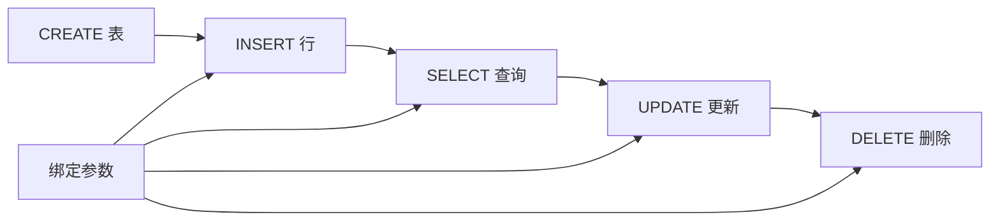

# 第 27 章：SQL 基础——安全地增删改查

> SQL 是向数据库表达“要什么”和“改变什么”的语言。本章学习最小 CRUD，并把参数绑定作为不可省略的安全习惯。

## 本章目标

学完后，你能够：

1. 读写 CREATE、INSERT、SELECT、UPDATE、DELETE；
2. 使用 WHERE 限定目标；
3. 使用 ORDER BY 排序；
4. 使用参数绑定而不是拼接用户输入；
5. 理解影响行数；
6. 在内存数据库验证 SQL；
7. 识别漏写 WHERE 的危险；
8. 从 Rust 代码找到 SQL 参数对应关系。

## 开始前需要会什么

请先完成第 26 章，理解表、行、列、主键和约束。Rust 只需看懂函数参数与 `Result`。

## 新术语表

| 术语 | 白话解释 |
|---|---|
| SQL | 操作关系型数据库的语言 |
| CRUD | Create、Read、Update、Delete 的合称 |
| 查询 | 从数据库读取符合条件的数据 |
| `WHERE` | 限定哪些行参与操作 |
| `ORDER BY` | 按列升序或降序排列结果 |
| 参数绑定 | SQL 结构与输入值分开交给数据库 |
| SQL 注入 | 输入被错误拼进 SQL 后改变语句含义的攻击或缺陷 |
| 影响行数 | INSERT/UPDATE/DELETE 实际改变了多少行 |

## 先建立直觉

SQL 像给档案员的结构化指令：从哪张表、选择哪些列、满足什么条件、按什么顺序。参数绑定则像把“指令模板”和“具体资料”分开装袋，用户输入永远只是值，不会变成指令。

## 图解



## 跟我一步一步做

### 第一步：创建表

```sql
CREATE TABLE study_tasks (
  id TEXT PRIMARY KEY,
  title TEXT NOT NULL,
  subject TEXT NOT NULL
);
```

正式应用通过 migration 建表；这里用于理解语法。

### 第二步：参数化插入

```rust
connection.execute(
    "INSERT INTO study_tasks (id, title, subject, created_at, updated_at)
     VALUES (?1, ?2, ?3, ?4, ?4)",
    params![id, title, subject, timestamp],
)?;
```

`?1` 对应第一个参数。标题 `O'Reilly 阅读` 中的引号会被作为数据正确处理。

绝对不要：

```rust
// 错误示例：用户输入被拼入 SQL
let sql = format!("INSERT INTO study_tasks (title) VALUES ('{title}')");
```

### 第三步：查询与排序

```sql
SELECT title
FROM study_tasks
WHERE deleted_at IS NULL
ORDER BY created_at ASC, id ASC;
```

`ASC` 是升序，`DESC` 是降序。第二排序字段保证时间相同时结果稳定。

### 第四步：更新指定行

```sql
UPDATE study_tasks
SET title = ?1, version = version + 1
WHERE id = ?2;
```

没有 WHERE 会更新整张表。执行前先把语句用自然语言复述一遍。

### 第五步：删除指定行

```sql
DELETE FROM study_tasks WHERE id = ?1;
```

这是硬删除，只用于本章基础实验。真实可恢复数据后续使用 `deleted_at` 软删除。

### 第六步：读取多行

```rust
let mut statement = connection.prepare(
    "SELECT title FROM study_tasks ORDER BY created_at ASC, id ASC",
)?;
let rows = statement.query_map([], |row| row.get(0))?;
let titles: rusqlite::Result<Vec<String>> = rows.collect();
```

prepare 解析语句，query_map 把每行映射为 Rust 值，collect 汇总并保留可能的读取错误。

## 完整示例

完整可运行代码在 [`database.rs`](../labs/backend-basics/src/database.rs)。核心测试先插入两条不同时间任务，确认排序，再更新一条、删除一条并重新查询。

```rust
insert_task(&connection, "late", "第二条", "math", 20)?;
insert_task(&connection, "early", "第一条", "politics", 10)?;
assert_eq!(list_titles(&connection)?, vec!["第一条", "第二条"]);
```

## 逐段解释

SQL 关键字通常大写便于阅读，但 SQLite 不要求。列名与表名属于语句结构，值通过参数绑定。

`execute` 适合不返回结果行的语句，并返回影响行数。更新不存在 ID 若影响 0 行，应由 repository 转成“未找到”错误。

`query_row` 期待一行；`query_map` 处理多行。数据库 NULL 需要映射为 `Option<T>`。

## 运行并观察

```powershell
cargo test --offline --manifest-path docs/tutorial/labs/backend-basics/Cargo.toml database::tests
```

预期三个测试通过：建表、引号标题安全插入、排序后更新删除。

## 常见错误与修复

### 字符串引号导致语法错

不要手动转义并拼接；使用参数绑定。

### UPDATE/DELETE 漏 WHERE

可能改变全部行。先在事务或临时数据库验证，并检查影响行数。

### SELECT * 依赖列顺序

生产 repository 明确列出所需字段，迁移新增列时更稳定。

### 查询顺序偶尔变化

没有 ORDER BY 就不要依赖返回顺序；需要稳定结果时明确排序和次级字段。

### 把 NULL 与空字符串混为一谈

NULL 表示缺失，空字符串是存在但长度为零的文本。Rust 分别对应 `Option<String>` 与 `String`。

## 在“学习空间”项目里找到它

在 `src-tauri/src/data` 的 repository 文件中搜索 `SELECT`、`INSERT`、`UPDATE` 和 `params!`。确认所有用户值通过参数绑定，并观察行映射如何转换成 model。不要在真实数据库控制台练习 DELETE。

## 必做练习

1. 写出查询所有未完成数学任务的 SQL。
2. 把结果按创建时间降序排列。
3. 解释 `?1` 与 `params![...]` 的对应关系。
4. 预测漏写 WHERE 的后果。
5. 给更新函数增加“影响 0 行”的测试思路。

## 选做挑战

在内存实验中增加 `completed` 筛选函数，接收 bool 并参数化查询。先写失败测试，不拼接 `0` 或 `1` 到 SQL 字符串。

## 答案与思路

```sql
SELECT id, title
FROM study_tasks
WHERE subject = ?1 AND completed = ?2 AND deleted_at IS NULL
ORDER BY created_at DESC, id ASC;
```

参数为 `params!["math", 0]`。更新影响 0 行可能意味着 ID 不存在或版本冲突，需要上层区分业务语义。

## 本章自检

- [ ] 能写五种基础语句；
- [ ] 能用 WHERE 限定行；
- [ ] 能用 ORDER BY 保证顺序；
- [ ] 始终使用参数绑定；
- [ ] 能解释 SQL 注入风险；
- [ ] 能区分 query_row 与 query_map；
- [ ] 能检查影响行数；
- [ ] 不在真实数据库练习破坏性语句。

## 本章小结

SQL 用结构化语句完成增删改查，WHERE 决定目标，ORDER BY 决定结果顺序。安全底线是把 SQL 结构与数据值分开参数绑定，并检查影响行数。所有练习都在内存数据库运行。

## 下一章

进入[第 28 章：Rust 操作 SQLite](28-Rust操作SQLite.md)。我们会把散落的 SQL 收进 repository，映射完整 StudyTask，并把底层错误转换为稳定 AppError。
