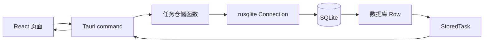

# 第 28 章：Rust 操作 SQLite——建立清楚的仓储层

> 前两章学会了数据库与 SQL。本章把 SQL 放进 Rust 函数，让上层代码只表达“创建任务、读取任务、修改任务”，而不必到处重复 SQL。

## 本章目标

学完后，你能够：

1. 使用 `rusqlite::Connection` 连接 SQLite；
2. 理解 `&Connection` 表示“临时借用连接”；
3. 使用 `params!` 绑定参数；
4. 把查询结果的一行转换为 Rust 结构体；
5. 区分 `query_row`、`query_map` 和 `execute`；
6. 使用 `OptionalExtension` 表示“可能查不到”；
7. 把数据库错误转换成应用自己的错误；
8. 理解仓储层为什么不应该放在 Tauri 命令里；
9. 在“学习空间”的真实代码中找到同样的分层方式。

## 开始前需要会什么

请先完成第 26、27 章。你应当知道表、行、列、主键和 CRUD，并能看懂最基本的 `struct`、`Result`、`Option` 与借用语法。

本章不会访问你的真实数据库。所有练习都使用内存数据库：程序退出后，练习数据立即消失。

## 新术语表

| 术语 | 白话解释 |
|---|---|
| `rusqlite` | Rust 操作 SQLite 的常用库 |
| Connection | 一条已经打开的数据库连接 |
| 仓储层 | 集中保存“如何读写某类数据”的代码层 |
| Row mapping | 把数据库的一行转换成 Rust 结构体 |
| 参数绑定 | 将 SQL 模板和具体值分开传递 |
| OptionalExtension | 把“没有查到行”转换成 `Ok(None)` 的工具 |
| 影响行数 | `UPDATE`、`DELETE` 实际改变的记录数量 |
| 错误边界 | 把底层错误转换为应用稳定错误的位置 |

## 先建立直觉

把数据库想成档案室：

- `Connection` 是档案室的门卡；
- SQL 是交给档案员的指令；
- `params!` 是随指令一起提交的资料；
- `Row` 是档案员递出来的一张原始表格；
- `StoredTask` 是应用真正认识的任务对象；
- repository 是负责跑档案室的人。

页面不应该亲自写 SQL，Tauri 命令也不应该塞满 SQL。命令负责接收前端请求，仓储函数负责数据库读写，模型负责表达数据。职责分开后，测试与修改都会简单很多。

## 图解



数据往返时，边界很清楚：页面不知道 SQL，数据库也不知道页面按钮长什么样。

## 跟我一步一步做

### 第一步：认识本章实验文件

打开 [repository.rs](../labs/backend-basics/src/repository.rs)。它操作第 26 章创建的 `study_tasks` 表。

结构体保存数据库里的一条完整任务：

```rust
#[derive(Debug, Clone, PartialEq, Eq)]
pub struct StoredTask {
    pub id: String,
    pub title: String,
    pub subject: String,
    pub completed: bool,
    pub created_at: i64,
    pub updated_at: i64,
    pub version: i64,
    pub deleted_at: Option<i64>,
}
```

这里的字段与表的列一一对应。`deleted_at` 使用 `Option<i64>`，因为没有删除时数据库值是 `NULL`。

### 第二步：让函数借用连接

```rust
pub fn get_task(
    connection: &Connection,
    id: &str,
) -> Result<Option<StoredTask>, AppError>
```

`&Connection` 的意思不是复制数据库，也不是把连接所有权交给函数，而是暂时借给它使用。函数结束后，调用者仍然拥有连接。

只读查询通常使用 `&Connection`。需要开启事务的方法往往需要 `&mut Connection`，第 30 章会专门讲。

### 第三步：绑定参数，不拼接字符串

```rust
connection.execute(
    "INSERT INTO study_tasks (id, title, subject, created_at, updated_at)
     VALUES (?1, ?2, ?3, ?4, ?4)",
    params![id, title, subject, timestamp],
)?;
```

`?1` 到 `?4` 是参数位置。真实值由 `params!` 单独提供。标题即使包含引号，也只会被当成数据，而不会破坏 SQL 结构。

不要这样做：

```rust
// 错误示范：不要把输入直接拼进 SQL。
let sql = format!("SELECT * FROM study_tasks WHERE id = '{id}'");
```

### 第四步：把一行映射为结构体

```rust
fn map_task(row: &Row<'_>) -> rusqlite::Result<StoredTask> {
    Ok(StoredTask {
        id: row.get(0)?,
        title: row.get(1)?,
        subject: row.get(2)?,
        completed: row.get::<_, i64>(3)? != 0,
        created_at: row.get(4)?,
        updated_at: row.get(5)?,
        version: row.get(6)?,
        deleted_at: row.get(7)?,
    })
}
```

SQLite 没有 Rust 的 `bool` 类型，表中使用整数 `0` 和 `1`，因此映射时转换为布尔值。列顺序必须与 SELECT 顺序一致。

为了降低错位风险，实验代码把列清单集中为常量：

```rust
const TASK_COLUMNS: &str =
    "id, title, subject, completed, created_at, updated_at, version, deleted_at";
```

### 第五步：读取一条可能不存在的记录

```rust
connection
    .query_row(
        &format!("SELECT {TASK_COLUMNS} FROM study_tasks WHERE id = ?1"),
        params![id],
        map_task,
    )
    .optional()
    .map_err(storage)
```

`query_row` 预期得到一行。默认情况下，没有行会产生 `QueryReturnedNoRows` 错误；`.optional()` 把它变成 `Ok(None)`。因此：

- 查到：`Ok(Some(task))`；
- 没查到：`Ok(None)`；
- 数据库损坏或类型错误：`Err(AppError)`。

### 第六步：读取多行

```rust
let rows = statement.query_map([], map_task).map_err(storage)?;
rows.collect::<rusqlite::Result<Vec<_>>>().map_err(storage)
```

`query_map` 会对查询得到的每一行调用 `map_task`。最终收集成 `Vec<StoredTask>`。任何一行无法正确转换，整个结果都返回错误，避免悄悄丢数据。

### 第七步：检查更新是否真的发生

```rust
let changed = connection.execute(
    "UPDATE study_tasks
     SET title = ?1, updated_at = ?2, version = version + 1
     WHERE id = ?3 AND deleted_at IS NULL",
    params![title, timestamp, id],
)?;

if changed == 0 {
    return Err(AppError::not_found());
}
```

`execute` 返回影响行数。如果是 `0`，可能是任务不存在，也可能已被软删除。仓储层将这种情况转换成稳定的 `not_found`。

## 完整示例

下面是一个最小、可运行的仓储使用流程：

```rust
use rusqlite::Connection;
use backend_basics::database::create_schema;
use backend_basics::repository::{create_task, list_tasks, update_task_title};

fn main() -> Result<(), Box<dyn std::error::Error>> {
    let connection = Connection::open_in_memory()?;
    create_schema(&connection)?;

    let created = create_task(
        &connection,
        "task-1",
        "整理英语试卷",
        "english",
        1_700_000_000,
    )?;
    println!("创建：{}，版本 {}", created.title, created.version);

    let updated = update_task_title(
        &connection,
        "task-1",
        "整理英语阅读错题",
        1_700_000_100,
    )?;
    println!("更新：{}，版本 {}", updated.title, updated.version);

    for task in list_tasks(&connection)? {
        println!("{} / {}", task.id, task.title);
    }

    Ok(())
}
```

练习时优先运行仓库自带测试，不必修改真实应用入口。

## 逐段解释

### 为什么 `create_task` 创建后又查询一次

INSERT 只告诉我们影响了几行，不会自动返回完整对象。再用 `get_task` 查询一次，可统一得到数据库实际保存的默认值，例如 `completed = 0`、`version = 1`。

### 为什么仓储函数接收 Connection

如果每个函数内部都重新打开数据库：

1. 测试难以替换为内存数据库；
2. 同一事务无法跨多个操作；
3. 连接配置容易不一致；
4. 路径选择逻辑会散落到各处。

把连接作为参数传入，调用者决定它来自真实数据库、临时文件还是内存。

### 为什么不把 rusqlite 错误直接发给前端

数据库错误可能包含表名、路径、SQL 片段等内部信息，而且错误文字会随库版本变化。实验通过 `storage` 函数统一转换为稳定的 `storage_failed`：

```rust
fn storage(error: rusqlite::Error) -> AppError {
    AppError::storage(error.to_string())
}
```

内部错误保留用于诊断，但第 25 章已经保证它不会序列化到前端。

### 为什么 SQL 不放进 command

假设 `create_daily_task` 命令同时处理参数、打开数据库、拼 SQL、映射行、组织响应。它会很快变成难测试的大函数。更好的结构是：

```text
command：接收前端参数、安排阻塞任务、返回响应
repository：执行 SQL、映射数据、判断影响行数
model：表达任务和输入输出结构
database manager：管理连接、迁移和恢复
```

## 运行并观察

在项目根目录执行：

```powershell
cargo test --offline --manifest-path docs/tutorial/labs/backend-basics/Cargo.toml repository::tests
```

你应看到 5 个仓储测试通过。它们分别验证：

1. 创建后可以按 id 读回；
2. 列表按创建时间排序；
3. 修改标题会让版本加一；
4. 缺失记录得到 `None` 或 `not_found`；
5. 错误列类型会被转换成 `storage_failed`。

再检查代码质量：

```powershell
cargo clippy --offline --manifest-path docs/tutorial/labs/backend-basics/Cargo.toml --all-targets -- -D warnings
```

`--offline` 表示只使用本机已经缓存的依赖，避免练习时意外联网。

## 常见错误与修复

### 错误一：`no such table: study_tasks`

原因：查询前没有创建结构。先运行 `create_schema(&connection)`，或在真实应用中先执行 migrations。

### 错误二：`Invalid column type`

原因：`row.get` 期待的 Rust 类型与数据库实际值不一致，或 SELECT 列顺序和映射顺序不同。对照 `TASK_COLUMNS` 与 `map_task` 逐列检查。

### 错误三：查询不到却当成程序崩溃

对于正常的“记录可能不存在”，在 `query_row` 后使用 `.optional()`，返回 `Option`。只有真正异常才返回 `Err`。

### 错误四：更新成功但页面拿到旧值

UPDATE 后重新查询，或明确构造更新后的对象。不要假设数据库默认值和触发器没有改变数据。

### 错误五：SQL 中直接插入变量

始终使用占位符和 `params!`。只有经过程序控制的固定 SQL 片段才可以进入 `format!`；本章的 `TASK_COLUMNS` 是固定常量，不含用户输入。

### 错误六：布尔值映射混乱

统一约定 SQLite 中 `0 = false`、`1 = true`，表结构使用 CHECK 约束，Rust 映射时明确转换。

## 在“学习空间”项目里找到它

先读实验，再只读观察真实项目：

1. [实验仓储](../labs/backend-basics/src/repository.rs)：最小的增查改与错误转换；
2. [数据库管理器](../../../src-tauri/src/data/database.rs)：集中打开、配置并借用真实连接；
3. [首页仓储](../../../src-tauri/src/data/dashboard/repository.rs)：首页任务、计时等数据库操作；
4. [专注数据](../../../src-tauri/src/data/focus.rs)：专注会话、预设与行映射；
5. [专注计划](../../../src-tauri/src/data/focus_plans.rs)：版本检查和多步骤操作；
6. [首页命令](../../../src-tauri/src/commands/dashboard_commands.rs)：命令如何调用数据层，而不是自己承担全部逻辑；
7. [数据错误](../../../src-tauri/src/data/error.rs)：真实项目如何统一转换 `rusqlite::Error`。

你现在只需要回答三个问题：连接在哪里管理、SQL 在哪里执行、数据库行在哪里变成 Rust 模型。不要急着读完每个大文件。

## 必做练习

### 练习一：画出一次读取的数据路径

从“React 请求任务列表”开始，写出经过 command、repository、Connection、SQLite、row mapping 再返回页面的顺序。

### 练习二：增加按学科筛选的设计

先不修改代码，写出函数签名和参数化 SQL。要求不能用字符串拼接 subject。

### 练习三：判断返回类型

为以下需求选择返回类型并说明原因：

1. 按 id 找一个可能不存在的任务；
2. 列出今天的所有任务，可能一条都没有；
3. 修改一个必须存在的任务；
4. 数据库打不开。

### 练习四：运行全部实验测试

```powershell
cargo test --offline --manifest-path docs/tutorial/labs/backend-basics/Cargo.toml
```

阅读测试名，用自己的话说出每个仓储测试保护了什么。

## 选做挑战

为实验仓储设计一个 `list_tasks_by_subject`：

```rust
pub fn list_tasks_by_subject(
    connection: &Connection,
    subject: &str,
) -> Result<Vec<StoredTask>, AppError>
```

要求：

1. 使用 `?1` 和 `params![subject]`；
2. 排除 `deleted_at IS NOT NULL` 的记录；
3. 保持稳定排序；
4. 先写测试，再实现；
5. 不连接真实应用数据库。

## 答案与思路

### 练习一参考

```text
React invoke
→ Tauri command 接收参数
→ 数据库管理器提供连接
→ repository 执行 SELECT
→ SQLite 返回 Row
→ map_task 转换 StoredTask
→ command 序列化结果
→ React 收到对象
```

### 练习二参考

```rust
fn list_tasks_by_subject(
    connection: &Connection,
    subject: &str,
) -> Result<Vec<StoredTask>, AppError>
```

```sql
SELECT id, title, subject, completed, created_at, updated_at, version, deleted_at
FROM study_tasks
WHERE subject = ?1 AND deleted_at IS NULL
ORDER BY created_at ASC, id ASC
```

### 练习三参考

1. `Result<Option<StoredTask>, AppError>`：操作可能失败，记录也可能不存在；
2. `Result<Vec<StoredTask>, AppError>`：零条记录就是空 Vec，不是错误；
3. `Result<StoredTask, AppError>`：缺失应转换成 `not_found`；
4. `Err(AppError)`：这是操作失败，不是正常的“没有记录”。

### 练习四参考

不要只看绿色结果。把测试理解为合同：例如“missing rows”测试规定了找不到时的稳定行为，“bad row data”测试规定了损坏数据不能被静默忽略。

## 本章自检

在不看正文的情况下回答：

- [ ] `&Connection` 为什么不会夺走连接所有权？
- [ ] `execute`、`query_row`、`query_map` 分别适合什么操作？
- [ ] 为什么查询一条记录时经常需要 `OptionalExtension`？
- [ ] `params!` 比字符串拼接安全在哪里？
- [ ] SELECT 列顺序为什么必须和 `row.get` 对齐？
- [ ] 为什么命令层不应该堆放 SQL？
- [ ] 底层数据库错误为什么要转换成应用错误？
- [ ] 如何保证练习不碰真实数据？

如果有三项答不出，请重新运行仓储测试，并逐行对照 `repository.rs`。

## 本章小结

你已经把 SQL 从独立语句提升成可测试的 Rust 仓储：连接由外部提供，参数安全绑定，查询行显式映射，缺失记录与真正错误被清楚区分。这个分层是桌面应用可靠本地数据功能的基础。

## 下一章

下一章学习 [第 29 章：迁移、软删除与版本冲突](29-迁移软删除与版本冲突.md)。我们会解决应用升级后如何保留旧数据、如何让删除可恢复，以及两个设备或两个窗口同时编辑时如何避免互相覆盖。
