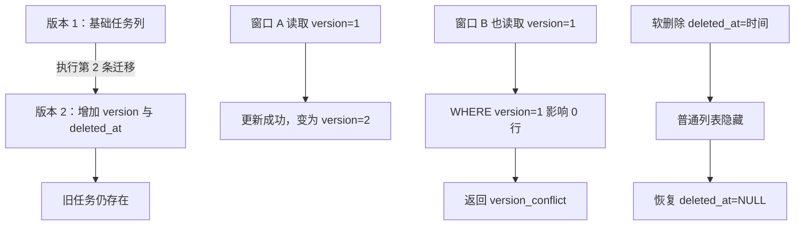

# 第 29 章：迁移、软删除与版本冲突——让数据经得起升级和并发修改

> 能保存数据只是起点。真正可靠的本地应用还要在升级时保住旧数据、让误删可恢复，并阻止旧页面覆盖较新的修改。

## 本章目标

学完后，你能够：

1. 理解数据库迁移解决什么问题；
2. 使用 `PRAGMA user_version` 查看结构版本；
3. 理解迁移为什么只能追加，不能改写已发布历史；
4. 测试旧数据库升级后数据仍然存在；
5. 用 `deleted_at` 实现软删除与恢复；
6. 在正常列表中隐藏已删除记录；
7. 使用 `version` 实现乐观并发控制；
8. 区分“记录不存在”和“版本冲突”；
9. 在真实项目中找到相同的保护机制。

## 开始前需要会什么

请先完成第 28 章，理解仓储函数、`Connection`、参数绑定、影响行数和 `AppError`。

本章仍然只操作内存数据库，不读取、修改或迁移你的真实“学习空间”数据。

## 新术语表

| 术语 | 白话解释 |
|---|---|
| Schema | 数据库有哪些表、列、约束和索引的整体结构 |
| Migration | 把旧结构一步一步升级到新结构的脚本 |
| Schema version | 当前已经执行到第几次迁移 |
| 向前迁移 | 从旧版本升级到更高版本 |
| 软删除 | 不物理删行，只记录删除时间 |
| 恢复 | 清空删除标记，让记录重新可见 |
| 乐观并发控制 | 更新时确认自己看到的版本仍是最新版 |
| Version conflict | 数据已被别人更新，当前修改基于旧版本 |
| Append-only | 已发布内容不改写，只在后面追加 |

## 先建立直觉

数据库像一本长期使用的纸质登记册。

- 迁移是在保留旧内容的前提下增加新栏目；
- 软删除是把一行移进废纸篓，而不是立刻烧掉；
- `version` 是每行上的修订编号；
- 版本冲突是两个人都拿着第 1 版，其中一人已写成第 2 版，另一人不能再假装第 1 版仍是最新。

如果应用只在空数据库上测试，它很容易“新安装能用，升级就坏”。所以迁移测试必须从旧版本开始，先插入旧数据，再升级，再确认数据和默认值。

## 图解



## 跟我一步一步做

### 第一步：把结构变化拆成迁移

打开 [migrations.rs](../labs/backend-basics/src/migrations.rs)。实验把数据库拆成两版：

```rust
fn all_migrations() -> Migrations<'static> {
    Migrations::new(vec![
        M::up(VERSION_ONE),
        M::up(VERSION_TWO),
    ])
}
```

第 1 版创建任务表；第 2 版增加：

```sql
ALTER TABLE study_tasks ADD COLUMN version INTEGER NOT NULL DEFAULT 1;
ALTER TABLE study_tasks ADD COLUMN deleted_at INTEGER;
```

`DEFAULT 1` 很重要：旧行没有 version，升级时它们会自动得到初始版本 1。

### 第二步：执行到最新版本

```rust
pub fn migrate(connection: &mut Connection) -> Result<(), AppError> {
    all_migrations()
        .to_latest(connection)
        .map_err(|error| AppError::storage(error.to_string()))
}
```

迁移需要修改数据库结构，因此接收 `&mut Connection`。迁移库会读取已执行版本，只运行尚未执行的部分。

### 第三步：读取结构版本

SQLite 提供内部版本号：

```sql
PRAGMA user_version;
```

实验封装为 `schema_version(&connection)`。完成两条迁移后返回 2。再次调用 `migrate` 仍然是 2，不会重复添加列。

### 第四步：写升级保护测试

正确顺序是：

1. 只执行第 1 版迁移；
2. 按第 1 版结构插入一条旧任务；
3. 执行全部迁移；
4. 检查结构版本变为 2；
5. 检查旧标题仍在；
6. 检查新增 `version = 1`、`deleted_at = NULL`。

这比“在空库上执行全部迁移”更能发现真实升级问题。

### 第五步：软删除而不是 DELETE

```sql
UPDATE study_tasks
SET deleted_at = ?1,
    updated_at = ?1,
    version = version + 1
WHERE id = ?2
  AND version = ?3
  AND deleted_at IS NULL;
```

数据行还在，只是有了删除时间。正常列表统一添加：

```sql
WHERE deleted_at IS NULL
```

### 第六步：实现恢复

恢复不是重新 INSERT，而是更新原行：

```sql
UPDATE study_tasks
SET deleted_at = NULL,
    updated_at = ?1,
    version = version + 1
WHERE id = ?2
  AND version = ?3
  AND deleted_at IS NOT NULL;
```

原 id、创建时间和关联关系都能保留。

### 第七步：使用版本条件更新

```sql
UPDATE study_tasks
SET title = ?1,
    updated_at = ?2,
    version = version + 1
WHERE id = ?3
  AND version = ?4
  AND deleted_at IS NULL;
```

调用者提交自己读取到的 `expected_version`。影响 1 行表示成功；影响 0 行时，再读取当前记录：

- id 不存在或已删除：`not_found`；
- id 仍在但版本不同：`version_conflict`。

## 完整示例

```rust
use rusqlite::Connection;
use backend_basics::migrations::migrate;
use backend_basics::repository::{
    create_task, get_task, restore_task, soft_delete_task,
    update_task_title_if_version,
};

fn main() -> Result<(), Box<dyn std::error::Error>> {
    let mut connection = Connection::open_in_memory()?;
    migrate(&mut connection)?;

    let original = create_task(
        &connection,
        "task-1",
        "整理数学错题",
        "math",
        10,
    )?;

    let updated = update_task_title_if_version(
        &connection,
        &original.id,
        "整理高数极限错题",
        original.version,
        20,
    )?;
    assert_eq!(updated.version, 2);

    let deleted = soft_delete_task(
        &connection,
        &updated.id,
        updated.version,
        30,
    )?;
    assert!(deleted.deleted_at.is_some());

    let restored = restore_task(
        &connection,
        &deleted.id,
        deleted.version,
        40,
    )?;
    assert!(restored.deleted_at.is_none());
    assert_eq!(get_task(&connection, "task-1")?, Some(restored));

    Ok(())
}
```

这个示例只使用内存数据库，运行结束不会留下文件。

## 逐段解释

### 为什么不能修改已经发布的第 1 条迁移

老用户的数据库已经把“第 1 条迁移已完成”记入版本号。你后来修改第 1 条内容，老用户不会重新运行，但新用户会运行修改后的版本，于是两类用户虽然都显示 version 1，结构却不同。

正确做法：第 1 条永久保持不变，把任何新变化写成第 2、3、4 条迁移。

### 为什么软删除也要增加 version

删除是一种数据修改。如果不增加版本，另一个旧页面可能在删除后继续更新这条记录，造成“已删除内容偷偷复活”或状态混乱。

### 为什么普通查询必须统一过滤 deleted_at

只要漏掉一次过滤，垃圾箱内容就会重新出现在正常列表。真实项目通常把查询集中到数据模块，并为正常列表与垃圾箱列表分别写测试。

### 为什么叫“乐观”锁

它不提前锁住记录，而是乐观地允许多人读取，在写入瞬间检查版本。学习应用冲突频率低，这种方式简单、性能好，也适合桌面和移动端同步前的本地数据模型。

### 冲突发生后页面应该怎么做

不要自动覆盖。合理流程是：提示“内容已更新”，重新读取最新版，让用户重新确认修改。未来双端同步也需要同样的冲突意识。

## 运行并观察

```powershell
cargo test --offline --manifest-path docs/tutorial/labs/backend-basics/Cargo.toml migrations::tests
cargo test --offline --manifest-path docs/tutorial/labs/backend-basics/Cargo.toml repository::tests
```

重点观察四类结果：

1. 第 1 版数据库升级到第 2 版后旧行保留；
2. 连续执行迁移不会重复修改结构；
3. 软删除任务不出现在普通列表，但可以恢复；
4. 旧版本更新返回 `version_conflict`，较新的标题不被覆盖。

再运行全部测试和静态检查：

```powershell
cargo test --offline --manifest-path docs/tutorial/labs/backend-basics/Cargo.toml
cargo clippy --offline --manifest-path docs/tutorial/labs/backend-basics/Cargo.toml --all-targets -- -D warnings
```

## 常见错误与修复

### 错误一：直接修改 CREATE TABLE

只改最初建表语句无法升级已经安装的数据库。保留旧迁移，追加 `ALTER TABLE` 迁移。

### 错误二：新增 NOT NULL 列却没有默认值

旧行没有新列的值，迁移可能失败。为旧数据提供合理默认值，或分多步回填后再收紧约束。

### 错误三：软删除后列表仍能看到

检查所有正常列表是否包含 `deleted_at IS NULL`，并增加“删除后列表为空”的测试。

### 错误四：恢复时 INSERT 一条新记录

这会破坏 id 和关联。恢复应更新原记录的 `deleted_at`。

### 错误五：更新只按 id 匹配

`WHERE id = ?` 无法发现旧页面。加入 `AND version = ?`，成功后 version 加一。

### 错误六：把影响 0 行都解释成 not_found

记录可能仍存在，只是版本更新了。追加一次读取，用当前状态区分缺失和冲突。

## 在“学习空间”项目里找到它

只读查看以下文件：

1. [实验迁移](../labs/backend-basics/src/migrations.rs)：两版结构与升级测试；
2. [实验仓储](../labs/backend-basics/src/repository.rs)：软删除、恢复和版本检查；
3. [真实迁移](../../../src-tauri/src/data/migrations.rs)：应用按顺序追加的正式 schema；
4. [数据错误](../../../src-tauri/src/data/error.rs)：真实版本冲突与迁移失败如何表达；
5. [专注计划](../../../src-tauri/src/data/focus_plans.rs)：`WHERE ... version = ?` 的实际使用；
6. [附件数据](../../../src-tauri/src/data/attachments.rs)：带 `deleted_at` 和 `version` 的数据生命周期；
7. [数据库管理器](../../../src-tauri/src/data/database.rs)：启动迁移、版本读取与恢复保护。

真实项目迁移比实验长很多，因为它已经包含英语资料、作文、首页、专注等模块。阅读时先找 `Migrations::new`，再按顺序看每个 `M::up`，不要一开始逐行啃完整 SQL。

## 必做练习

### 练习一：解释升级测试顺序

说明为什么必须“先建旧库、插入旧数据、再升级”，而不是只测试空库。

### 练习二：模拟两个窗口

纸上写出窗口 A、B 都读取 version 1，A 保存为 version 2，B 再保存时 SQL 的影响行数和最终结果。

### 练习三：设计垃圾箱查询

写出只列出已删除任务的 SQL，按删除时间从新到旧排列。

### 练习四：判断是否需要增加版本

判断下列操作是否应增加 version：修改标题、标记完成、软删除、恢复、只读查看。

## 选做挑战

为实验设计 `list_deleted_tasks` 和 `purge_task`：

- `list_deleted_tasks` 只返回 `deleted_at IS NOT NULL`；
- `purge_task` 才执行物理 DELETE；
- 物理删除前要求记录已软删除；
- 物理删除也检查 expected version；
- 先写测试，再实现；
- 不接触真实数据库。

思考：永久删除按钮为什么应该比普通删除更难误触？

## 答案与思路

### 练习一参考

空库只能证明最新结构能创建，不能证明历史结构能安全变化。旧库测试同时保护迁移顺序、默认值和用户已有数据。

### 练习二参考

窗口 A 的条件 `id = task-1 AND version = 1` 匹配成功，记录变为 version 2。窗口 B 仍提交 version 1，条件不再匹配，影响 0 行；仓储读取到当前记录仍存在，于是返回 `version_conflict`，A 的内容保持不变。

### 练习三参考

```sql
SELECT id, title, subject, completed, created_at, updated_at, version, deleted_at
FROM study_tasks
WHERE deleted_at IS NOT NULL
ORDER BY deleted_at DESC, id ASC;
```

### 练习四参考

修改标题、标记完成、软删除和恢复都改变数据，应增加 version。只读查看不改变数据，不增加。

## 本章自检

- [ ] migration 与普通 SQL 初始化有什么区别？
- [ ] 为什么已发布迁移不能原地修改？
- [ ] 如何确认当前 schema version？
- [ ] 新增 NOT NULL 列时为什么要考虑旧行？
- [ ] 软删除如何隐藏和恢复？
- [ ] 为什么删除与恢复也要增加 version？
- [ ] `WHERE id = ? AND version = ?` 保护了什么？
- [ ] 如何区分 not_found 与 version_conflict？
- [ ] 如何证明升级没有丢失旧数据？

如果有三项答不出，请重新阅读迁移测试与两个 repository 冲突测试。

## 本章小结

你已经让数据具备“长期生命”：迁移按顺序追加并保护旧数据；软删除让误删可恢复；版本字段阻止旧页面覆盖新内容。这些机制也是以后实现 Windows 与 Android 数据同步时的基础。

## 下一章

下一章学习 [第 30 章：事务、附件与备份](30-事务附件与备份.md)。我们会处理多个数据库操作必须一起成功的情况，并学习如何安全管理图片文件、校验备份和恢复数据。
