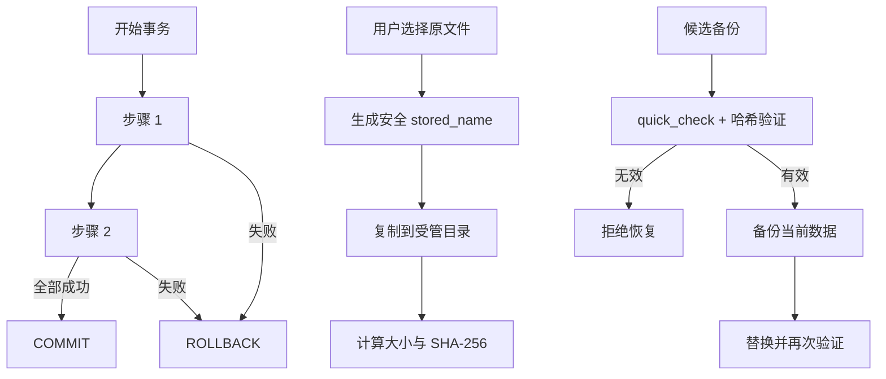

# 第 30 章：事务、附件与备份——保护一整套本地学习资料

> 数据库里的一行、磁盘上的一张照片和用户手中的备份共同构成资料。可靠性不是“成功时能保存”，而是任何一步失败后仍能回到清楚、可恢复的状态。

## 本章目标

学完后，你能够：

1. 理解事务的原子性、提交与回滚；
2. 用 `&mut Connection` 开启事务；
3. 解释为什么数据库事务不能自动回滚文件系统；
4. 把外部文件复制到应用受管目录；
5. 生成安全的存储文件名，阻止路径逃逸；
6. 使用 SHA-256 校验附件和备份是否变化；
7. 使用 SQLite Online Backup API 创建一致快照；
8. 在恢复前验证候选备份；
9. 在恢复前创建保护性备份；
10. 理解真实项目为何还需要清单、临时目录和失败回滚。

## 开始前需要会什么

请先完成第 28、29 章，理解仓储层、`Connection`、`Result`、迁移、软删除和版本冲突。

本章所有文件都写入测试自动创建的临时目录。不会读取或覆盖“学习空间”的真实数据库、附件与备份。

## 新术语表

| 术语 | 白话解释 |
|---|---|
| Transaction | 一组要么全部成功、要么全部撤销的数据库操作 |
| Commit | 确认事务中的全部修改 |
| Rollback | 撤销事务中尚未提交的全部修改 |
| Atomicity | 操作整体不可被拆成“只成功一半” |
| Managed directory | 由应用控制命名和生命周期的文件目录 |
| Path traversal | 利用 `../` 等路径跳出预期目录 |
| SHA-256 | 根据文件内容计算的固定长度指纹 |
| Snapshot | 某一一致时刻的数据库副本 |
| Integrity check | 检查 SQLite 文件内部结构是否完整 |
| Protective backup | 恢复前为当前数据额外创建的退路 |
| Manifest | 记录备份所含文件、大小和哈希的清单 |

## 先建立直觉

### 事务像一次收银

“创建作文 + 关联照片 + 写学习日志”应该是一件完整的事。中间任何一步失败，都不应留下半篇作文或孤立关联。事务先把修改放在临时账本里，全部成功才 commit；失败就 rollback。

### 附件像入库物品

用户选中的原文件可能在下载目录、相册或临时目录，应用不能永远依赖它。正确方式是复制到自己的受管目录，使用应用生成的安全文件名，并记录大小与哈希。

### 备份像封存箱

不能在数据库正在写入时粗暴复制多个文件。SQLite Online Backup API 会生成一致快照。恢复前先检查备份，再保存当前状态，最后才替换。

## 图解



## 跟我一步一步做

### 第一步：用一个函数包住事务

打开 [repository.rs](../labs/backend-basics/src/repository.rs)，找到：

```rust
pub fn in_transaction<T>(
    connection: &mut Connection,
    operation: impl FnOnce(&Transaction<'_>) -> Result<T, AppError>,
) -> Result<T, AppError>
```

它接收可变连接和一个操作闭包：

```rust
let transaction = connection.transaction()?;
match operation(&transaction) {
    Ok(value) => {
        transaction.commit()?;
        Ok(value)
    }
    Err(error) => {
        transaction.rollback()?;
        Err(error)
    }
}
```

`transaction()` 需要 `&mut Connection`，因为连接在事务期间不能同时被其他代码随意使用。

### 第二步：测试“成功全留、失败全撤”

实验测试先在成功事务中插入 `committed`，然后在另一个事务中插入 `rolled-back`，故意返回错误。最后检查：

- `committed` 存在；
- `rolled-back` 不存在；
- 调用者拿到原始业务错误。

这就是原子性可观察的结果。

### 第三步：不要把原文件路径直接当长期数据

打开 [attachments.rs](../labs/backend-basics/src/attachments.rs)。导入函数只接收内容与元数据，并把内容写进指定受管根目录：

```rust
pub fn import_bytes(
    managed_root: &Path,
    id: &str,
    original_name: &str,
    bytes: &[u8],
) -> Result<ManagedAttachment, AppError>
```

原名只用于提取安全扩展名。存储名来自应用 id：

```text
用户原名：../../英语试卷.JPG
受管文件名：photo-1.jpg
```

`../`、中文原名和路径分隔符都不会进入最终存储名。

### 第四步：记录文件指纹

```rust
pub struct ManagedAttachment {
    pub stored_name: String,
    pub path: PathBuf,
    pub byte_size: u64,
    pub sha256: String,
}
```

SHA-256 根据内容生成 64 位十六进制字符串。内容只改一个字节，哈希通常也完全不同。它用于发现文件被损坏或替换，不是加密文件。

### 第五步：使用 SQLite 快照备份

打开 [backup.rs](../labs/backend-basics/src/backup.rs)：

```rust
source
    .backup("main", target, None)
    .map_err(|error| AppError::storage(error.to_string()))?;
```

这调用 SQLite Online Backup API。与直接复制一个正在写入的 `.db` 文件相比，它能得到数据库认可的一致快照。

### 第六步：验证备份

实验执行：

```sql
PRAGMA quick_check;
```

结果必须为 `ok`，然后计算整个备份文件的 SHA-256。损坏的普通文本文件不会被误认为有效数据库。

真实项目还会验证备份包中的 manifest、每个附件大小与哈希、数据库和附件引用关系。这些保护不能只靠 `quick_check` 代替。

### 第七步：恢复前留下退路

最小恢复顺序：

1. 验证候选备份；
2. 打开当前数据库；
3. 为当前数据库创建保护性备份；
4. 关闭连接；
5. 替换当前数据库；
6. 再验证替换后的数据库。

候选文件无效时，流程在第 1 步就结束，当前数据不动。

## 完整示例

下面演示事务、附件和备份的最短组合。路径全部来自临时目录：

```rust
use rusqlite::Connection;
use tempfile::tempdir;

use backend_basics::attachments::{import_bytes, verify_attachment};
use backend_basics::backup::{create_backup, restore_with_protection};
use backend_basics::database::create_schema;
use backend_basics::repository::in_transaction;

fn main() -> Result<(), Box<dyn std::error::Error>> {
    let temp = tempdir()?;
    let current_path = temp.path().join("current.db");
    let backup_path = temp.path().join("backup.db");
    let protective_path = temp.path().join("before-restore.db");
    let attachment_root = temp.path().join("attachments");

    let mut connection = Connection::open(&current_path)?;
    create_schema(&connection)?;

    in_transaction(&mut connection, |transaction| {
        transaction.execute(
            "INSERT INTO study_tasks
             (id, title, subject, created_at, updated_at)
             VALUES (?1, ?2, ?3, ?4, ?4)",
            rusqlite::params!["task-1", "整理英语试卷", "english", 10],
        )?;
        Ok(())
    })?;

    let attachment = import_bytes(
        &attachment_root,
        "paper-1",
        "我的试卷.jpg",
        b"demo image bytes",
    )?;
    assert!(verify_attachment(&attachment)?);

    let backup = create_backup(&connection, &backup_path)?;
    println!("备份指纹：{}", backup.sha256);
    drop(connection);

    restore_with_protection(
        &current_path,
        &backup_path,
        &protective_path,
    )?;

    Ok(())
}
```

这是教学用最小模型，不应直接替换真实项目的完整备份模块。

## 逐段解释

### 数据库事务为什么不能包含文件回滚

SQLite 只管理数据库页，不知道你是否复制或删除了图片。因此以下流程仍可能半失败：

1. 文件复制成功；
2. 数据库 INSERT 失败；
3. 文件变成没有记录引用的孤儿。

真实系统常用“暂存目录 + 数据库事务 + 成功后移动 + 失败清理”，或定期扫描孤儿文件。必须明确设计补偿步骤。

### 为什么应用要控制 stored_name

原始文件名可能重复、含非法字符，甚至带 `../` 或绝对路径。如果直接 `root.join(original_name)`，攻击或误输入可能写到目录之外。应用生成存储名，原始名只作为展示元数据保存。

### SHA-256 能做什么，不能做什么

它能检测内容是否与记录时一致，但不能证明文件来自可信作者，也不能防止攻击者同时替换文件和清单。更高安全要求需要签名、密钥和可信存储。

### 为什么恢复前后都验证

恢复前验证避免把明显坏文件覆盖当前数据；恢复后验证确保复制或替换过程本身没有失败。保护性备份则提供人工或自动回滚的来源。

### 为什么真实项目使用备份包和 manifest

“学习空间”的完整状态不只有 SQLite，还包括附件和设置。真实备份包需要声明每个文件的相对路径、大小和哈希，并拒绝：

- `../escape` 之类的危险路径；
- manifest 未声明的额外文件；
- 缺失或哈希不匹配的附件；
- 数据库引用了不存在的附件；
- 用户确认后又被替换的备份文件。

## 运行并观察

运行全部后端实验：

```powershell
cargo test --offline --manifest-path docs/tutorial/labs/backend-basics/Cargo.toml
```

本章新增测试应证明：

1. 事务成功时全部提交，失败时全部回滚；
2. `../../英语试卷.JPG` 不会逃出受管目录；
3. 附件修改后 SHA-256 验证失败；
4. Online Backup 生成可查询的一致数据库；
5. 损坏的候选备份被拒绝；
6. 恢复后是候选数据，保护性备份中仍是恢复前数据。

再运行：

```powershell
cargo fmt --manifest-path docs/tutorial/labs/backend-basics/Cargo.toml -- --check
cargo clippy --offline --manifest-path docs/tutorial/labs/backend-basics/Cargo.toml --all-targets -- -D warnings
```

## 常见错误与修复

### 错误一：多个写操作不使用事务

中间失败会留下半成品。把同一业务动作的数据库修改放入同一事务，并测试故意失败时是否回滚。

### 错误二：事务里执行很慢的网络或文件操作

长事务会长期占用锁。先在临时区准备文件，事务只做必要数据库操作，完成后进行短小、可补偿的文件切换。

### 错误三：保存用户给出的完整路径

移动端路径可能失效，桌面路径也可能被移动。导入时复制到应用受管目录，只保存受管文件名与元数据。

### 错误四：只检查扩展名

扩展名不能证明内容完整。至少记录大小和 SHA-256；需要识别真实媒体类型时还要检查文件头。

### 错误五：直接复制正在使用的数据库文件

使用 SQLite Online Backup API 创建一致快照，不要猜测 WAL 文件何时写完。

### 错误六：未验证就覆盖当前数据

顺序必须是：候选校验 → 当前数据保护备份 → 替换 → 再校验。任何错误都要保留当前数据或明确回滚。

### 错误七：解压时相信压缩包内路径

每个条目必须是受控的相对路径，拒绝绝对路径、`..`、重复条目和未声明文件。

## 在“学习空间”项目里找到它

按“实验概念 → 真实实现”阅读：

1. [事务实验](../labs/backend-basics/src/repository.rs)：成功提交、失败回滚；
2. [附件实验](../labs/backend-basics/src/attachments.rs)：安全文件名、受管路径、SHA-256；
3. [备份实验](../labs/backend-basics/src/backup.rs)：一致快照、quick_check、保护性恢复；
4. [真实附件模块](../../../src-tauri/src/data/attachments.rs)：附件记录、复制、哈希、软删除；
5. [真实备份模块](../../../src-tauri/src/data/backup.rs)：压缩包、manifest、校验、暂存与恢复；
6. [数据库管理器](../../../src-tauri/src/data/database.rs)：连接、操作锁、健康检查和存储替换；
7. [真实数据路径](../../../src-tauri/src/data/paths.rs)：数据库、附件、备份和恢复暂存目录如何集中确定；
8. [专注数据](../../../src-tauri/src/data/focus.rs)：多表更新如何使用事务。

真实备份代码较长时，先找四个入口：`create_backup`、`validate_backup`、`restore_backup`、`hash_reader`。再沿着一次备份或恢复流程往下读。

## 必做练习

### 练习一：判断事务边界

为“导入一张试卷照片并创建资料记录”列出哪些步骤属于数据库事务，哪些属于文件操作，失败时分别如何补偿。

### 练习二：解释路径攻击

说明如果直接执行 `attachments_root.join("../../outside.txt")` 可能发生什么，以及实验如何避免。

### 练习三：设计备份恢复清单

不用写代码，写出从用户选择备份到恢复成功的严格步骤，至少包含两次验证和保护性备份。

### 练习四：阅读测试当作规格

打开 `attachments.rs`、`backup.rs` 与 `repository.rs` 的测试，用一句话描述每个测试禁止了什么坏结果。

## 选做挑战

在不接触真实应用数据的前提下，为实验设计一个 JSON manifest：

```json
{
  "formatVersion": 1,
  "files": [
    {
      "path": "database/study.db",
      "byteSize": 12345,
      "sha256": "..."
    }
  ]
}
```

要求：

1. 清单自身可序列化和反序列化；
2. 所有 path 只能由普通相对路径组件构成；
3. 每个声明文件必须存在且大小、哈希匹配；
4. 重复路径必须拒绝；
5. 多余未声明文件必须拒绝；
6. 测试全部使用 `tempdir()`。

## 答案与思路

### 练习一参考

文件先复制到受管临时路径并计算哈希；随后在短事务中创建附件元数据、资料记录和关联。事务失败则删除临时文件；事务成功后把临时文件原子移动到正式位置。如果最终移动失败，再执行补偿事务标记记录不可用或撤销刚创建的数据。

### 练习二参考

`join` 不会自动禁止 `..`，最终路径可能离开附件目录并覆盖其他文件。实验不使用原名作为路径，只从原名提取受限扩展名，主体使用过滤后的 id，并检查最终路径仍以 managed root 开头。

### 练习三参考

复制候选到暂存区 → 计算确认指纹 → 验证压缩路径与 manifest → 验证每个文件大小、哈希和数据库完整性 → 创建当前数据保护备份 → 准备替换目录 → 短暂关闭连接 → 原子切换 → 重新打开并健康检查 → 失败则恢复保护副本 → 成功后记录历史并清理暂存区。

### 练习四参考

测试不是演示，而是安全合同。例如“corrupt backup is rejected”规定坏文件永远不能进入覆盖步骤；“transaction rolls back”规定任何业务错误都不能留下第一半写入。

## 本章自检

- [ ] 事务的 commit 和 rollback 分别发生在什么时候？
- [ ] 为什么事务需要可变连接？
- [ ] 为什么 SQLite 事务不能自动撤销图片复制？
- [ ] 为什么不能长期引用用户原文件路径？
- [ ] stored_name 应由谁生成？
- [ ] SHA-256 验证的是什么？
- [ ] 为什么备份不能只复制正在使用的数据库？
- [ ] `PRAGMA quick_check` 能检查什么，不能检查什么？
- [ ] 恢复为什么必须先建立保护性备份？
- [ ] 真实备份 manifest 为什么必须限制路径？

如果有三项答不出，请重新运行本章新增的 6 个测试，并从断言反推每条安全规则。

## 本章小结

你已经完成本地数据基础的最后一环：事务保证数据库操作不留半成品；受管附件避免外部路径失效和目录逃逸；SHA-256 发现内容变化；一致快照、恢复前验证与保护性备份共同建立恢复底线。

到这里，你已经能从 React 请求一路追踪到 Tauri command、Rust 模型、仓储、SQLite、附件与备份。下一阶段会回到“学习空间”的真实业务模块，把这些底层能力组合成完整功能。

## 下一章

下一章进入第 31 章，开始学习英语资料库模块：从页面、路由和状态出发，继续追踪到照片导入、资料整理、数据库记录和文件存储。请先回到 [课程总目录](../00-课程总目录.md) 查看下一阶段安排。
