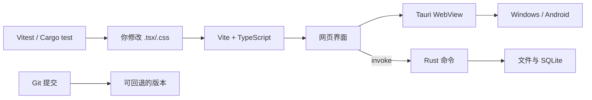

# 第 31 章：创建项目骨架——从空文件夹到可运行的桌面应用

> 从这一章开始，我们不再只读现有代码，而是亲手做一个缩小版“学习空间”。你不必一次记住所有命令，只要理解每个文件负责什么，并确认每一步都能运行。

## 本章目标

学完后，你能够：

1. 说清编辑器、终端、浏览器、Node.js、Rust、Vite、React 和 Tauri 各自负责什么；
2. 从空目录创建 React + TypeScript 项目；
3. 给网页外面套上 Tauri 桌面外壳；
4. 看懂教学项目最重要的目录；
5. 分别运行测试、网页开发版、生产构建和 Rust 测试；
6. 用 Git 保存第一个可以回退的版本。

## 开始前需要会什么

只要求你完成前 30 章，知道“前端负责界面、后端负责系统能力、数据库负责持久保存”即可。命令记不住没有关系，本章会逐条解释。

请先安装：

- Visual Studio Code：写代码的编辑器；
- Node.js：运行前端工具；
- Rust：编译 Tauri 后端；
- Git：保存代码历史；
- Windows WebView2：让 Tauri 显示网页界面。

## 新术语表

| 术语 | 白话解释 |
|---|---|
| IDE / 编辑器 | 写代码、查找文件和看报错的工具 |
| Terminal | 输入命令让电脑执行任务的窗口 |
| Runtime | 让某类程序能够运行的环境，例如 Node.js |
| Package | 别人写好、可以安装使用的代码 |
| Dependency | 当前项目依赖的 package |
| Build | 把源代码检查、转换并打包成可发布文件 |
| Scaffold | 项目的最小目录和配置骨架 |
| Entry | 程序开始执行的入口文件 |
| Frontend | 用户能看到并操作的界面部分 |
| Backend | 文件、数据库、系统调用等本地能力 |
| WebView | 桌面窗口里显示网页界面的容器 |
| Lock file | 锁定依赖精确版本，减少不同电脑的差异 |

## 先建立直觉

把软件想成一家店：

- React 是店内的货架、按钮和显示屏；
- TypeScript 是施工图上的尺寸标注，提前发现接错零件；
- Vite 是施工与打包工具；
- Tauri 是店铺所在的建筑，让网页获得桌面窗口和系统能力；
- Rust 是后场与仓库；
- SQLite 是账本；
- Git 是每次装修后的存档。

编辑器并不是“开发软件本身”。它只是你写文件的地方。真正完成检查和构建的是终端里运行的工具。

## 图解



## 跟我一步一步做

### 第一步：创建工作目录

在一个不会混入其他文件的位置打开终端：

```powershell
mkdir study-space
cd study-space
```

`mkdir` 创建文件夹，`cd` 进入文件夹。终端提示符最后一段应是 `study-space`。以后命令报“找不到文件”时，第一件事就是检查自己在哪个目录：

```powershell
Get-Location
```

### 第二步：创建 Vite 项目

```powershell
npm create vite@latest . -- --template react-ts
npm install
```

这里的 `.` 表示把项目建在当前文件夹；`react-ts` 表示选择 React 与 TypeScript。`npm install` 会读取 `package.json` 并下载依赖。

先启动网页：

```powershell
npm run dev
```

终端出现本地地址后在浏览器打开。看到 Vite 默认页面，说明 Node、依赖和浏览器端链路正常。按 `Ctrl + C` 停止开发服务器。

### 第三步：认识前端入口

教学成品位于 [study-space-app](../labs/study-space-app/)。先看五个文件：

1. [package.json](../labs/study-space-app/package.json)：项目名称、命令和前端依赖；
2. [index.html](../labs/study-space-app/index.html)：浏览器先打开的 HTML 外壳；
3. [main.tsx](../labs/study-space-app/src/main.tsx)：把 React 放进 HTML；
4. [App.tsx](../labs/study-space-app/src/app/App.tsx)：当前最外层组件；
5. [tokens.css](../labs/study-space-app/src/styles/tokens.css)：全局颜色、字体和基础样式。

执行路线是：

```text
index.html 的 #root
        ↓
src/main.tsx 调用 createRoot
        ↓
渲染 <App />
        ↓
App 返回用户看见的界面
```

### 第四步：加入测试工具

安装 Vitest 和界面测试工具：

```powershell
npm install -D vitest jsdom @testing-library/react @testing-library/jest-dom
```

在 `package.json` 的 scripts 中保留：

```json
{
  "scripts": {
    "dev": "vite",
    "build": "tsc -b && vite build",
    "test": "vitest run"
  }
}
```

三个命令分别解决不同问题：

- `npm run dev`：边修改边看效果；
- `npm run test`：行为是否符合要求；
- `npm run build`：类型和生产打包是否通过。

### 第五步：先写一个冒烟测试

打开 [App.test.tsx](../labs/study-space-app/src/app/App.test.tsx)：

```tsx
render(<App />);
expect(screen.getByRole("heading", { name: "学习空间" })).toBeInTheDocument();
```

“冒烟测试”不是证明全部功能正确，而是先确认应用最基本的渲染链路没有断。运行：

```powershell
npm run test
```

### 第六步：初始化 Tauri

安装前端 API 和命令行工具：

```powershell
npm install @tauri-apps/api
npm install -D @tauri-apps/cli
npx tauri init
```

向导中把开发地址设为 Vite 显示的地址，把前端构建命令设为 `npm run build`，构建目录设为 `../dist`。

Tauri 会新增 `src-tauri`。重点文件是：

- [tauri.conf.json](../labs/study-space-app/src-tauri/tauri.conf.json)：窗口、产品名、构建命令；
- [Cargo.toml](../labs/study-space-app/src-tauri/Cargo.toml)：Rust 项目信息与依赖；
- [lib.rs](../labs/study-space-app/src-tauri/src/lib.rs)：后端命令与应用启动；
- [main.rs](../labs/study-space-app/src-tauri/src/main.rs)：桌面程序入口；
- [default.json](../labs/study-space-app/src-tauri/capabilities/default.json)：前端允许调用哪些系统能力。

### 第七步：理解最小后端命令

教学项目提供一个不会改数据的健康检查：

```rust
pub fn health_message() -> &'static str {
    "教学版后端已连接"
}
```

真正暴露给前端的 Tauri command 再调用它。这样纯逻辑容易单元测试，桌面框架代码也保持很薄。

运行 Rust 测试：

```powershell
cargo test --manifest-path src-tauri/Cargo.toml
```

### 第八步：启动桌面应用

```powershell
npm run tauri dev
```

第一次会编译许多 Rust 依赖，等待时间比以后长。最后应该出现独立窗口，而不是浏览器标签页。窗口里的界面仍由 React 绘制。

### 第九步：建立忽略清单

`.gitignore` 至少包含：

```gitignore
node_modules/
dist/
src-tauri/target/
src-tauri/gen/
```

这些都是下载或生成的内容，不应进入 Git。真正需要保存的是源代码、配置，以及 npm 与 Cargo 的锁文件。

### 第十步：保存第一个版本

```powershell
git init
git add .
git status
git commit -m "chore: create study space app"
```

先看 `git status`，确认没有 `node_modules`、`dist` 或 `target`，再提交。提交不是上传网络，而是在本机留下一个清晰存档。

## 完整示例

最小结构如下：

```text
study-space/
├─ index.html
├─ package.json
├─ tsconfig.json
├─ vite.config.ts
├─ src/
│  ├─ main.tsx
│  ├─ vite-env.d.ts
│  ├─ app/
│  │  ├─ App.tsx
│  │  └─ App.test.tsx
│  ├─ styles/
│  │  └─ tokens.css
│  └─ test/
│     └─ setup.ts
└─ src-tauri/
   ├─ Cargo.toml
   ├─ tauri.conf.json
   ├─ capabilities/default.json
   └─ src/
      ├─ lib.rs
      └─ main.rs
```

验证全部最小链路：

```powershell
npm run test
npm run build
cargo test --manifest-path src-tauri/Cargo.toml
cargo check --manifest-path src-tauri/Cargo.toml
```

## 逐段解释

### 为什么同时有 package.json 和 Cargo.toml

这是两个项目套在一起：`package.json` 管前端 JavaScript/TypeScript 世界；`Cargo.toml` 管 Rust 世界。Tauri 负责把两边连接起来。

### 为什么开发时浏览器能开，最后却是桌面程序

开发时 Vite 提供网页，方便热更新；Tauri 的 WebView 加载这个地址。发布时 Vite 生成静态 `dist`，Tauri 把它与 Rust 程序打包，不再依赖开发服务器。

### 为什么测试和 build 都要跑

测试检查你明确写出的行为；build 检查类型、导入和打包。测试通过不代表一定能构建，构建通过也不代表按钮行为一定正确，所以两者互补。

### 为什么教学项目比真实项目小

真实项目包含迁移、同步、备份、移动端适配和大量页面。初学时直接复制它只会得到“不知道哪部分有用”的代码。教学项目每章只增加一层，最终再与真实实现对照。

## 运行并观察

进入教学实验目录：

```powershell
cd docs/tutorial/labs/study-space-app
npm run test
npm run build
cargo test --offline --manifest-path src-tauri/Cargo.toml
```

你应该观察到：

1. 一个前端测试通过；
2. `dist` 中产生生产文件；
3. 一个 Rust 测试通过；
4. Git 不追踪 `dist` 和 `src-tauri/target`。

## 常见错误与修复

### `npm` 不是可识别的命令

Node.js 未安装或终端尚未刷新。安装 LTS 版后关闭并重新打开终端，再运行 `node -v` 和 `npm -v`。

### `cargo` 不是可识别的命令

Rust 未安装或环境变量未刷新。安装 Rustup 后重新打开终端，运行 `rustc -V` 与 `cargo -V`。

### 找不到 package.json

你很可能站错目录。运行 `Get-Location` 与 `Get-ChildItem`，确认当前位置含 `package.json`。

### Tauri 窗口空白

检查 `devUrl` 是否与 Vite 地址一致，`frontendDist` 是否指向 `../dist`，并先单独运行 `npm run build`。

### 首次 Rust 编译很慢

这是正常现象。依赖编译完成后会使用缓存。不要删除 `src-tauri/target` 来“修复”普通代码错误。

### Git 中出现数万个文件

立即停止提交，检查 `.gitignore`。不要把 `node_modules`、`dist` 或 `target` 加入版本历史。

## 在“学习空间”项目里找到它

教学项目与真实项目的对应关系：

1. [教学 package.json](../labs/study-space-app/package.json) ↔ [真实 package.json](../../../package.json)；
2. [教学 Vite 配置](../labs/study-space-app/vite.config.ts) ↔ [真实 Vite 配置](../../../vite.config.ts)；
3. [教学 App](../labs/study-space-app/src/app/App.tsx) ↔ [真实 App](../../../src/app/App.tsx)；
4. [教学 Tauri 配置](../labs/study-space-app/src-tauri/tauri.conf.json) ↔ [真实 Tauri 配置](../../../src-tauri/tauri.conf.json)；
5. [教学 Rust 入口](../labs/study-space-app/src-tauri/src/lib.rs) ↔ [真实 Rust 入口](../../../src-tauri/src/lib.rs)。

阅读真实项目时不要从第一行硬啃。先沿着这五个对应点确认启动链路，再逐步进入业务模块。

## 必做练习

1. 不看答案，画出 `index.html → main.tsx → App.tsx` 的执行箭头；
2. 在页面中加入一行“今天先完成一件事”，运行测试与 build；
3. 把 Rust 健康消息改成自己的文字，运行 Cargo 测试；
4. 用自己的话解释 `npm run dev` 与 `npm run build` 的区别；
5. 故意从错误目录运行一次 `npm run test`，观察报错并自己定位。

## 选做挑战

在前端添加“检查后端”按钮，通过 `@tauri-apps/api/core` 的 `invoke` 调用 `health_check_command`，显示返回消息。浏览器环境下给出友好提示，不要让页面崩溃。

## 答案与思路

入口路线是 HTML 提供挂载点，`main.tsx` 创建 React 根节点，`App.tsx` 描述界面。开发命令持续监听文件并快速刷新；构建命令执行完整类型检查并生成压缩后的发布文件。Rust 消息变化后测试若失败，应先同步更新预期，再确认命令注册名称与前端调用名称一致。

选做挑战的核心结构：

```tsx
try {
  const message = await invoke<string>("health_check_command");
  setStatus(message);
} catch {
  setStatus("请在桌面应用中检查后端");
}
```

## 本章自检

- [ ] 编辑器和终端分别做什么？
- [ ] React、Vite 与 Tauri 的关系是什么？
- [ ] `package.json` 与 `Cargo.toml` 为什么同时存在？
- [ ] 前端入口经过哪三个文件？
- [ ] `npm run test` 与 `npm run build` 各检查什么？
- [ ] Tauri 开发时加载什么，发布时加载什么？
- [ ] 哪四类目录不能提交进 Git？
- [ ] 如何确认自己站在正确目录？
- [ ] 第一次 Rust 编译为什么慢？
- [ ] 为什么先做小教学项目而不是复制全部真实代码？

## 本章小结

你已经把“开发软件”拆成可以理解的工具链，并拥有一个真正能测试、构建和打开窗口的 React + TypeScript + Vite + Tauri 项目。更重要的是，你知道每个核心文件为什么存在，而不只是复制命令。

## 下一章

下一章学习 [第 32 章：实现应用外壳与主题](32-实现应用外壳与主题.md)。我们会做固定导航、独立滚动、路由、统一色彩与平板布局，让骨架第一次像一个完整应用。
