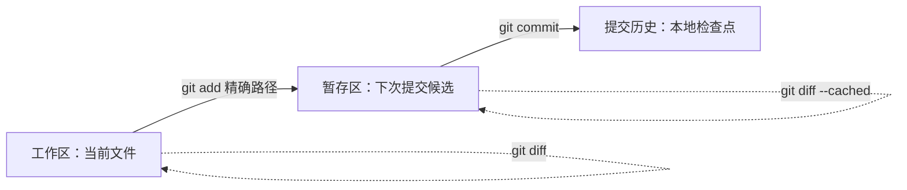
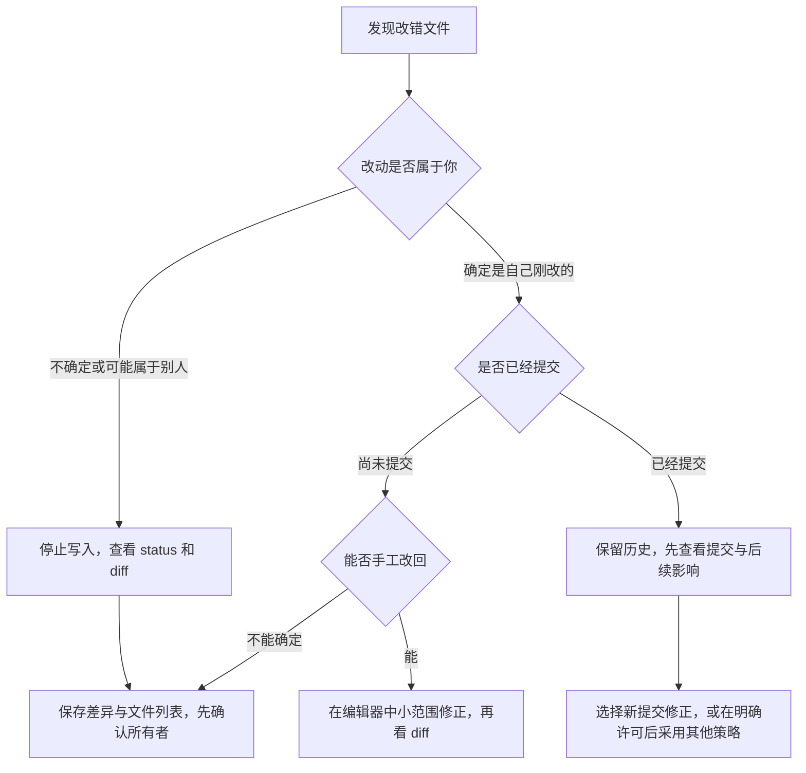

# Git 安全命令速查

Git 能保护历史，也能在使用不当时覆盖尚未保存的工作。先看状态和差异，再决定动作。第一次写操作必须在独立练习仓库中完成。

## 三个区域



文件保存后只进入工作区；`git add` 后进入暂存区；`git commit` 后才成为一个历史检查点。提交仍在本机，不等于已经上传远程。

## 第一组：只读检查，优先使用

### 当前状态

```powershell
git status --short
```

常见前缀：

- `??`：Git 尚未跟踪的新文件；
- ` M`：工作区有修改，尚未暂存；
- `M `：修改已经暂存；
- `MM`：暂存后又继续修改；
- ` D`：工作区删除了已跟踪文件；
- `A `：新文件已暂存。

两个字符分别表示暂存区与工作区状态，空格本身也有含义。

### 查看尚未暂存的差异

```powershell
git diff
git diff -- "docs/tutorial/00-课程总目录.md"
```

第二条只看一个明确文件。以 `-` 开头的行通常表示旧内容，以 `+` 开头的行通常表示新内容；文件头部的 `---`、`+++` 不是正文删除和新增。

### 查看已暂存差异

```powershell
git diff --cached
git diff --cached --name-only
```

提交前必须检查。若这里出现无关文件，不要继续提交。

### 查看历史

```powershell
git log --oneline -10
git show --stat HEAD
```

第一条显示最近十个提交摘要，第二条显示当前提交涉及哪些文件。它们不会修改工作区。

## 第二组：明确创建本地历史

### 暂存精确文件

```powershell
git add -- "docs/tutorial/00-课程总目录.md"
```

`--` 表示后面按路径理解，避免特殊文件名被误认为选项。工作区存在他人或其他任务的修改时，优先列出精确路径，不使用笼统的 `git add .`。

暂存后检查：

```powershell
git diff --cached --name-only
git diff --cached
```

### 创建提交

```powershell
git commit -m "docs: add course entrance"
```

提交信息说明这次变化的目的。成功后再次检查：

```powershell
git status --short
git show --stat --oneline HEAD
```

未被提交的其他修改应该仍然留在工作区。

## 为什么本课程不默认使用 `git add .`

`git add .` 会从当前目录向下暂存大量变化。在一个已经有未提交工作的项目中，它可能把与当前任务无关的页面、密钥配置、生成文件或用户工作一起加入提交。精确暂存虽然多写几个路径，但边界更清楚。

## 第三组：理解风险后才使用

下面的命令不是“清理按钮”。它们可能改变历史或覆盖文件：

| 操作 | 风险 | 初学阶段做法 |
| --- | --- | --- |
| restore/checkout 文件 | 可能覆盖工作区修改 | 先保存差异并确认文件所有者 |
| reset | 可能移动分支或改变暂存区 | 不凭网上片段直接执行 |
| reset hard | 同时覆盖暂存区与工作区 | 不对真实项目使用 |
| clean | 可能删除未跟踪文件 | 不把它当垃圾清理器 |
| rebase | 重写一段提交历史 | 学会普通提交和分支后再练 |
| force push | 覆盖远程历史 | 协作仓库中需要明确许可 |

看到这些词时，先回答三个问题：目标提交是什么、哪些文件会变化、未提交内容如何保留。答不出来就暂停。

## “我改错文件了”决策树



手工小范围修正通常比执行一个不了解的恢复命令更容易控制。任何操作前先复制或记录当前差异，不要为了让 `git status` 看起来干净而牺牲工作。

## 练习：证明选择性提交

只在练习仓库中操作：

1. 创建 `first.txt` 和 `second.txt`；
2. 两个文件都写入一行文字；
3. 运行 `git status --short`；
4. 只执行 `git add -- first.txt`；
5. 运行 `git diff --cached --name-only`，应只看到 `first.txt`；
6. 提交 `first.txt`；
7. 再运行 `git status --short`，`second.txt` 应仍然存在且未提交。

这项练习的重点不是命令数量，而是证明一次提交可以只包含你明确选择的文件。

## 真实“学习空间”项目的安全检查顺序

```powershell
Set-Location -LiteralPath "D:\Projects\study-space"
git status --short
git diff --stat
git diff --name-only
git diff --cached --name-only
```

以上都是检查。若看到不认识的修改：

- 不删除；
- 不恢复；
- 不全部暂存；
- 不把它们顺便提交；
- 先明确本次任务只需要哪些文件。

## Git 不能替你保护什么

- 尚未保存到文件的编辑器内容；
- 从未提交且后来被外部程序永久删除的文件；
- `.gitignore` 排除且没有其他备份的数据；
- 应用数据库里尚未导出的用户数据；
- 密钥泄露后的秘密本身。

Git 是版本控制，不是所有数据的万能备份。真实数据仍需要应用内备份、加密快照和恢复验证。

返回[课程总目录](../00-课程总目录.md)。
